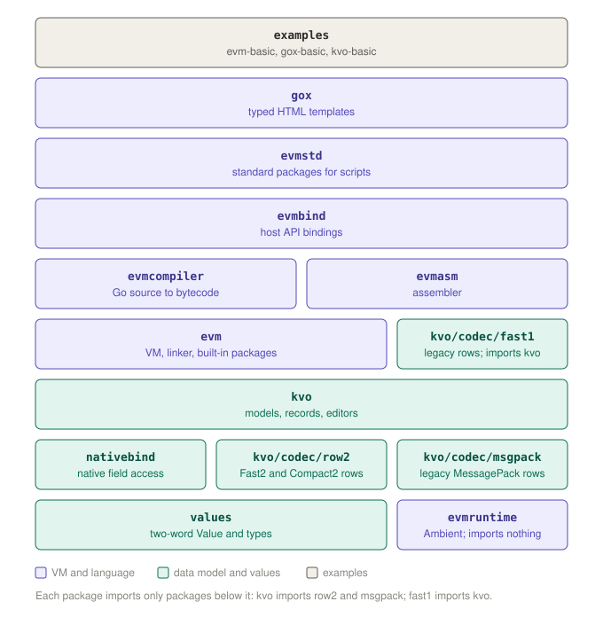

# EVM

**Safe, fast embedded Go.** Compile Go source at run time and run it right
inside your Go application—on your own structs, slices, and maps, within
execution budgets you control.

EVM pairs an optimizing Go compiler with a register-based virtual machine.
Scripts call your host functions and methods directly, either through generated
bindings with zero reflection or through reflection with no build step. Because
EVM shares memory and garbage collection with your host process, scripts read
and mutate your real Go data with no serialization at the boundary.

This repository brings three pieces together:

- **EVM** — a compiler, VM, host-binding generator, and standard library for
  running a safe, sequential subset of Go inside your app.
- **[GoX](gox/README.md)** — typed HTML templates that put markup inside real
  Go functions, compiled and live-reloaded through EVM.
- **[KVO](kvo/README.md)** — typed data records with fast binary encodings
  (`Fast2` / `Compact2`) and one unified API across Go structs, encoded rows,
  scripts, and templates.

A plugin looks like ordinary Go, using your application's own types and
methods:

<!-- excerpt: examples/evm-basic/_plugin/bonus.go -->
```go
func OnOrder(c *shop.Customer, o *shop.Order, now time.Time) string {
	ordersSeen++

	points := o.Cents / 100 * shop.PointsPerDollar
	if slices.ContainsFunc(o.Items, isGift) {
		points *= 2
	}
	// ...
	c.AddPoints(points, "order "+o.ID)
	// ...
}
```

The host compiles that source against the packages it chooses to expose, links
it once into an immutable program, and calls it with ordinary Go values:

<!-- excerpt: examples/evm-basic/main.go -->
```go
module := must(evmcompiler.Compile("bonus.go", pluginSource, packages...))
program := must(evm.Link(module, packages...))
// ...
vm := evm.New(program)
budget := evm.Budget{Steps: 1_000_000, Duration: time.Second}
// ...
ensure(vm.RunEntryNative(context.Background(), "OnOrder", []any{ada, order, now}, result[:], budget))
```

Whether you are running a plugin, rendering a GoX template, or working with KVO
records, the lifecycle is always the same five steps (walked through in
[Basic usage](#basic-usage) below):

1. **Write your application in plain Go**—no framework lock-in or special base
   types.
2. **Expose selected packages.** `evmbind.New` reads your package's own `.go`
   source and turns its exports into a script-facing API.
3. **Compile** plugin or template source against those packages; type mismatches
   and missing fields fail here, before anything runs.
4. **Link** once into an immutable, concurrency-safe `*evm.Program`.
5. **Run** the program on your live Go values, as many times as you need, under
   strict per-call budgets.

Requires Go 1.27+.

```sh
go get github.com/andreyvit/evm
```

## Why EVM?

- **Customize per account with code, not tangled configuration.** Generic
  config-driven engines accumulate complex internals where dozens of edge cases
  (95% of them irrelevant to any one account) interact in brittle ways. Writing
  and validating simple Go for *one* account's exact rules is far simpler than
  maintaining one generic engine for every account. That unlocks deeper
  customization, much higher-quality AI-generated code, and a tiny blast radius
  (a single account instead of every account)—opening the door to lights-out,
  no-human-required parts of your codebase.
- **Per-account versioning and staged rollouts.** Run different versions of
  even your own built-in logic for different accounts, rolling out changes
  gradually without littering the host binary with feature flags.
- **Iterate faster than server deploys.** Templates, reports, emails, and
  ad-hoc data queries can be edited, compiled, and swapped at run time without
  redeploying the host binary.
- **No second language, no serialization tax.** Plugins are Go and operate on
  your actual `*Customer` pointers, slices, and maps. Call `c.AddPoints(...)`
  directly—no JSON marshaling, no shadow data model.
- **Type-checked before a single instruction runs.** Every plugin is compiled
  against your real host API. A typo in a field name or a wrong argument type is
  caught at compile time.
- **Strict capability control.** A script can import only the packages you hand
  it. There are no goroutines, no `unsafe`, and no filesystem, network, or
  process access unless you explicitly expose it.
- **Runaway scripts stop cleanly.** Every invocation runs inside explicit
  budgets for instruction steps, allocations, wall-clock duration, call depth,
  and output bytes.
- **Built for the request path.** EVM compiles to typed register bytecode over
  unboxed 64-bit words, dispatches small host calls straight from registers
  through generated wrappers, and allocates zero bytes on warm calls beyond
  what the script itself allocates. Across five benchmark workloads (November
  2026), EVM ran **6–15× faster than Yaegi** and **3–12× faster than
  GopherLua**, landing between 1.4× faster and 1.9× slower than C Lua 5.5
  (LuaJIT with tracing remained 1.4–13× ahead). GoX rendered six application
  templates in **27–40% less time than cached `html/template`**. See the
  [dated benchmarks](#performance) for hardware, inputs, and commands.
- **Ideal for AI-generated plugins and ad-hoc queries.** Print your exposed Go
  declarations with `evmcompiler.PackageSource`, let an agent or operator write
  a rule or query script, and let the compiler verify it before it ever runs—no
  new endpoints or deploys required.

> **Security model:** EVM controls *what APIs* a script can call and *how many
> resources* it can spend, not OS-level process isolation. See [Trust](#trust).
>
> **Want to see how the VM works under the hood?** Read
> **[Inside EVM](_docs/EVMBook.md)**—a complete book covering values, KVO data
> modeling, register windows, bytecode, the compiler, the evaluator,
> optimizations, and GoX lowering.

## At a glance

- **EVM:** Sequential Go 1.23 (structs, slices, maps, strings, closures,
  interfaces, generics, range-over-func, `defer`/`panic`/`recover`, package
  globals, `init`, multi-file packages); no goroutines, channels, or `unsafe`.
  Source-driven host bindings with reflection or generated direct wrappers,
  shared Go memory, [curated standard library](evmstd/API.md), per-call
  budgets, source-mapped errors, coverage, and disassembly.
- **GoX:** HTML inside Go functions, components as typed functions, typed
  callback slots, automatic contextual escaping (`html/template` rules),
  implicit and optional arguments, formatting pipelines, HTML/text/CSS output,
  concurrent renders, `gox fmt` / `gox check`, and [editor support](_editors/README.md).
- **KVO:** Schema-defined records with stable numeric property codes, one typed
  API across Go structs, `Fast2`, `Compact2`, `MessagePack`, and decoded
  memory, zero-decode field reads, batched editors, and first-class script and
  template integration.

## How EVM Go differs from standard Go

EVM runs sequential Go 1.23 with 64-bit `int`/`uint` sizes, and 95% of what you
write works identically to ordinary Go. The deliberate differences fall into
five areas:

- **No concurrency or `unsafe`:** Goroutines, channels, `select`, `unsafe`,
  and cgo are rejected at compile time. Slice lengths and capacities fit in 32
  bits, and single-file scripts may omit the `package` clause.
- **Host-defined virtual packages:** Scripts can import only host-supplied
  packages plus EVM's curated standard library (no filesystem, network, or
  env). Host package variables (`Package.Values`) are read-only and
  unaddressable, and script package globals live per `VM` session.
- **KVO records & editors:** Model types (`*m.Customer`) expose local and
  qualified property selectors (`c.points_earned` / `c.customer_points_earned`)
  that are read-only; edits go through `*m.CustomerEdit` (with collection
  writes flushed on save), encoded records never decode implicitly (call
  `NativeCopy()`), and local list ranges avoid allocating a slice.
- **Automatic ownership copies for borrowed data:** Transaction-scoped KVO
  records and `//evm:borrow-bytes` slices are copied automatically by the
  compiler when they escape, cross an invalidating call, or (for borrowed
  bytes) are mutated.
- **Fatal budget & cancellation traps:** `defer`/`recover()` catches script
  panics and Go language errors (`ErrNil`, `ErrBounds`, etc.), whereas budget
  exhaustion, cancellation, and host callback errors abort immediately without
  running script defers.

For the complete breakdown—including hidden host fields, concrete host
generics, and VM-bound closures—see
**[Inside EVM §6.10: How EVM Go differs from standard Go](_docs/EVMBook.md#610-how-evm-go-differs-from-standard-go)**.

## Basic usage

### 1. EVM: run a Go plugin

Start with a plugin written in ordinary Go. It imports your application as
package `shop`:

<!-- excerpt: examples/evm-basic/_plugin/bonus.go -->
```go
package plugin

import (
	"fmt"
	"shop"
	"slices"
	"strings"
	"time"
)

// Package variables live as long as the VM session that runs the plugin.
var ordersSeen int

// OnOrder awards points for an order and returns a line for the log.
func OnOrder(c *shop.Customer, o *shop.Order, now time.Time) string {
	ordersSeen++

	points := o.Cents / 100 * shop.PointsPerDollar
	if slices.ContainsFunc(o.Items, isGift) {
		points *= 2
	}
	if now.Sub(c.Joined) >= 365*24*time.Hour {
		points += 50 // loyalty bonus after a year
	}
	c.AddPoints(points, "order "+o.ID)

	for _, tier := range []string{"gold", "silver"} {
		if c.Points >= shop.TierThreshold(tier) {
			c.Tier = tier
			break
		}
	}
	return fmt.Sprintf("#%d %s: +%d points, %d total, %s", ordersSeen, o.ID, points, c.Points, c.Tier)
}

func isGift(item shop.Item) bool { return strings.HasPrefix(item.SKU, "GIFT-") }
```

The host application is plain Go with no knowledge of EVM:

<!-- excerpt: examples/evm-basic/shop.go -->
```go
// PointsPerDollar is the base earning rate.
const PointsPerDollar = 10

type Customer struct {
	Name    string
	Tier    string
	Points  int64
	Joined  time.Time
	History []string
}

// AddPoints credits the customer and records why.
func (c *Customer) AddPoints(points int64, reason string) {
	c.Points += points
	c.History = append(c.History, reason)
}
// ...
// TierThreshold returns the points a customer needs to hold a tier.
func TierThreshold(tier string) int64 {
```

The host embeds both sources, binds its own package, compiles and links the
plugin once, then calls it for each order:

<!-- excerpt: examples/evm-basic/main.go -->
```go
// The host's own source tells the compiler what package "shop" declares.
//
//go:embed shop.go
var shopSource embed.FS

// The underscore keeps the go tool from building the plugin as host code.
//
//go:embed _plugin/bonus.go
var pluginSource string
// ...
// Bind the host package. Every exported type, method, function and
// constant in shop.go becomes visible. Go cannot look functions or types
// up by name, so the options supply the functions, plus the types that
// no function, method or field leads to.
shop := must(evmbind.New("shop", shopSource, evmbind.Options{
	Functions: map[string]any{"TierThreshold": TierThreshold},
	Types:     []reflect.Type{reflect.TypeFor[Customer](), reflect.TypeFor[Order]()},
}))
// What a plugin can import: the host package and the standard packages.
packages := append(evmstd.Packages(), shop.Bind(nil))

// Compile and link once. A linked program is immutable and can be shared.
module := must(evmcompiler.Compile("bonus.go", pluginSource, packages...))
program := must(evm.Link(module, packages...))

// A VM is one session: it owns the plugin's package variables. Each call
// gets a budget, so a runaway plugin stops with an error.
vm := evm.New(program)
budget := evm.Budget{Steps: 1_000_000, Duration: time.Second}

ada := &Customer{Name: "Ada", Tier: "basic", Joined: time.Date(2024, 1, 15, 0, 0, 0, 0, time.UTC)}
now := time.Date(2025, 3, 1, 0, 0, 0, 0, time.UTC)
for _, order := range []*Order{
	{ID: "A-1", Cents: 4200, Items: []Item{{SKU: "MUG-1", Qty: 2}}},
	{ID: "A-2", Cents: 9900, Items: []Item{{SKU: "GIFT-CARD", Qty: 1}}},
	{ID: "A-3", Cents: 1500, Items: []Item{{SKU: "LMP-3", Qty: 1}}},
} {
	// Arguments and results are ordinary Go values. The plugin works on
	// the host's own *Customer, not on a copy.
	var result [1]any
	ensure(vm.RunEntryNative(context.Background(), "OnOrder", []any{ada, order, now}, result[:], budget))
	fmt.Fprintln(out, result[0])
}
fmt.Fprintln(out, ada.Name, "has", ada.Points, "points after", ada.History)
```

`go run ./examples/evm-basic` prints:

<!-- excerpt: examples/evm-basic/main_test.go -->
```text
#1 A-1: +470 points, 470 total, basic
#2 A-2: +2030 points, 2500 total, gold
#3 A-3: +200 points, 2700 total, gold
Ada has 2700 points after [order A-1 order A-2 order A-3]
```

What to notice in this example:

- **Single source of truth:** `evmbind.New` reads `shop.go` directly
  (declarations, parameter names, and doc comments) without executing it, so
  there is no separate IDL to keep in sync. `shop.Bind(nil)` pairs those
  declarations with their runtime implementations.
- **Safe compilation:** Compile errors return `evmcompiler.Diagnostics` with
  file, line, and column; importing an unexposed package fails compilation.
- **Programs vs. VMs:** A linked `*evm.Program` is immutable and shared across
  goroutines. A `*evm.VM` is a single-goroutine session that owns package
  variables—`ordersSeen` increments across the loop because the loop reuses
  one VM. Call `vm.Reset()` to clear state, or compile and link a new program
  to hot-swap plugin versions without disrupting in-flight sessions.
- **Live Go values:** `RunEntryNative` checks exact Go argument types (pass
  `int64(5)` for an `int64`). Because the plugin mutates `ada` in place through
  `c.AddPoints` and `c.Tier = tier`, the host sees the updated struct
  immediately.
- **Clean failure boundaries:** Exceeding a budget stops the call and marks the
  session unusable until `vm.Reset()`. (`must` and `ensure` are small panic
  helpers at the bottom of [`main.go`](examples/evm-basic/main.go).)

### 2. GoX: render a typed HTML template

A GoX template is an ordinary Go function taking `*gox.Builder` with HTML
markup right inside the body. Here is the main page from
[examples/gox-basic](examples/gox-basic):

<!-- excerpt: examples/gox-basic/views/page.gox -->
```gox
package views

import (
	"app"

	"github.com/andreyvit/evm/gox"
)

func Page(b *gox.Builder, store *app.Store, user *app.User, cart *app.Cart, q string) {
	<Layout title={store.Name}>
		<slot-styles>
			<style>.out { opacity: .5 }</style>
		</slot-styles>
		<slot-content>
			<Header user={user} cart={cart} />
			<form><input name="q" value={q} placeholder="Search"></form>
			<ProductList q={q} />
			<CartSummary cart={cart} />
		</slot-content>
	</Layout>
}

// Callers do not pass store. *app.Store is an implicit type, so Header and
// ProductList receive the store of whichever component calls them.
func Header(b *gox.Builder, store *app.Store, user *app.User, cart *app.Cart) {
	<header>
		<h1>
			"Welcome to "
			store.Name
		</h1>
		<span class="avatar" title={user.Email}>user.Initials()</span>
		" "
		user.Name
		if user.Admin {
			" (admin)"
		}
		", member since "
		user.Joined | app.FormatDate
		" — "
		app.Pluralize(cart.Count(), "item", "items")
		" in cart"
	</header>
}
```

The layout takes its content as slots:

<!-- excerpt: examples/gox-basic/views/layout.gox -->
```gox
//gox:arg styles optional
func Layout(b *gox.Builder, title string, styles func(), content func()) {
	<html>
		<head>
			<title>title</title>
			<style>.tag { font-size: 12px }</style>
			if styles != nil {
				styles()
			}
		</head>
		<body>content()</body>
	</html>
}
```

A product row mixes markup, Go control flow and a helper:

<!-- excerpt: examples/gox-basic/views/products.gox -->
```gox
func ProductRow(b *gox.Builder, store *app.Store, p *app.Product) {
	<li class="product {stockClass(p)}">
		<a href={p.URL()}>p.Name</a>
		" "
		p.Price | app.FormatMoney
		if !p.InStock() {
			<em>" sold out"</em>
		}
		for _, tag := range p.Tags {
			" "
			<span class="tag">
				"#"
				tag
			</span>
		}
		<small>
			" seen "
			p.Viewed() | strconv.Itoa
			"×"
		</small>
	</li>
}

func stockClass(p *app.Product) string {
	if p.InStock() {
		return "in"
	}
	return "out"
}
```

The host exposes its application package to templates, as it does for a
plugin, and adds GoX options:

<!-- excerpt: examples/gox-basic/render.go -->
```go
// Go cannot look functions or types up by name, so the options supply
// the functions, plus the types that no function, method or field
// leads to.
app := must(evmbind.New("app", appSource, evmbind.Options{
	Functions: map[string]any{
		"Pluralize":   Pluralize,
		"Discount":    Discount,
		"FormatMoney": FormatMoney,
		"FormatDate":  FormatDate,
	},
	Types: []reflect.Type{
		reflect.TypeFor[Store](),
		reflect.TypeFor[User](),
		reflect.TypeFor[Cart](),
	},
}))
return &Env{
	Packages: []evm.Package{app.Bind(nil)},
	Options: gox.Options{
		// A component that declares a *app.Store parameter receives
		// its caller's store without being passed it.
		// FormatMoney takes the store the same way, so a template
		// writes price | app.FormatMoney.
		ImplicitTypes: []string{"*app.Store"},
	},
}
```

Then it compiles and links once, and renders for each request:

<!-- excerpt: examples/gox-basic/main.go -->
```go
env := NewEnv()

// Compile and link once. "Page" names the function Render runs. A linked
// program is immutable and renders concurrently.
tmpl := must(env.Options.CompileFiles("Page", Views, env.Packages...))
page := must(tmpl.Link(env.Packages...))

user := &User{Name: "Ada Lovelace", Email: "ada@example.com", Admin: true, Joined: time.Date(2025, 3, 1, 0, 0, 0, 0, time.UTC)}
cart := &Cart{Coupon: "SPRING", Lines: []CartLine{
	{Product: TheStore.Products[0], Qty: 2},
	{Product: TheStore.Products[2], Qty: 1},
}}
for _, query := range []string{"", "lamp"} {
	// Arguments are ordinary Go values, in the order of Page's
	// parameters after the builder. Templates work on the host's own
	// structs, not on copies.
	html := must(page.RenderNative(context.Background(), []any{TheStore, user, cart, query}, gox.RenderOptions{Strict: true}))
	fmt.Fprintln(out, html)
}
```

`go run ./examples/gox-basic` prints the page twice, once per query.

What to notice:

- **Go + markup together:** Inside an element, quoted strings and expressions
  render, while `if`, `for`, and variables are ordinary Go. Each file imports
  the packages it uses, and `gox fmt` adds missing imports automatically.
- **Typed components and slots:** `<Header user={user} cart={cart} />` calls
  `Header` with type-checked arguments. Slots are `func()` parameters—`<slot-content>`
  fills `content`, and `//gox:arg styles optional` lets callers omit `styles`.
- **Implicit context:** Nobody passes `store` to `Header` because `*app.Store`
  is in `ImplicitTypes` and flows automatically from the caller's scope.
- **Explicit formatting, automatic escaping:** Text positions accept only
  strings and trusted content, so `p.Price | app.FormatMoney` explicitly
  formats the price (filling `store` implicitly). Every value is escaped for
  its exact context (`Wool Blanket <XL>` renders as `Wool Blanket &lt;XL&gt;`).
- **Live updates & strict mode:** `Strict: true` turns nil-pointer output
  diagnostics into render errors. Recompiling a template at run time is just
  compiling and linking the updated source—see
  [render_test.go](examples/gox-basic/render_test.go).

### 3. KVO: read and edit typed records

KVO cleanly separates *what a record means*, *how it is stored*, and *who reads
it*:

- A **schema** holds properties and models.
- A **property** pairs a stable numeric code, a name (like
  `customer:points_earned`), and a type into a typed handle such as
  `kvo.NewSignedProp[int64](...)`.
- A **model** lists the properties belonging to one record type.
- A **record** (`kvo.Record`) is a 16-byte handle viewing data in place, with
  no decoded copy.
- A **binding** connects a model to a Go struct type and constructs records.

One `kvo.Record` API works identically across all four representations:

| Representation | Record from | Reads and edits |
| --- | --- | --- |
| Go struct | `binding.Record(reflect.ValueOf(ptr))` | Read and write the struct's fields |
| Fast2 or Compact2 row | `binding.Encoded(row2.Open(bytes))` | Read fields from the bytes; an edit builds a new row |
| MessagePack row | `binding.MessagePack(bytes)` | Scan the encoded map by `msgpack` names; an edit rewrites the changed path |
| Decoded memory | `record.Fastest()` on a row whose model has no Go struct | Read indexed, owned values |

Fast2 and Compact2 are the current row formats. Fast2 favors access speed,
Compact2 size, and a Fast2 row can hold Compact2 children. MessagePack and
Fast1 are supported legacy formats; `kvo/codec/fast1` has its own API.

The same `Get`, `Edit` and script field access work on every representation.
Code that takes a `kvo.Record` does not know which one it has.

This repository has no database. A database such as
[edb](https://github.com/andreyvit/edb) stores the rows and hands out
records. A model also serves values that are never stored: a script takes a
Go struct as a typed record the same way.

#### The example

The model, with a Go struct for it:

<!-- excerpt: examples/kvo-basic/model.go -->
```go
// Customer is the Go struct form of a customer. A kvo tag binds a field to a
// property by name; a msgpack tag names its key in MessagePack rows.
type Customer struct {
	Name     string    `kvo:"name" msgpack:"name"`
	Tags     []string  `kvo:"tags" msgpack:"tags"`
	Earned   int64     `kvo:"points_earned" msgpack:"points_earned"`
	Redeemed int64     `kvo:"points_redeemed" msgpack:"points_redeemed"`
	Joined   time.Time `kvo:"joined" msgpack:"joined"`
}

// Declare each property once, with a stable code and a type. A model lists
// the properties of one record type. Build all of this at startup.
var (
	Schema       = kvo.NewSchema()
	CustomerType = kvo.NewEntityType(Schema, "customer", reflect.TypeFor[Customer]())

	Customer_Name = kvo.NewStringProp[string](Schema, 1, "customer:name", kvo.TMachineString)
	Customer_Tags = kvo.NewListProp(Schema, 2, "customer:tags",
		kvo.ListOf(kvo.TMachineString), values.StringCodec[string]())
	Customer_Earned   = kvo.NewSignedProp[int64](Schema, 3, "customer:points_earned", kvo.TInt64)
	Customer_Redeemed = kvo.NewSignedProp[int64](Schema, 4, "customer:points_redeemed", kvo.TInt64)
	Customer_Joined   = kvo.NewTimeProp(Schema, 5, "customer:joined")

	CustomerModel = kvo.NewModel(Schema, CustomerType, func(b *kvo.ModelBuilder) {
		b.Prop(Customer_Name)
		b.Prop(Customer_Tags)
		b.Prop(Customer_Earned)
		b.Prop(Customer_Redeemed)
		b.Prop(Customer_Joined)
	})

	// Customers makes records of the model from structs and from rows.
	Customers = kvo.Bind(reflect.TypeFor[Customer](), CustomerModel)
)

// PointBalance takes a record in any representation. Scripts call it as a
// method: customer.PointBalance().
func PointBalance(c kvo.Record) int64 {
	return c.Get(Customer_Earned) - c.Get(Customer_Redeemed)
}
```

Go code makes three records, one per representation, then reads and edits
them the same way:

<!-- excerpt: examples/kvo-basic/main.go -->
```go
// One customer per representation. A database would hand out the two
// encoded rows; here the binding encodes them from structs.
ada := &Customer{Name: "Ada", Tags: []string{"vip"}, Earned: 1250, Redeemed: 250, Joined: date(2024, 1, 15)}
bob := &Customer{Name: "Bob", Tags: []string{"newsletter"}, Earned: 300, Redeemed: 100, Joined: date(2025, 2, 1)}
cyd := &Customer{Name: "Cyd", Earned: 80, Joined: date(2025, 2, 20)}
bobRow := Customers.Encode(nil, reflect.ValueOf(bob).Elem(), row2.Fast2)
cydRow := msgpack.Encode(nil, reflect.ValueOf(cyd))

// A record is a 16-byte handle that views the struct or the row's bytes
// in place. Opening a row decodes nothing.
records := []kvo.Record{
	Customers.Record(reflect.ValueOf(ada)),
	Customers.Encoded(row2.Open(bobRow)),
	Customers.MessagePack(cydRow),
}

// Go reads typed properties the same way from every representation.
for _, c := range records {
	name := c.Get(Customer_Name)     // string
	tags := c.Get(Customer_Tags)     // kvo.List[string]
	joined := c.Get(Customer_Joined) // time.Time
	fmt.Fprintf(out, "%s: %d points, %d tags, joined %s\n", name, PointBalance(c), tags.Len(), joined.Format(time.DateOnly))
}

// Go edits through an editor. Editing a struct writes to the struct.
// Editing a row builds a new row and leaves the old bytes alone.
for i, c := range records {
	edit := c.Edit()
	edit.Set(Customer_Earned, edit.Get(Customer_Earned)+100)
	edit.List(Customer_Tags).AddUnique("welcomed")
	records[i] = edit.Record()
}
```

A script sees the schema as package `m`. A model is a type, a property is a
field, and an editor is the `Edit` type:

<!-- excerpt: examples/kvo-basic/_script/rules.go -->
```go
package rules

import (
	"fmt"
	"m"
	"time"
)

// Describe reads a customer. Package m comes from the KVO schema: each model
// is a type and each property is a field. The same code runs on a Go struct
// and on an encoded row.
func Describe(c *m.Customer, now time.Time) string {
	status := "member"
	for _, tag := range c.tags {
		if tag == "vip" {
			status = "VIP"
		}
	}
	days := int(now.Sub(c.joined).Hours() / 24)
	return fmt.Sprintf("%s: %s for %d days, %d points", c.name, status, days, c.PointBalance())
}

// Redeem edits a customer. The host decides what an edit means: here it
// writes to the Go struct or builds a new row.
func Redeem(c *m.CustomerEdit, points int64) bool {
	if points <= 0 || points > c.points_earned-c.points_redeemed {
		return false
	}
	c.points_redeemed += points
	return true
}
```

The host builds package `m` from the schema, compiles the script once and
runs it on the same three records:

<!-- excerpt: examples/kvo-basic/main.go -->
```go
// Scripts see the schema as package "m": type m.Customer with a field
// per property. PointBalance becomes a method of it.
models := must(evm.ModelPackage("m", Schema))
ensure(evmbind.RegisterMethods(&models, []evmbind.Method{
	evmbind.RecordMethod(CustomerModel, "PointBalance", PointBalance, evmbind.BorrowOnly),
}, evmbind.MethodOptions{}))
packages := append(evmstd.Packages(), models)

// Compile and link once.
module := must(evmcompiler.Compile("rules.go", rulesSource, packages...))
program := must(evm.Link(module, packages...))
vm := evm.New(program)
budget := evm.Budget{Steps: 100_000, Duration: time.Second}

// The script reads the same records. Nothing is converted or copied.
now := date(2025, 3, 1)
for _, c := range records {
	var result [1]any
	ensure(vm.RunEntryNative(context.Background(), "Describe", []any{c, now}, result[:], budget))
	fmt.Fprintln(out, result[0])
}

// The script edits through the host's editors. They live in a record
// scope, which a host opens for the length of a transaction.
ctx, scope := evm.WithRecords(context.Background())
defer scope.Close()
for i, c := range records {
	edit := c.Edit()
	var result [1]any
	ensure(vm.RunEntryNative(ctx, "Redeem", []any{scope.EditRecord(CustomerModel, edit), int64(250)}, result[:], budget))
	records[i] = edit.Record()
	fmt.Fprintf(out, "%s redeems 250: %v, balance %d\n", c.Get(Customer_Name), result[0], PointBalance(records[i]))
}
fmt.Fprintf(out, "Ada's struct: %d redeemed\n", ada.Redeemed)
```

`go run ./examples/kvo-basic` prints:

<!-- excerpt: examples/kvo-basic/main_test.go -->
```text
Ada: 1000 points, 1 tags, joined 2024-01-15
Bob: 200 points, 1 tags, joined 2025-02-01
Cyd: 80 points, 0 tags, joined 2025-02-20
Ada's struct: 1350 earned, tags [vip welcomed]
Bob's old row: 300 earned; new row: 400 earned, tags [newsletter welcomed]
Ada: VIP for 411 days, 1100 points
Bob: member for 28 days, 300 points
Cyd: member for 9 days, 180 points
Ada redeems 250: true, balance 850
Bob redeems 250: true, balance 50
Cyd redeems 250: false, balance 180
Ada's struct: 500 redeemed
```

What to notice:

- **Typed, unboxed reads:** `c.Get(Customer_Earned)` returns an `int64`
  directly—the property handle carries the Go type.
- **Local names:** Property `customer:points_earned` uses the local name
  `points_earned` in struct tags and script selectors.
- **Representation-agnostic code:** `Describe` ran unchanged on a Go struct, a
  `Fast2` row, and a `MessagePack` row, and `PointBalance` works both as a Go
  function and as `c.PointBalance()` in scripts.
- **Safe edits:** Editing `ada` mutated the struct in place, while editing
  `bob` left `bobRow` untouched and returned a new row from `edit.Record()`.
  Read-only records need no scope; script editors live inside an
  `evm.WithRecords` scope. Persistence and lookup always stay in your host
  application.

## Advanced usage

A quick map of every capability across EVM, GoX, and KVO. Follow the linked
guides for complete contracts and edge cases.

### EVM

Deep dives: [host contracts](_docs/embedding.md) ·
[`evmbind` guide](evmbind/README.md) ·
[hand-written bindings](_docs/bindings.md) ·
[`values` representation](values/README.md) ·
[standard packages](evmstd/API.md)

#### Compile

- **Single file or full package:** `evmcompiler.Compile(filename, source, packages...)`
  compiles one file (the `package` clause is optional);
  `evmcompiler.CompileFiles(map[string]string{...}, packages...)` compiles a
  multi-file package. Scripts support Go 1.23 features including generics and
  range over integers and functions.
- **Diagnostics:** Compile errors return `evmcompiler.Diagnostics`, where each
  `Diagnostic` carries a `Position` and `Message`.
- **Safety limits:** Total source is capped at `evmcompiler.MaxSourceSize`
  (1 MiB). Nesting is capped at 32 type levels (`MaxTypeNesting`), 500
  expression levels (`MaxExprNesting`; `a+b+c` is 2), 100 statement levels
  (`MaxStmtNesting`; each `else if` counts), and 32 nested function literals
  (`MaxFuncNesting`). Constant string expressions are capped at 1 MiB
  (`MaxConstStringSize`). Package-wide branching is bounded by
  `MaxBranchWeight` (~4,000 sequential `if`s, a 2,300-case `switch`, or a
  450-case `switch` assigning distinct locals); split large functions or
  packages if you hit it.
- **Reuse environments for many scripts:** `evmcompiler.NewEnvironment(packages...)`
  type-checks your host packages once. Subsequent `Compile` and `CompileFiles`
  calls check only the script itself. Environments are immutable and safe for
  concurrent use. (Unlike the package-list functions, `NewEnvironment` fails
  eagerly if any package cannot be imported.)
- **Debugging & tooling:** Pass `evmcompiler.Options{NoOptimization: true}` to
  keep unoptimized bytecode, call `module.Disassemble()` to inspect it, or
  build test modules with `evmasm.Assemble(source)`. For static analysis tools,
  use `Analyze`, `AnalyzeFiles`, `SourceImporter`, and `CheckLimits`.
- **Generate API docs for humans or agents:** `evmcompiler.PackageSource`,
  `PackagesSource`, and `PackagePaths` print the exact Go declarations scripts
  see. Customize per-function comment lines with
  `evmcompiler.DeclarationOptions{Annotations: fn}`.

#### Link and run

- **Link once, share everywhere:** `evm.Link(module, packages...)` returns an
  immutable `*evm.Program` (`evm.LinkWithHostData` attaches host metadata read
  via `program.HostData()`).
- **Shared link environments:** `evm.NewLinkEnvironment(packages...)` validates
  and binds host packages once so linking many modules stays fast. Calling
  `env.NewLinkEnvironment(packages...)` on an `evmcompiler.Environment` goes
  further, sharing linked host shapes, bound native methods, and all-native
  method tables across every program compiled from that environment (do not
  mutate those shared tables).
- **Sessions:** `evm.New(program)` creates one execution session. Package
  initialization runs once before the first call, and package variables persist
  until `vm.Reset()`. A VM is single-goroutine and non-reentrant (concurrent
  calls return `evm.ErrReentry`), so use one VM per goroutine.
- **Calling entries:**
  - `vm.RunEntryNative(ctx, "Entry", []any{...}, results, budget)` passes and
    returns ordinary Go values.
  - `vm.Run` and `vm.RunWithBudget` use raw `values.Value` (`values.Int(5)`,
    `result.AsInt()`).
  - `vm.RunNative(ctx, func(c *evm.Call) error { ... }, budget)` runs host code
    inside the session (`c.NativeArguments`, `c.RunEntry`, `c.NativeAny`).
  - `program.EntrySignature("Entry")` inspects parameter and result types.
- **Program isolation:** Interface values, function handles, and type IDs
  belong to one linked program—repack them when crossing to another program.

#### Host packages from source

- **Automatic binding:** `evmbind.New("shop", source, evmbind.Options{...})`
  reads your package's `.go` source and exposes its exports. Pass
  `schema.Package()` to `Compile` and `schema.Bind(host)` to `Link`.
- **Functions, receivers, and variables:**
  - `Options.Functions` binds package functions by Go value.
  - `Options.Host` binds them as methods on a host receiver (taking a leading
    `*evm.Call`), supplied at link time via `schema.Bind(host)`.
  - `Options.Values` exposes read-only package variables.
- **Shaping the API:** Use `Options.Types` for extra root types, `Options.Omit`
  to exclude symbols (`"Secret"`, `"User.Token"`), `Options.Only` or
  `Options.Selective` to pick a subset from a large package, `Options.Methods`
  / `Fields` / `OmitFields` to filter members, and `Options.TypeNames` to
  rename types for scripts.
- **Cross-package sharing & generics:** Share types across schemas with
  `Options.Imports` (`evmstd.Imports()` supplies `time.Duration`, `*url.URL`,
  etc.). Bind concrete generic structs with `Options.Instances` and generic
  functions with `Options.GenericFunctions`.
- **Interfaces & helpers:** Register concrete interface implementations with
  `Options.Implementations` (`evmbind.Pointer[Tx]()`), pack/unpack them with
  `schema.Interface` / `schema.NativeInterface`, wrap struct pointers for
  `vm.Run` with `schema.NativePointer`, and look up VM types with `schema.Type`
  / `schema.NativeType`.
- **No source available?** `evmbind.Discover("app", evmbind.Discovery{...})`
  binds functions and reachable types purely by reflection (no parameter names
  or doc comments; add constants via `Discovery.Constants`). Combine multiple
  package fragments for one import path with `evm.MergePackages`.

#### Generated native bindings

By default, host calls go through reflection. Generated bindings compile direct
Go wrappers into your host binary so calls and field accesses avoid reflection.

- **Generate:** Run `go run github.com/andreyvit/evm/evmbind/cmd/evmbind -dir ../api -path demo -native example.org/project/api -package apibindings -o bindings_gen.go`
  for a full package, or call `evmbind.Generate(...)` from Go with the same
  options as `evmbind.New`. Regenerate whenever bound declarations change.
- **Wire up:** Pass `Options.Static: &apibindings.Bindings`. `evmbind.Automatic`
  (default) uses generated wrappers when their source fingerprint matches and
  falls back to reflection otherwise; `evmbind.StaticOnly` panics on missing or
  stale wrappers. Check `schema.UsesStatic()` to see which path is active, and
  use `-tags evmreflect` to exclude generated code while refactoring.
- **Fast paths:** Small calls (functions with ≤2 args or pointer methods with
  ≤1 arg, returning ≤1 word/string/pointer) use direct register instructions.
  Generated field accessors also accelerate KVO via `schema.NativeFields` and
  `binding.WithNativeSchema(schema)`. Use `evmbind.GenerateMethods` for
  [record methods](#records-in-scripts-and-templates).

#### Hand-written packages

- Build an `evm.Package` directly with `Types`, `Functions`, `Methods`,
  `Constants`, `Values`, and `Aliases` (`evm.TypeAlias`).
- Implement `evm.ExternalFunction` / `ExternalMethod` with `Call`
  (`func(*evm.Call) error`, using `c.Argument` and `c.SetResult`) or
  `Direct` (`evm.DirectUnary` / `evm.DirectBinding`) for zero-window register
  calls.
- Declare types from `values.Shape` (`values.NewStructShape`,
  `values.NewPointerShape`), add custom field conversions with
  `TypeDecl.NativeCodec`, expose package variables via `evm.ExternalValue`, and
  list interface entry types in `Package.EntryTypes`.
- Never retain `*evm.Call` or its argument window after returning, and check
  `c.Context` for cancellation inside long host calls.

#### Values across the boundary

- **Direct & shared:** Scalars, strings, and named scalars convert directly.
  Structs pass by value; pointers keep their Go address so host and script
  share one object. Slices and maps of bound types keep their Go backing
  storage. Variadic functions and methods follow Go semantics.
- **`time.Time`:** One type on both sides. Go values keep their location and
  monotonic reading; `values.Time(t)` (for `vm.Run`) stores a UTC instant.
- **`any` and `error`:** `any` carries bound Go values with their types;
  script-only values arrive in Go as `*evm.GuestValue` and round-trip intact.
  `error` crosses both ways with its identity (script-defined errors need an
  active VM or callback scope when Go calls `Error()`).

#### Functions and callbacks

- **Accepting script functions in Go:** Use `*evm.FunctionOf[func(int) int]` to
  accept closures, bound methods, or functions (Go sees `*evm.FunctionHandle`),
  or `*evm.NamedFunctionOf[func(int) any]` for public, non-capturing functions
  only (Go sees `*evm.NamedFunction`).
- **Retaining & invoking later:** `program.FunctionValue` /
  `NamedFunctionValue` retain script callables; invoke them with
  `vm.RunFunction`, `RunFunctionWithBudget`, or `RunFunctionNative` (or resolve
  public entries via `program.EntryFunction`).
- **Calling back mid-call:** Inside a host function, use `c.RunCallback`,
  `c.RunCallbackArgs`, and `c.RunInterfaceMethod` (wrap errors with
  `c.CallbackError` or `c.PanicCallback` to keep guest `recover()` working).
- **Passing Go closures to scripts:** Cache `evm.NewNativeFunctionType(sig)`
  and create script-callable closures with `c.NativeFunction` (during a call)
  or `program.NativeFunction` (for `Run` inputs).
- **Idle callbacks:** To invoke a script function stored in a Go struct field
  while the VM is idle, run inside `vm.RunNative` or open
  `vm.OpenCallbackScope(ctx, budget)` and `defer scope.Close()`.

#### Limits and budgets

- **Session & per-call caps:** `vm.Limits` sets session defaults (1M steps per
  call, call depth 1,024, 1M allocations, 64 MiB per session). Pass `evm.Budget`
  for per-call caps (including `init`); use `Budget.UnlimitedSteps` to lift the
  step cap. Cancelling `ctx` stops execution.
- **Stretchable ceilings & narrowing:** Set `HardDuration`, `HardAllocations`,
  or `HardAllocationBytes` if you want host calls (`c.IncreaseCPUBudget`,
  `c.IncreaseMemBudget`) or scripts (`evmruntime.IncreaseCPUBudget`,
  `IncreaseMemBudget`) to request extra headroom. Narrow limits for a sub-step
  with `c.NarrowBudget` / `c.NarrowCPUBudget` until `scope.End(c)`.
- **Accounting:** Allocation limits are cumulative until `vm.Reset()`, not live
  heap size—reset long-lived sessions between units of work. Host functions run
  outside VM meters unless they call `c.ChargeAllocation(bytes)`.
- **Limit errors:** `evm.ErrSteps`, `ErrDepth`, `ErrRegisters`,
  `ErrAllocations`, `ErrAllocation`, `ErrOutput`, and `ctx.Err()` for timeouts
  and cancellation.

#### Errors and panics

- **Execution errors:** Failures return `*evm.ExecutionError{Function, PC, Position, Err}`
  which unwraps cleanly for `errors.Is` (`evm.ErrNil`, `ErrBounds`,
  `ErrNilMap`, `ErrDivideByZero`, `ErrNegativeShift`, `ErrTypeAssertion`,
  `ErrNilFunction`). Uncaught `panic(v)` wraps `*evm.PanicError`.
- **Recovery vs. fatal:** Scripts catch their own panics and language errors
  with `defer`/`recover()`. Budget exhaustion, cancellation, invalid values,
  and native callback errors are fatal and skip script defers.
- **Session state after failure:** Any failed run (including wrong Go argument
  types in `RunEntryNative`) invalidates the VM (`evm.ErrInvalidState`) until
  `vm.Reset()`; unknown entry names or wrong arities fail before the run and
  leave the session intact. Results are written only on success, and host side
  effects are never rolled back.
- **Host panics & manual errors:** Panics inside `evmbind` functions become
  fatal VM errors with source positions; panics in hand-written `Call`
  callbacks propagate after VM cleanup. Move errors manually with `c.SetError`,
  `c.ErrorValue`, and `c.NativeError`.

#### Standard packages and output

- **Built into the VM:** `errors`, `fmt`, `log`, `math`, `strconv`, `strings`,
  `evmruntime`, `evmruntime/log`, and basic `time.Time` are always available.
- **Standard library (`evmstd.Packages()`):** Adds `bytes`, `cmp`,
  `encoding/base64`, `encoding/hex`, `encoding/json` (validation/reformatting
  only), `html`, `iter`, `maps`, `math/bits`, `net/url`, `path`,
  `path/filepath`, `regexp`, `slices`, `sort`, `time`, `unicode`,
  `unicode/utf8`, and `unicode/utf16` (included automatically by GoX). Nothing
  touches disk, network, or env (`time.Now` is exposed; `time.Local` and
  `LoadLocation` are not). See [`evmstd/API.md`](evmstd/API.md) for the full
  inventory.
- **Metering & extending:** `cmp`, `iter`, `maps`, `slices`, and `sort` compile
  from script source and are metered; the rest call Go outside VM meters. A
  host package at path `"time"` merges with the built-in `time` package. List
  paths with `evm.StandardLibraryPaths()` and `evmstd.Paths()`.
- **Output:** Set `vm.Output = func(s string) error` to capture `print`,
  `fmt.Print`, and `log` (`nil` writes to Go's logger; capped at
  `Limits.OutputBytes`, default 1 MiB).

#### JSON, ownership, shared source, and coverage

- **JSON:** Convert script `any` to Go trees (`json.Number`) with
  `program.JSONValue` / `c.JSONValue`, encode JSON bytes with `EncodeJSON` /
  `EncodeJSONObject`, or call `record.ToJSON()` inside a script.
- **Ownership of borrowed data:** The compiler automatically copies borrowed
  values (like transaction-scoped records) when they escape. Refine analysis
  with `ExternalFunction.Ownership` (`&evm.OwnershipEffects{...}`) or
  `evmbind.BorrowOnly` / `NoRetain` / `NoInvalidate` on record methods, register
  custom borrowable types with `values.NewOwnedType`, and inspect inserted
  copies via `function.OwnershipSites`.
- **Shared Go source:** Supply guest-compiled Go via
  `evm.Package{Path: "ids", Source: source}` and unify host/KVO/script scalar
  identity with `Package.SharedTypes`. Bodyless declarations bind to
  `ExternalFunction` / `ExternalMethod` (generics via `Instantiate`), and
  `TypeDecl{SourceName, TypeArgs}` maps source types to native shapes.
- **Coverage:** Attach `evm.NewCoverage(program)` via `vm.SetCoverage(cov)`
  (one collector per concurrent run, combined with `Merge`). Read line-level
  coverage via `Lines()` and per-instruction counts via `Instructions()`.

#### Performance

- Compile, link, and build bindings once during setup—never in the request
  loop.
- Reuse VMs and argument/result slices so warm calls allocate only what the
  script itself allocates.
- Generated bindings remove reflection from calls and field reads, not the
  cost of your host logic or row decoding—always measure the whole operation.
- Reports: [EVM](_docs/benchmarks.md) · [bindings](_docs/bindings.md) ·
  [record methods](_docs/bench-record-methods.md) ·
  [list traversal](_docs/list-cells.md) · [GoX](gox/_docs/benchmarks.md) ·
  [typed KVO access](kvo/_docs/bench-typed-access.md) ·
  [KVO access strategies](kvo/_docs/bench-record-access.md) ·
  [Inside EVM Chapter 10: Compiler and VM optimizations](_docs/EVMBook.md#10-compiler-and-vm-optimizations).

#### Trust

- Bytecode and bindings are trusted inputs: always compile script source
  rather than accepting raw uploaded bytecode.
- `Link` validates operands and layouts, but cannot prove arbitrary pointers
  safe. EVM is a sandbox for API surface and budgets, not a process isolation
  boundary.

### GoX

Full reference: the [GoX guide](gox/README.md) ·
[Inside EVM Chapter 11: GoX typed HTML templates](_docs/EVMBook.md#11-gox-typed-html-templates-compiled-to-go).

#### Markup & escaping

- **Go + HTML:** Write markup anywhere inside a function taking `*gox.Builder`.
  Tags separate statements; inside elements, `"text"` and expressions render,
  while assignments and control flow do not (`_ = f()` discards a result).
  Source indentation emits nothing—put spaces in strings. Use `<>...</>` for
  fragments, and parenthesize `<` comparisons (`if (a < b)`). `return`,
  `break`, and `continue` automatically close elements they exit.
- **Attributes & embedded JS/CSS:** Static (`class="card"`), interpolated
  (`href="/customers/{id}"`), or dynamic (`value={expr}`). False boolean HTML
  attributes (`disabled={off}`) are omitted; others (`aria-*`) print `false`.
  Inside `<script>` and `<style>`, insert escaped Go data with `{=expr}`. Field
  selectors also accept JSON names and `snake_case` (`p.app_ids` for `AppIDs`).
- **Typed output & pipelines:** Text positions accept only strings, trusted
  content, and `gox.Content` (never silently formatting numbers). Pipe values
  through formatters: `v | f` → `f(v)`, `v | f(a)` → `f(a, v)`, `v | f(_, a)` →
  `f(v, a)`. Attributes accept strings and integers (plus `bool` as whole
  values; `byte`/`rune` are rejected as ambiguous); CSS accepts strings,
  integers, and floats; JS accepts JSON-compatible values.
- **Contextual escaping & nil guards:** Uses Go's `html/template` escaping
  rules per context. Mark trusted values with `gox.HTML`, `CSS`, `JS`, `JSStr`,
  `URL`, `Srcset`, `HTMLAttr`, or `gox.Content` (`gox.Text` / `gox.TrustedHTML`).
  Nil pointers in output expressions report via `RenderOptions.Report` and skip
  that output (or fail under `Strict: true`).

#### Components, compiling, and tooling

- **Components & slots:** Any function (`<Button label="Save" />`), selector
  (`<ui.Button>`), function value (`<chosen />`), or local closure is a
  component. `func(...)` parameters are typed slots (`<slot-footer>` fills
  `footer`; direct children fill `body`, and slots can take parameters like
  `row func(item Item)`). Self-closing calls returning a value can be assigned
  (`content := <Translate key={key} />`).
- **Implicit, optional, map, and ambient inputs:** Mark parameters with
  `//gox:arg name implicit` (or `Options.ImplicitTypes`; `*gox.Builder` and
  `*evmruntime.Ambient` are always implicit), `optional` (plus `gox.Optional[T]`
  when presence matters), `legacyName="..."`, or `ambient="key"`. Build maps
  inline with `extras:key={v}`, `extras:{k}={v}`, `extras:attrs:type="email"`,
  and override ambient context with `ambient:color="blue"`.
- **Imperative helpers:** Modify the open tag with `b.Class`, `b.Attr`,
  `b.AttrOrOmit`, `b.Data`, emit raw markup with `b.Open`/`Close`/`Text`/`HTML`,
  and compose class strings with `gox.ClassList`.
- **Compile, link, render:** `gox.Compile`, `CompileSources`, and
  `CompileFiles` (plus `gox.Options{ImplicitTypes, Format, ParseFrontmatter,
  AllowMissingPackage, Environment}` for HTML, text, or CSS). Link once to a
  concurrent `*gox.Program` (or share host packages with
  `gox.NewEnvironment` / `NewLinkEnvironment`), and render with
  `RenderNative` / `RenderFuncNative` (Go values), `Render` / `RenderFunc`
  (`values.Value`), or `RenderFunction` / `RenderFunctionInCall` (script
  callables). Output caps at 16 MiB by default; failed renders emit nothing.
- **Host integration & metadata:** Share GoX types via `gox.Schema()`,
  `TrustedContentSchema()`, and `AmbientSchema()`, store renderers in
  `*evm.FunctionOf[func(*gox.Builder)]`, inspect parameters (`ParametersFor`),
  files & `---` frontmatter (`Files`, `Frontmatter`, `SplitFrontmatter`),
  static/dynamic CSS classes for Tailwind safelists (`Classes`,
  `DynamicClasses`), and printed declarations (`gox.PackageSource`).
- **CLI & editors:** `go install ./cmd/gox` provides `gox fmt` (formats and
  adds missing imports) and `gox check` (syntax check); Go APIs are
  `FormatSource`, `CheckSyntax`, and `Preprocess` (inspect `GeneratedSources`).
  Enforces `gox.MaxTagNesting` (100) and `evmcompiler` limits, supports
  GoX-mapped `RenderOptions.Coverage`, and includes [editor support](_editors)
  for Zed, Vim, Neovim, VS Code, TextMate, Sublime Text, and Helix.

GoX renders on the server with no client-side runtime and does not yet generate
standalone native Go (`GeneratedSources` is for inspection).

### KVO

Deep dives: [KVO overview](kvo/README.md) ·
[reading & editing guide](kvo/_docs/access.md) ·
[records in scripts](_docs/embedding.md#records-in-scripts) ·
[Inside EVM Chapter 3: Data modeling with KVO](_docs/EVMBook.md#3-data-modeling-with-kvo)

#### Declare

- **Schema & models:** Build `kvo.NewSchema()`, `kvo.NewEntityType(schema, "customer", goTypes...)`,
  and `kvo.NewModel(schema, entityType, func(b *kvo.ModelBuilder) { ... })`
  once during startup (never per request). Property codes are permanent
  identities—never renumber or reuse them; duplicate codes or names panic.
- **Properties:** Scalars (`NewSignedProp[T]`, `NewUnsignedProp[T]`,
  `NewStringProp[T]`, `NewBoolProp[T]`, `NewFloat32Prop[T]`,
  `NewFloat64Prop[T]`, `NewBytesProp[T]`, `NewTimeProp`, `NewLegacyTimeProp`,
  `NewScalarProp`), lists (`NewListProp`), maps (`NewMapProp`, `NewJSONMapProp`,
  `NewNestedMapCodec`), nested records (`NewRecordProp`, `NewRecordListProp`,
  `NewRecordMapProp`), and untyped/runtime properties (`NewProp`,
  `NewValueProp`, `schema.MustPropByCode`, `Bind…Prop`).
- **Model options & struct mapping:** Configure properties with `kvo.Compact`,
  `PresenceIsSignificant` (uses `kvo.Optional[T]`), `PrimaryKey`, `PropName`,
  embedded structs (`b.Inline` + `kvo:",inline"`), and script names
  (`b.SetRowName`). Map struct fields via `kvo:"name"` / `kvo:"-"` tags, or
  without tags via `model.RegisterNativeType(goType, codeToFieldMap)`.

#### Represent, read, edit, and lifetimes

- **Representations:** `kvo.Bind(goType, model)` (full struct) or
  `kvo.Project(goType, model, fields)` (subset/custom map) produce records over
  Go structs (`binding.Record`), Fast2/Compact2 rows (`binding.Encoded(row2.Open(bytes))`,
  `row2.Trusted`, `kvo.Encoded(view).WithModel(model)`), or MessagePack rows
  (`binding.MessagePack`). Encode with `binding.Encode(..., row2.Fast2|Compact2)`
  or `msgpack.Encode`; decode/validate with `Decode`, `TryDecodeRecord`,
  `Validate`. Mix layouts in one row with `kvo.Compact`.
- **Decode once & generated fields:** Call `record.Fastest()` to decode once
  for repeated reads (`Fast()` keeps Fast2 as-is), `NativePointer()` /
  `Native()` to get the Go struct pointer, and `WithGenerated` /
  `WithNativeSchema` to remove reflection from struct field access.
- **Read:** `record.Get(prop)` / `prop.Get(record)` return Go types directly
  (`kvo.List[T]`, `kvo.Map[K, V]`, `kvo.Record`, `kvo.RecordList`). Check
  presence with `Missing()` / `Has(code)`, read untyped via `GetValue`,
  `GetOwnedString`, `Child`, `ListValue`, or export JSON via `record.ToJSON`.
  Operations panic on error; `Try…` variants return errors.
- **Edit:** `edit := record.Edit()` supports `Set`, `Get`, `Delete`,
  `edit.List(p)` (`Append`, `AddUnique`, `Remove`, `RemoveAt`, `Set`, `Clear`),
  `edit.Map(p)` (`Set`, `Delete`, `Clear`, `Lookup`, `SetNull`), child editors
  (`Edit`, `New`, `EditOrCreate`, `kvo.EditMap`), and `Record()` / `Snapshot()`
  / `MessagePack()` / `Changes()`. Struct/memory editors write through
  immediately; row editors batch changes and leave source bytes untouched
  (MessagePack preserves unknown fields).
- **Lifetimes:** Views borrow their bytes. Call `record.Own()` to keep data
  past its source, `record.Clone()` for an independent copy to edit,
  `list.OwnedSlice()` to copy strings too, and `recordList.CloneSlice()` to
  clone each element.

#### Records in scripts and templates

- **Model packages:** `evm.ModelPackage("m", schema)` exposes `m.Customer`
  (read) and `m.CustomerEdit` (edit) to both scripts and GoX templates, with
  local (`c.points_earned`) and qualified (`c.customer_points_earned`) field
  selectors, zero-slice `for _, tag := range c.tags` iteration, and
  `c.ToJSON()`.
- **Passing & editing:** Pass `kvo.Record` or bound struct pointers to
  `RunEntryNative` / `RenderNative` (`record.Value()` to `vm.Run`), or return
  them from host functions via `call.SetRecordResult` / `RecordValue`
  (`call.Record` reads them). Open a scope with `evm.WithRecords(ctx)` for
  editors (`scope.EditRecord`, `scope.MutableRecord`, `call.SetEditRecordResult`,
  and `call.FlushRecord` before saving).
- **Methods & native storage:** Expose Go helpers as model methods with
  `evmbind.RecordMethod`, `RegisterMethods`, and `GenerateMethods`; pass model
  structs through host APIs with `evmbind.Options.Models` and `Mutable`; add
  `row.NativeCopy()` via `RecordType.NativeAllocation` +
  `evm.RegisterNativeCopies`. The compiler automatically copies records that
  escape their scope.

## Packages



Each package imports only packages below it. `evm` imports `kvo` for record
support; `kvo`, `nativebind` and `values` never import the VM, so a host can use
the data model without it. `kvo/codec/fast1` sits above `kvo` because it
imports `kvo`; the other two codecs sit below because `kvo` imports them.

| Package | Imports |
|---|---|
| `examples/*` | `evm`, `evmbind`, `evmcompiler`, `evmstd`, `gox`, `kvo`, `kvo/codec/msgpack`, `kvo/codec/row2`, `values` |
| `gox` | `evm`, `evmbind`, `evmcompiler`, `evmruntime`, `evmstd`, `values` |
| `evmstd` | `evm`, `evmbind` |
| `evmbind` | `evm`, `evmcompiler`, `kvo`, `nativebind`, `values` |
| `evmcompiler` | `evm`, `kvo`, `nativebind`, `values` |
| `evmasm` | `evm`, `values` |
| `evm` | `kvo`, `kvo/codec/row2`, `nativebind`, `values` |
| `kvo/codec/fast1` | `kvo` |
| `kvo` | `kvo/codec/msgpack`, `kvo/codec/row2`, `nativebind`, `values` |
| `kvo/codec/row2`, `kvo/codec/msgpack` | `values` |
| `nativebind` | `values` |
| `values`, `evmruntime` | nothing |

## Documentation

| Guide | What it covers |
| --- | --- |
| [Embedding EVM](_docs/embedding.md) | Sessions, shared environments, budgets, errors, borrowing effects, shared source, and coverage |
| [`evmbind`](evmbind/README.md) | Binding Go packages from source, generated wrappers, reflection discovery, and explicit record methods |
| [Hand-written bindings](_docs/bindings.md) | Manual `evm.Package` declarations, `DirectBinding`, Go-backed record storage, and binding benchmarks |
| [Standard packages](evmstd/API.md) | Complete inventory of every standard library symbol exposed to scripts (and why omitted ones are excluded) |
| [GoX guide](gox/README.md) | Template syntax, contextual escaping, components, slots, implicit arguments, ambient context, tooling, and troubleshooting |
| [GoX editor support](_editors/README.md) | Syntax highlighting for Zed, Vim, Neovim, VS Code, TextMate, Sublime Text, and Helix |
| [KVO overview](kvo/README.md) & [Access guide](kvo/_docs/access.md) | Models, typed properties, lists, maps, child editors, decoding strategies, MessagePack edits, JSON, and lifetimes |
| [Shared values](values/README.md) | Two-word `Value` representation, interface header layouts, and VM aggregate storage |
| [Inside EVM (book)](_docs/EVMBook.md) | Full internals walkthrough: values, bytecode, compiler, evaluator, optimizer, and GoX lowering |
| [Benchmarks](bench/README.md) | How to run the suites and links to all dated measurement reports |

## Internals and tests

[Inside EVM](_docs/EVMBook.md) walks through the entire machine from Go source
to register execution—values, instruction encoding, compilation, calling
conventions, the host boundary, the evaluator, optimization, and GoX lowering.
Bytecode has no persisted compatibility format. [Benchmarks](bench/README.md)
measure execution, compilation, and database costs separately.

```sh
go test ./...
go run ./examples/evm-basic
go run ./examples/gox-basic
go run ./examples/kvo-basic
go run ./EVMBook-rebuild.go
go test ./bench -run '^$' -bench . -benchmem
go test ./kvo -run '^$' -bench 'Benchmark(AccessStrategy|DecodedAccess|TypedList)$' -benchmem
go test ./gox -run '^$' -bench BenchmarkApplication -benchmem
```

[README_test.go](README_test.go) verifies that every code excerpt in this file
stays byte-for-byte in sync with `examples/`.

## License

Copyright (c) 2026 Andrey Tarantsov. Published under the [Zero-Clause BSD license](LICENSE).
