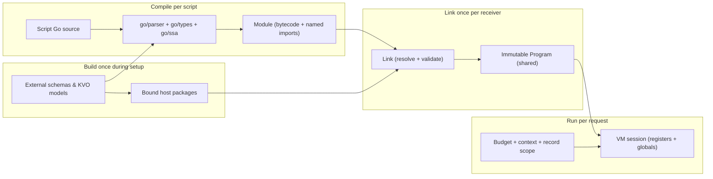
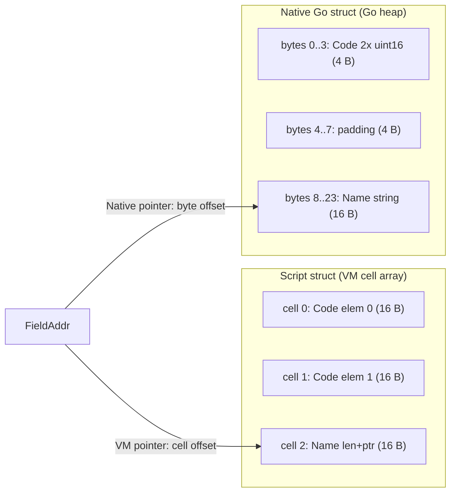
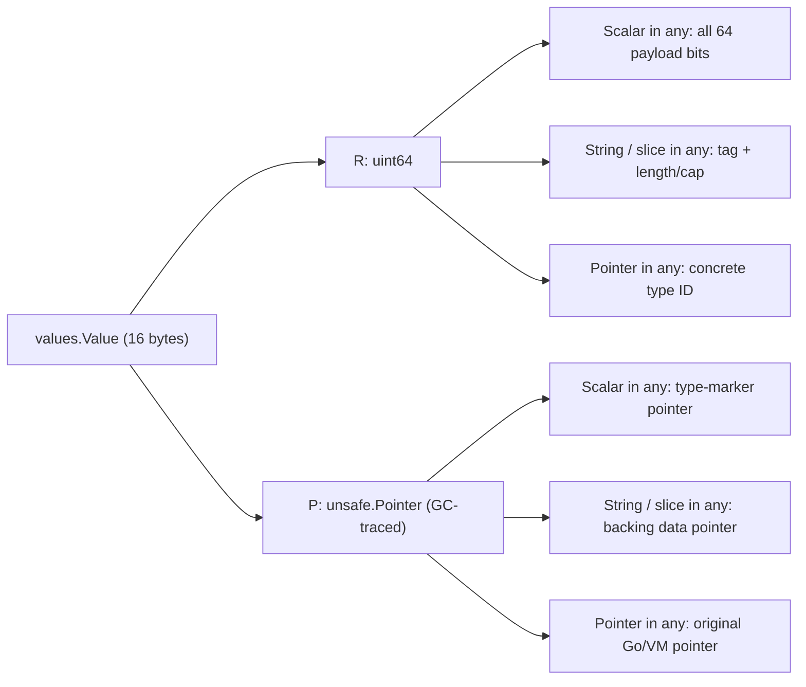
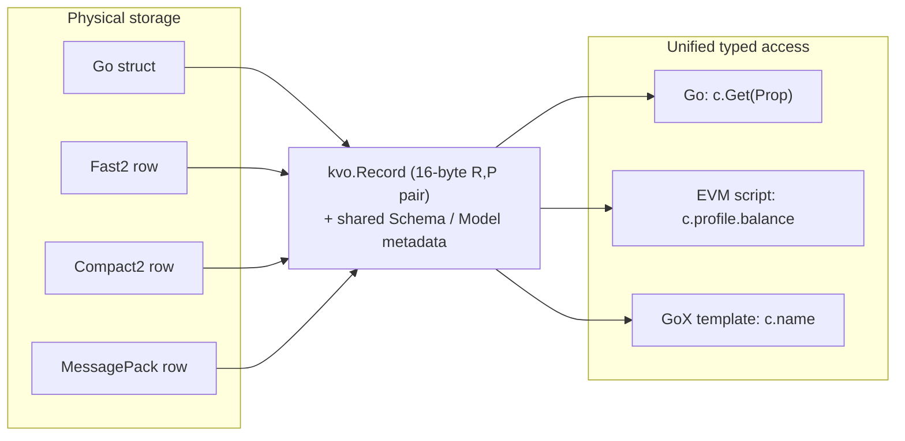
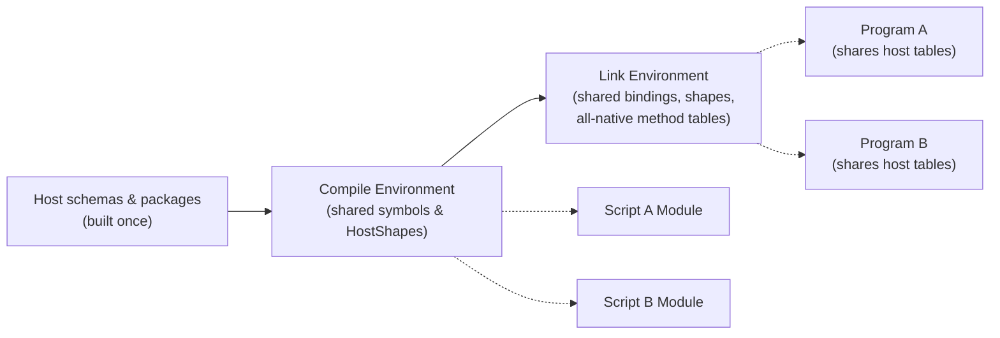
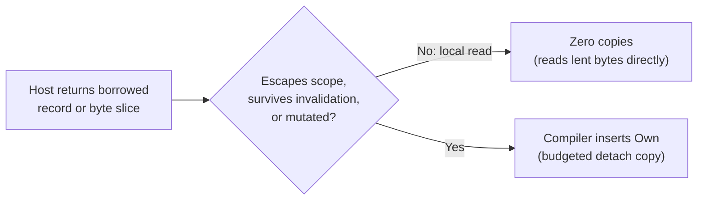
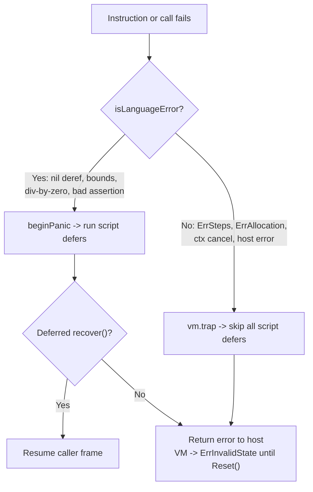
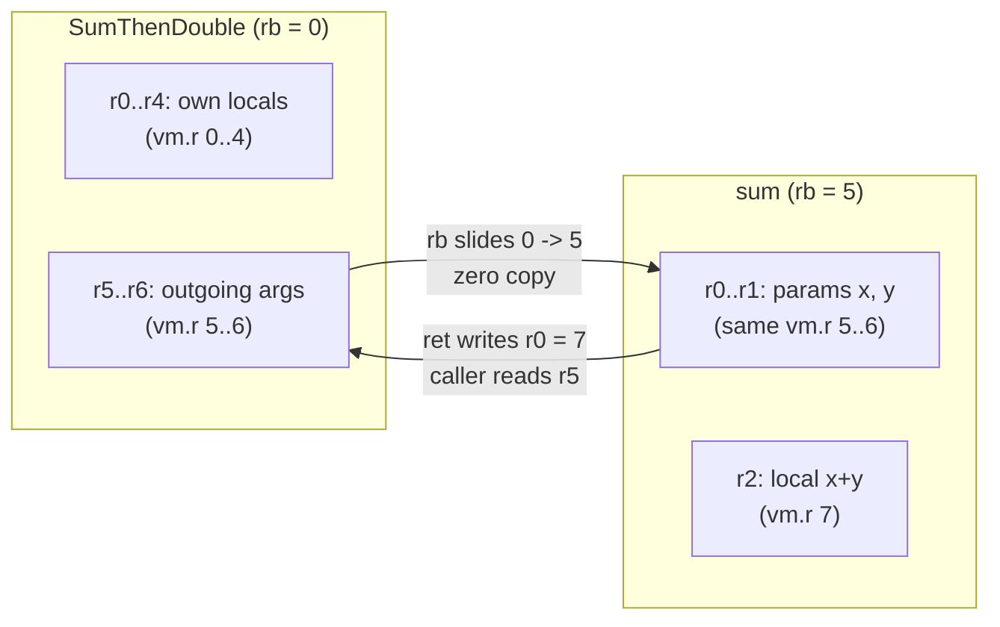
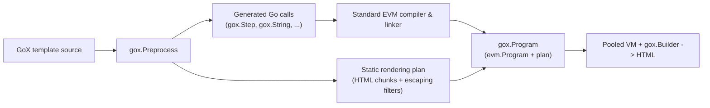

# Inside EVM

*How EVM compiles Go scripts and runs them inside a Go application.*

This book follows a Go script from plain source text all the way down to bits
in a register. It is written for contributors working on the VM, for host
authors tuning a hot path, and for anyone curious how a small, fast virtual
machine for a statically typed language fits together. If you just want to
embed EVM in an application, start with the [README](../README.md) and the
[host contracts](embedding.md) first—then come back here when you want to see
what happens under the hood.

### How to read this book

**Chapters 1–4** lay down the foundations: why EVM exists, how every Go value
and KVO record sits in memory, how compiled modules and overlapping register
windows work, and the instruction set itself. Browse the module, calling-convention,
and layout overview in Chapter 4 first and skim the opcode tables—you can always
flip back when a specific opcode catches your eye.

**Chapters 5–6** follow the compiler from `go/types` and SSA down to bytecode,
then walk through Go construct by construct beside live disassembly listings
(plus a complete catalog of how EVM Go differs from standard Go).

**Chapters 7–9** cover the runtime boundary and execution engine: native host
bindings, automatic borrow/ownership analysis, budgets and cancellation,
execution coverage, and stepping inside the evaluator loop.

**Chapters 10–12** finish with the performance story—what actually made EVM
fast, what failed, and how it compares to Lua, LuaJIT, and other Go
interpreters—followed by GoX (typed HTML templates compiled to the exact same
VM) and a short end-to-end walkthrough tying every chapter together on a real
runnable example.

Once Chapters 1–4 click, you can jump into any later chapter on its own. Every
bytecode listing beneath a Go example is compiled, linked, and executed against
an assertion whenever the book is rebuilt (see the Appendix). Throughout the
book, **Why this way?** sidebars call out the engineering history behind notable
choices—distinguishing **clear trade-offs** (measured or weighed against real
alternatives), **reasonable defaults** (clean choices that worked and were never
challenged), and things **not yet done**.

## 1. Architecture and goals

### 1.1 Why embed a Go VM?

Three real-world pressures push a Go application toward running Go code inside
itself:

1. **Customize per account with code instead of configuration.** When you try
   to customize multi-tenant business logic through configuration, your engine
   rapidly grows complex internals where dozens of edge cases—95% of them
   irrelevant to any single account—interact in subtle, fragile ways. Writing
   and validating straightforward code for *one* account's exact rules is far
   simpler than building one generic engine that covers every conceivable case.
   That unlocks deeper customization, dramatically better AI-generated code,
   and a tiny blast radius (a bug affects one account, not every account)—and
   together those make lights-out, no-human-required parts of the codebase
   genuinely practical.
2. **Staged rollouts through per-account versioning.** Even for your own
   built-in logic, running different compiled versions for different accounts
   gives you clean, fine-grained rollouts without tangling the host binary in
   long-lived feature flags.
3. **Code that changes faster than the server binary.** HTML templates,
   emails, reports, and ad-hoc data queries can be edited, type-checked, and
   swapped at run time without rebuilding or restarting the server.

You have a few classic ways to embed dynamic behavior in a Go server, and each
comes with a painful trade-off:

- **Subprocesses or RPC plugins** isolate crashes, but force you to serialize
  every struct across a process boundary and pay IPC latency on every call.
- **Go's `plugin` package** runs native code, but cannot unload modules, cannot
  enforce CPU or memory budgets, and breaks on the slightest toolchain or
  dependency mismatch.
- **Embedding Lua or JavaScript** gives you fast scripting, but forces your
  team (and your users) into a second language, a second type system, and a
  bridge layer that marshals data back and forth.

EVM takes a different bet: **run a safe, sequential subset of Go itself, inside
the host Go process, directly on the host's own memory.** Six goals shape every
design decision you will see in this book:

1. **Real Go on real host data.** A plugin is ordinary Go that calls
   `c.AddPoints(...)` on your host's actual `*Customer` pointer and reads your
   real slices and maps. Memory and garbage collection are shared with the
   host—nothing is serialized at the boundary.
2. **Checked before a single instruction runs.** Scripts are type-checked
   against your exposed Go packages at compile time. A typo in a field name or
   a wrong argument type fails compilation before any code executes.
3. **Explicit capability control.** A script can import only the packages the
   host hands to the compiler. There are no goroutines, no channels, no
   `unsafe`, and no filesystem, network, or environment access unless the host
   explicitly exposes it.
4. **Hard, deterministic budgets.** A runaway loop or giant allocation stops
   cleanly. Every invocation runs inside limits on instruction steps,
   allocations, wall-clock duration, call depth, and output bytes.
5. **Fast enough for the request path.** Bytecode operates on unboxed 64-bit
   words in split register banks, small host calls run straight from registers
   through generated Go wrappers (zero reflection), and warm calls allocate
   nothing beyond what the script itself allocates.
6. **One VM for scripts, templates, and stored records.** Business rules,
   GoX HTML templates (Chapter 11), and KVO record scans (Chapter 3) all compile to
   and run on the exact same VM.

Keep one boundary clear from the start: **EVM is a capability and budget
sandbox, not an OS process isolation boundary.** Always accept Go source and
compile it yourself—never accept raw uploaded bytecode—and remember that any
native Go function you expose runs inside your own process.

> **Why this way? (Clear trade-off — why not `plugin`, Yaegi, or Lua?)**
> Go's standard `plugin` package cannot unload code, breaks across Go and
> dependency versions, and offers no step or memory budgets. AST-walking Go
> interpreters like Yaegi are 5–15× slower and lack zero-decode data access and
> borrow analysis. Embedded Lua is fast, but forces teams—and AI agents—to
> maintain a second dynamic language with a second type system instead of
> writing ordinary, statically checked Go.

### 1.2 The overall approach

Before diving into data structures and opcodes, it helps to see the five
architectural choices that hold EVM together:

1. **Stand on Go's own compiler frontend.** Rather than writing a custom Go
   parser or reimplementing Go's type inference, generics, and method-set rules
   by hand, EVM feeds script source through Go's standard `go/parser`,
   `go/types`, and `golang.org/x/tools/go/ssa`. That guarantees real Go
   semantics while letting EVM focus its code on lowering SSA, optimizing
   bytecode, and enforcing limits.
2. **A split-bank register VM, not a stack VM.** Every instruction is a fixed
   64-bit word operating on frame-local registers split into two Go slices:
   `vm.r` (`[]uint64`) for unboxed integers, floats, and lengths, and `vm.p`
   (`[]unsafe.Pointer`) for GC-visible pointers. Keeping pointers in their own
   bank means Go's garbage collector traces live VM registers natively without
   boxing scalars or tagging every word.
3. **Shared host memory with zero serialization.** Host pointers, slices, maps,
   and encoded database rows (Chapter 3) cross directly into VM registers.
   Scripts mutate your host's real structs and read stored data in place, and
   generated Go wrappers (Chapter 7) let hot host calls skip reflection
   altogether.
4. **Validate once at link time, run unchecked in the hot loop.** `evm.Link`
   resolves host bindings, freezes type layouts, and verifies every register
   index, table index, and branch target up front. Because every instruction is
   already proven valid before execution begins, the evaluator's inner loop
   never wastes cycles re-checking instruction operands on every dispatch.
5. **Deterministic budgets baked into the evaluator.** A local countdown fuel
   counter polls cancellation every 256 dispatches and stops infinite loops
   precisely; allocation reservations cap memory before Go allocates it; and
   budget or cancellation errors trap fatally without running script `defer`s.

### 1.3 Compile, bind, link, run: separating declarations from implementations

With those goals in mind, suppose a script calls `meter.Take("abc", 4)`. What
does EVM actually need to know?

At **compile time**, it only needs the signature `func Take(string, int) int`.
It never needs a live meter object, and it never runs a line of host code—the
signature alone is enough to reject `meter.Take(4, "abc")` with a type error.
At **run time**, EVM needs the Go function implementing `Take`.

Keeping those two phases apart is the central architectural split in EVM. You
can compile a script once against a package's declarations and later link that
same compiled module against different host receivers—say, a production meter
and a test stub—without recompiling the script.



Look at how cleanly the responsibilities separate:

- A **schema** holds the external API declarations.
- **Compiling** checks the script against that schema and produces a `Module`
  full of instructions and named imports.
- **Binding** pairs the schema with a concrete Go receiver.
- **Linking** resolves imports to bindings, validates every operand, and
  produces an immutable `Program` you can share across goroutines.
- A **VM** is one execution session over that program, with its own registers
  and package variables.

KVO records follow the same split: the compiled module records the model and
numeric property code, the linker validates them, and the running VM reads the
row through shared access metadata.

This separation pays off whenever something changes—you only redo the minimum
necessary step:

| What changed | What you need to redo |
| --- | --- |
| A different `meter` receiver instance | Bind the new receiver and re-link the existing `Module`. |
| Need isolated globals for another request | Create another `VM` from the same `Program`. |
| Edited script source | Recompile and re-link against the existing schema. |
| Changed host API declarations | Rebuild the schema, check wrappers, and recompile scripts. |

In Go, the whole pipeline for a parameterless `Run` entry is ten lines:

```go
module, err := evmcompiler.Compile("main.go", source, schema.Package())
if err != nil {
    return err
}
program, err := evm.Link(module, schema.Bind(host))
if err != nil {
    return err
}
return evm.New(program).Run(ctx, "Run", nil, nil)
```

Notice what the trust boundary looks like here. The host decides which packages
a script may import by choosing what to hand the compiler. The linker verifies
table indices, frame sizes, and type layouts, trusting the typed compiler to
emit valid pointer operations. External functions run as ordinary native Go
inside the host process—Chapter 8 explains how budgets and cancellation behave
across that boundary.

### 1.4 Vocabulary

A handful of terms recur throughout the rest of this book:

| Term | Meaning |
| --- | --- |
| **Host** | The Go application embedding EVM. |
| **Script** | Go source compiled at run time (called a *plugin* in the README; a GoX template is a script too). |
| **External** | Declared to scripts, implemented in native Go by the host (functions, methods, types, packages). |
| **Schema** | The script-facing declarations of one external package, built once by `evmbind` from Go source. |
| **Binding** | The native Go code wired behind an external declaration. |
| **Module** | Compiler output: bytecode instructions and operand tables, with imports still referenced by name. |
| **Program** | Linked module: imports resolved to bindings and operands validated. Immutable and safe to share. |
| **VM / session** | One live execution state over a program: register banks, call stack, and script package variables. |
| **R, P, V** | A word register (`uint64`), a GC-visible pointer register (`unsafe.Pointer`), and the pair of both at the same index. |
| **KVO / Record** | EVM's typed data-modeling layer (Chapter 3): one 16-byte handle (`kvo.Record`) that reads Go structs and encoded database rows through the same API. |

Now that the overall pipeline and terms are clear, let's zoom in on the first
fundamental question of any VM: how do you represent every Go value in memory
without drowning the garbage collector?

## 2. Runtime values, types, and shapes

Because Go is statically typed, EVM does not have to carry a type tag on every
integer or pointer at run time. That single fact unlocks a compact,
GC-friendly value model.

### 2.1 Two-word values: splitting words and GC pointers

Take the 64-bit word `1`. On its own, those bits could be the integer `1`, the
boolean `true`, the byte length of a one-character string, or a function
reference. In EVM, the *instruction* reading the register decides what those
bits mean.

In the `values` package, a general value is a pair of machine words:

```go
type Value struct {
    R uint64
    P unsafe.Pointer
}

func Int(v int64) Value {
    return Value{R: uint64(v)}
}

func String(v string) Value {
    return Value{R: uint64(len(v)), P: unsafe.Pointer(unsafe.StringData(v))}
}
```

Why split `R` (raw bits) and `P` (pointer) instead of using one tagged word or
NaN-boxing? C VMs like LuaJIT can hide pointers and type tags inside unused NaN
bit patterns of a 64-bit `double`, because they own their own memory manager.
EVM lives inside Go's precise, moving-capable garbage collector, which forbids
hiding pointers inside `uint64` or `float64` values—the GC must know
*statically* which words are pointers. Keeping pointers in a dedicated
`unsafe.Pointer` bank means Go's GC can scan live `P` registers directly,
without ever mistaking an integer for a pointer, losing track of a live string,
or boxing scalars on the heap. Two ironclad rules follow from this: **`P` is
never a spare integer**, and **`R` must never be the sole reference to a Go
object.**

Splitting the banks also saves work on hot paths: integer and floating-point
arithmetic touch only the `R` bank, never allocating a 16-byte cell or
bothering the GC. Strings, slices, interfaces, and KVO records use both halves:

| Script value | `R` (word) | `P` (GC-visible pointer) |
| --- | --- | --- |
| Integer, `bool`, `float` | Decoded bits (narrow signed ints are sign-extended). | Unused. |
| `string` | Byte length. | Immutable byte data. |
| Mutable slice | Length in low 32 bits, capacity in high 32 bits. | Start of backing buffer (layout fixed by compiler or host ABI). |
| `map` | Unused. | Map object. |
| Pointer | Unused. | Address. |
| Struct or array value | Unused. | Flattened snapshot (`nil` can represent all zeros). |
| `complex64` | Real and imaginary `float32` bits packed together. | Unused. |
| `complex128` | Unused. | Pointer to two `float64` cells. |
| Function | Program's function-reference index + 1 (`0` = `nil`). | Closure capture environment, if any. |
| Interface | Payload, tag, or concrete type ID (see §2.5). | Scalar marker, backing pointer, or fallback box. |
| KVO record / list | Typed-pair tag, representation ID, and auxiliary length. | Encoded or native payload. |

Slices are a neat example of how both halves cooperate. A slice with length 2
and capacity 5 packs both bounds into `R` as `0x0000000500000002`:

```go
return Value{R: uint64(length) | uint64(capacity)<<32, P: p}
```

Copy that pair and both copies share the same backing elements. Reslice one,
and its `R` changes independently while `P` may advance into the same
allocation—just like Go's own slice header, only packed into two words instead
of three (the trade-off is that slice length and capacity are capped at 32
bits, measured in elements).

### 2.2 Nominal types and register representations

At the VM level, a `Type` carries two things: a nominal identity and a register
representation (`Raw`, `Pointer`, or `Pair`):

```go
type Type struct {
    name string
    repr Repr
    own  OwnFunc // copies a borrowed value; see §3.3
}
```

Identity is pointer identity: two separately constructed `*Type` values with
the same name are *not* the same type, and signatures compare lists of `*Type`
pointers. Conversely, two distinct types—like `type Points int` and `type Rank
int`—can share the exact same `Raw` representation while staying distinct to
the type system.

### 2.3 Storage shapes and the 16-bit shape table

If a `Type` says *who* a value is, a **`Shape`** says *how it occupies memory*
and links to the shapes of its fields or elements. Instead of carrying a
descriptor on every value, instructions index the compiled module's `Shapes`
table by a 16-bit integer—so a million `Row` values all point to one entry.

Whenever the compiler encounters a Go type, `typeEnvironment.shape` unaliases
it and checks its cache before building a new shape:

```go
t = types.Default(types.Unalias(t))
// ... resolve a shape the host declared for this type ...
if s, ok := e.shapes.At(t).(*values.Shape); ok {
    return s, nil
}
s := &values.Shape{Cells: 1, DisplayName: displayTypeName(t)}
e.shapes.Set(t, s)
e.shapeOrder = append(e.shapeOrder, s)
```

Walk through a concrete example: `type Points int`, `type Rank int`, and
`type Score = Points`. `Points` and `Rank` each get a shape (distinct Go types,
same register bank), while `Score` reuses `Points` because it is an alias.
Every `[]Points` shares one slice shape pointing back to `Points`, and
`[100000]Points` creates a single array shape with length 100,000 (consuming
storage cells at run time, not 100,000 shape indices).

For a struct like `type Row struct { Code [2]uint16; Name string }`, the
compiler flattens its fields into contiguous VM cells:

```go
s.Fields = append(s.Fields, values.Field{
    Name: field.Name(), Shape: fs, Offset: s.Cells,
    Embedded: field.Embedded(), Tag: u.Tag(i),
})
s.Cells += fs.Cells
```

```text
             offset in cells       representation in storage
Row.Code     0                     cell 0: R for Code[0]
                                   cell 1: R for Code[1]
Row.Name     2                     cell 2: R length, P bytes
Total        3 cells               48 logical bytes on a 64-bit machine
```



Here is a subtle but vital distinction: **script struct offsets count VM cells,
whereas native Go offsets count bytes.** A script-defined struct can have a
completely different memory layout from the same declaration compiled by Go, so
a host binding can never cast VM cells to `*Row`. Chapter 7 shows how generated
wrappers bridge the two layouts safely.

What about recursive structs like `type Node struct { Next *Node }`? Because
the compiler inserts `Node` into its cache *before* descending into its fields,
building `*Node` finds the pending `Node` shape immediately and avoids infinite
recursion. The linker uses the same pre-cache trick when snapshotting shapes so
later mutations to a `Module` can never corrupt a linked `Program`.

Every compiled module gets **65,536 shape slots**—a hard limit inherited from
the 16-bit operand field in EVM's 64-bit instruction word. Today, the compiler
lists all imported host shapes on the module (so interfaces and native bindings
can resolve host types they meet at run time, counting toward the 65,536 cap),
while a linked `Program` trims its runtime shape table down to only the highest
index any instruction actually uses (saving ~23 KB on a trivial GoX plugin).

> **Why this way? (Not yet needed)**
> Assigning short 16-bit indices only to shapes addressed directly by `alloc`,
> `load`, and `store` while reaching the rest by pointer would lift the 65,536
> cap on imported types, but no real host has hit it yet.

For the test fixture package `h` (from Chapter 7):

| Script source | Shapes in module | Distinct shape indices read by memory instructions |
| --- | ---: | ---: |
| Empty `Run`, no imports | 0 | 0 |
| Empty `Run` with `import _ "h"` | 35 | 0 |
| `Run` reads `Bits` on an external `Row` | 36 | 0 |

In a boundary test, an external package declaring 65,536 empty structs compiled
fine; adding one more hit `too many storage shapes`. (If that limit ever
matters in practice, the compiler could assign short indices only to shapes
addressed directly by instructions while keeping the rest linked by pointer.)

### 2.4 Struct snapshots and Go aliasing semantics

In Go, assigning one struct to another copies the struct's own fields, while
slices, maps, and pointers inside it keep sharing their targets. Take a `Bag`
holding an `int` and a `[]int`:

```text
a:  [ N: 1 ][ len: 1, cap: 1, P ] ─┐
                                    ├──> [ element: 2 ]
b:  [ N: 1 ][ len: 1, cap: 1, P ] ─┘
```

Changing `b.N` must leave `a.N` alone, while changing `b.Items[0]` must show up
in `a.Items[0]`. How does EVM pull this off in just a few lines?

When the evaluator executes `load`, it calls `snapshot`:

```go
v, err := snapshot(shape, shape.Stored(p[b]), &budget.allocated, limits)
```

Scalars and `nil` aggregate snapshots pass straight through. Any non-nil
aggregate (a struct, array, or `complex128`) gets a fresh copy of its
contiguous cells:

```go
p, err := allocCells(s.Cells, allocated, limits)
if err != nil {
    return values.Value{}, err
}
s.Store(p, v)
return values.Value{P: p}, nil
```

`Shape.Store` copies only that flat slice of cells—it never chases pointers
inside them. Go value semantics and Go pointer aliasing both fall out of that
single rule!

> **Why this way? (Reasonable default)**
> Eager cell snapshots on `load` were never challenged—struct copies are small,
> so copy-on-write was never needed here (unlike large borrowed `[]byte`
> buffers in Chapter 7, where copy-on-write was chosen after eager cloning
> proved too expensive).

Notice how the shape index in `load` and `store` tells the VM *how* to treat
the exact same address:

| Type at the address | `load` | `store` |
| --- | --- | --- |
| `int` | Read `R` from one cell. | Write `R` and clear `P`. |
| `string` | Read length and data pointer into `R` and `P`. | Write both halves (bytes stay in place). |
| `*Customer` | Read pointer into `P`. | Write `P` and clear `R`. |
| `struct{ Customer *Customer }` | Copy one cell into fresh storage; put its address in `P`. | Copy that cell into destination (`nil` clears it). |

Look closely at the last two rows—they are both one cell wide and both live in
`P`, yet they behave differently. For `*Customer`, `P` *is* the customer's
address. For `struct{ Customer *Customer }`, `P` points to a snapshot cell
*holding* the customer's address, so zeroing the original struct field leaves
the snapshot untouched (the `Detach` listing in Chapter 6 demonstrates this
live).

### 2.5 Unboxed interfaces and presence

Ordinary typed code knows every value's type at compile time. Interface values
like `any(int(1))` do not—consumers can type-assert or switch on them at run
time, so an interface value must carry its dynamic type.

To avoid heap-boxing every integer or string stuffed into `any`, EVM uses
compact encodings inside the same two-word pair:



- **Scalars** keep all 64 payload bits in `R` and store a real pointer into the
  program's type-marker array in `P`.
- **Strings and common slices** pack high-bit tags into `R` while `P` keeps
  pointing at the real backing data.
- **Pointers** keep a concrete type ID in `R` and the original pointer in `P`
  (native Go pointers add a tag bit).
- Anything that doesn't fit—including functions—falls back to a heap box.

> **Why this way? (Clear trade-off)**
> Always boxing interfaces in a `Value` cell was the original baseline. On
> JSON-heavy dynamic-value benchmarks, unboxed encodings cut re-boxing time by
> **44.9%** (`2,050 → 0` allocations) and update-and-read time by **21.1%**
> (`24.6 KB → 0`). An early prototype regressed pointer and function interface
> loops by 6–7% until pointer assertion IDs were moved to link time, after
> which control benchmarks stayed within ±3%.

Regardless of which compact form was used, one function decodes them all:

```go
shape, payload, err := program.UnpackInterface(value)
```

Only `(R=0, P=nil)` is a `nil` interface: a scalar zero has a non-nil marker
pointer in `P`, a typed `nil` pointer has a nonzero type ID in `R`, and a typed
`nil` slice has its slice tag. Because a scalar's 64 bits can match any tag
prefix, unpackers always check marker pointers first. And because type IDs
belong to a single linked `Program`, always repack interfaces when crossing
between programs (see [values/README.md](../values/README.md) for the exact bit
layouts).

Presence is a separate question from dynamic type. A map lookup `m[k]` returns
zero whether the key was stored as `0` or absent—so `v, ok := m[k]` emits a
second boolean output, and `values.Map.Find` returns `(*MapEntry, bool, error)`
to keep missing keys distinct from both zero values and comparison panics.

Everything in this chapter covers ordinary Go values. Next, let's see how EVM
extends that exact same two-word value model to read and edit stored database
records without decoding them.

> **Key takeaways — Chapter 2**
> - Every runtime value fits in two words (`R uint64`, `P unsafe.Pointer`); `P` is *always* a real GC pointer or `nil`, never an integer.
> - Nominal `Type` identity is pointer equality; a `Shape` describes memory layout and is indexed by a 16-bit table entry.
> - Shallow cell snapshots on `load` give Go struct value copies and pointer aliasing from a single rule.
> - Interfaces pack scalars, strings, common slices, and pointers right into `(R, P)` without heap boxing; only `(R=0, P=nil)` is a `nil` interface.

## 3. Data modeling with KVO

### 3.1 Why a VM has a data modeling framework

If you are coming from Lua, Python, or ordinary Go, seeing a dedicated chapter
on a data-modeling framework inside a VM book probably looks unusual. Why would
a virtual machine know anything about "KVO records"?

Picture a real Go service backed by an embedded key-value database (such as
[edb](https://github.com/andreyvit/edb)). A table holds 500,000 customer rows,
and a script—or a Go report—wants to scan them and sum
`c.profile.balance * c.profile.rate` for active customers.

In ordinary Go, each row is serialized on disk (say, as MessagePack or JSON),
so you decode every row into a `*Customer` struct. That allocates hundreds of
thousands of strings, tag slices, history maps, and nested structs you never
even touch—just to read three numbers—and floods the garbage collector. Yet if
you try to read raw binary rows by hand, your business logic becomes welded to
one storage format, and you end up maintaining separate code paths for encoded
rows, in-memory Go structs (for tests and live objects), scripts, and HTML
templates.

**KVO ("Key-Value Objects") solves that by separating three concerns:**

1. **What a record means:** A schema of typed properties with permanent numeric
   codes.
2. **How it is stored:** A Go struct, a `Fast2` binary row, a `Compact2` binary
   row, a legacy `MessagePack` row, or decoded memory.
3. **Who reads or edits it:** Native Go code, EVM scripts, or GoX templates.



Five concepts make up the whole model:

| Concept | Role |
| --- | --- |
| **Schema** | A registry holding all properties and models for an application. |
| **Property** | One typed field with a permanent numeric code (never renumbered) and a name like `customer:points_earned`. |
| **Model** | The list of properties belonging to one record type (for example, `Customer`). |
| **Record (`kvo.Record`)** | A 16-byte handle viewing one value of a model in place—struct or encoded bytes—without decoding the whole row. |
| **Editor** | A typed handle for mutations: writes straight to a Go struct, or batches changes and encodes a new row. |

Because both Go and EVM represent a `kvo.Record` using the exact same 16-byte
`(R, P)` pair from Chapter 2, a script can scan half a million encoded rows
with ordinary field syntax (`c.profile.balance`), reading only the bytes it
touches with zero per-row heap allocations—and that exact same script runs
unchanged against an in-memory Go struct in a unit test.

### 3.2 Schemas, properties, and wire layouts

A **KVO property code** identifies a logical field across every storage format;
it is neither a VM cell offset nor a Go byte offset:

```go
count := kvo.NewSignedProp[int64](schema, 1, "sample:count", kvo.TInt64)
labels := kvo.NewMapProp(schema, 2, "sample:labels",
    kvo.MapOf(kvo.TMachineString, kvo.TMachineString),
    values.StringCodec[string](), values.StringCodec[string]())
model := kvo.NewModel(schema, entity, func(b *kvo.ModelBuilder) {
    b.Prop(count, kvo.PresenceIsSignificant)
    b.Prop(labels, kvo.Compact | kvo.KeepDictionaryZeroValues)
})
```

`PresenceIsSignificant` tells the model to distinguish a stored zero from an
absent field (matching `kvo.Optional[T]` or a pointer in Go);
`KeepDictionaryZeroValues` does the same for entries inside `labels`.

At the wire level, the codec provides raw bytes and the property tells you how
to read them:

```go
field := view.RawField(count.Code()) // Compact2 payload: ff
field.Decode(row2.Signed).AsInt()    // -1
field.Decode(row2.Word).AsUint()     // 255
```

That same `0xff` byte means `-1` or `255` depending on the property's declared
type. `Compact2` packs short integers with a trailing catalog for size; `Fast2`
uses full-width scalar slots and a key directory for speed; and a `Fast2` row
can embed `Compact2` children without boxing a single scalar on read.

### 3.3 Records in the VM: 16-byte pairs, lifetimes, and editors

Best of all, a `kvo.Record` rides on the exact same 16-byte `(R, P)` pair as
every other VM value: `P` points at the payload, and `R` packs a tag, a
representation ID, and an auxiliary byte length. That representation ID indexes
shared metadata naming both the model and the physical layout, so every
representation travels in one uniform carrier—returning a record via
`call.SetRecordResult(model, record)` allocates nothing.

When a script writes `c.profile.balance`, the compiler resolves both names to
property codes and—if `c.profile` has no other use—fuses them into a single
`GetChildKey` operation that visits both directories with no intermediate
record. Reading an immutable record needs no transaction scope and no expiry
check.

> **Why this way? (Clear trade-off — 16-byte pairs with no read arena)**
> Originally, `kvo.Record` was a 128-byte struct and EVM read handles checked
> scope tokens on every access. Shrinking immutable handles to a 16-byte
> `(R, P)` pair (32-bit length + flags + representation ID in `R`, payload in
> `P`) cut Fast2 retain-and-read from **16.05 → 6.60 ns**, native
> retain-and-read from **12.91 → 3.98 ns**, and a 256-row Fast2 scan from
> **17.9 → 12.1 µs** (`5 → 0` allocs). Two runtime-checked alternatives were
> explicitly rejected: a scope arena with generation counters (~16 MB of
> bookkeeping per million reads when escape can't be disproved) and
> per-transaction representation leases (no safe point to reuse an ID since
> scripts never explicitly free records).

Of course, dropping runtime read checks shifts lifetime safety onto the
compiler: a borrowed record is only valid while its backing bytes stay alive.
By attaching ownership effects to host functions (which results borrow from
which scope, which calls retain arguments, which calls end a scope), you let
the compiler insert copies only where a borrowed value actually escapes—so a
scan loop over a million rows copies only the single match it returns. (Native
Go code gets no compiler analysis and calls `Own()` or `Clone()` itself.)

Editable records use a separate type (`CustomerEdit`, a **reasonable default**
inherited from KVO's immutable/mutable split) and live inside a transaction
`evm.WithRecords` scope—today an editor cache and registry rather than a
read-lifetime gate. Nested editors remember their path to the root: reading
creates nothing, writing creates children on demand, and the host flushes
pending collections and commits. KVO records also carry no hidden database
key (carrying one separately cost a 32-byte side allocation that erased the
16-byte win)—keep the lookup key separately or store a `kvo.PrimaryKey`
property (see [kvo/_docs/access.md](../kvo/_docs/access.md)).

### 3.4 Lists, maps, and JSON inside records

Even lists inside a record can avoid allocating a Go slice. Whenever the
compiler proves that a script only reads a scalar or string list locally
(`for _, tag := range c.tags`, `len`, or indexing), the script carries KVO's
16-byte list cell and reuses a VM iterator workspace—materializing an owned
slice only if the list is mutated or escapes. That was a **measured trade-off**:
list microbenchmarks improved 2–12% on range and 5–13% on `len` with zero
allocations across 552 samples (while whole-database scans of 463K rows stayed
within 1% noise; see [list-cells.md](list-cells.md)).

For schemaless data, a JSON dictionary (`kvo.MapOf(kvo.TMachineString,
kvo.TJSON)`) appears in scripts as `map[string]any`, keeping `null` distinct
from absent keys and preserving full 64-bit integer precision. On an editor,
assigning into a JSON map materializes it once so all aliases see pending
writes until the host flushes on save.

Finally, `Record.ToJSON` walks modeled data straight into an owned tree
(replacing an accidental serialize-and-reparse path, cutting record export from
32.3 → 11.5 µs and GoX rendering from 176.6 → 84.4 µs), while
`Program.JSONValue` and `EncodeJSON` convert script `any` values into Go trees
or JSON bytes while checking cycles, finite numbers, depth, and output size.

With values, types, shapes, and records in place, let's look at how compiled
modules sit in memory, how functions pass arguments across overlapping call
windows, and the instruction set itself.

> **Key takeaways — Chapter 3**
> - KVO separates logical schema (models + permanent numeric property codes) from physical storage (`Fast2`, `Compact2`, `MessagePack`, Go structs, decoded memory).
> - A `kvo.Record` travels in the same 16-byte `(R, P)` pair as any VM value, enabling zero-decode, zero-allocation field reads.
> - Immutable records borrow their bytes; the EVM compiler inserts `Own` copies automatically where records escape (Chapter 7), while mutable editors live in transaction scopes.
> - Local read-only scalar/string lists iterate in place through 16-byte list cells without materializing Go slices.

## 4. Instruction set and calling convention

Before diving into the opcode tables, it helps to understand the **shape** of
EVM's instruction set—why it looks the way it does, and why certain tables keep
appearing in operands.

EVM is a **fixed-width, 64-bit, register-to-register RISC-style bytecode ISA**
designed for fast decoding inside a Go `switch` loop:

- **Fixed 64-bit words:** Every instruction is a single `uint64`, giving three
  full 16-bit register operands with no extension words.
- **Three-address register operations (not a stack VM):** In Go, there is no
  portable computed `goto`, so every bytecode instruction pays for a pass
  through a `switch`. A stack VM (like CPython or the JVM) needs three or four
  dispatches (`push`, `push`, `add`, `store`) to do what one three-address
  register instruction (`R[a] = R[b] + R[c]`) does in a single dispatch. Fewer,
  wider instructions directly cut Go's switch overhead.
- **Split register banks (`R` and `P`):** Instructions address frame-local
  word registers (`Ra`) and GC-visible pointer registers (`Pa`) independently,
  or pair them at the same index (`Va`).
- **Constant pools instead of inline literals:** Because a 64-bit instruction
  cannot hold an arbitrary 64-bit constant *and* an opcode and destination
  register, large integers, floats, and strings live in per-module **constant
  tables** (`Words` and `Strings`). Instructions like `const r3 wrd0` or
  `string v1 str0` simply carry a table index. (Small signed immediates that
  fit in 16 bits, like `add.imm.i64`, are encoded directly in the instruction.)
- **The extended-operations table (`extended extN`):** Richer, multi-operand,
  or type-directed operations (slice bounds, `append`/`copy`, map lookups,
  `FieldAddr`, type assertions, KVO record reads/writes) share one opcode
  (`OpExtended`) that indexes into a per-module **extended table**
  (`Module.Extended`). Each entry is an immutable descriptor carrying a closed
  op kind, shape metadata, input/output register lists, and flags.

> **Why this way? (Reasonable default & clear trade-off)**
> Fixed **64-bit words** were a reasonable provisional default chosen for
> simplicity (operand room, easy assembly and validation) at twice the code
> bytes of a 32-bit format like Lua's—code density against 32-bit words was
> never benchmarked. **`OpExtended`**, by contrast, was a clear trade-off
> against variable-width or continuation-word instructions so every instruction
> in the stream stays strictly one word; ops migrate in or out case by case
> when benchmarks justify it (early `new.struct`/`store.field` ops were retired
> into `extended`, while hot native pointer loads later moved out to a
> specialized path for GoX).
- **Typed side tables:** For the same reason, storage shapes (`Shapes`),
  numeric conversions (`Conversions`), closures (`Closures`), virtual method
  descriptors (`Methods`), and defer descriptors (`Defers`) all live in sibling
  tables on the `Module`, referenced by compact 16- or 32-bit indices.
- **Link-time validation:** Every register index, table index, reserved-zero
  field, and branch target is verified once at `Link` time so the evaluator can
  index straight into frame slices without bounds-checking opcodes.

To make that concrete, decode the 64-bit word `0x0003_0002_0001_0007`: the low
16 bits (`7`) are `add.i64`, and reading the remaining 16-bit fields from right
to left gives `A = 1`, `B = 2`, `C = 3`—executing `R[1] = R[2] + R[3]`. On a
`store` instruction, that same physical `A` field names the destination pointer
register `P[a]` instead; the opcode always determines the meaning and register
bank of every field.

### 4.1 In-memory modules and operand tables

An EVM program lives as an in-memory Go object graph. Each `Function` owns a
slice of 64-bit instruction words plus a parallel slice of source positions,
while the enclosing `Module` holds everything too big to fit inside a single
64-bit word—literal pools, type shapes, signatures, and extended operation
descriptors:

> **Why this way? (Not yet done)**
> There is no serialized bytecode file format yet simply because scripts are
> distributed as Go source and loading untrusted bytecode would require a
> semantic verifier first.

```go
// Selected fields of evm.Module
Functions    []Function
Imports      []Import
Words        []uint64
Strings      []string
Conversions  []Conversion
Shapes       []*values.Shape
ExtendedOps  []ExtendedOp
Globals      []*values.Shape
```

Every table index inside an instruction refers to one specific table—index `0`
in `Words` has nothing to do with index `0` in `Imports`—so instruction words
only make sense alongside their module's tables. Linking turns string literals
into ready-to-load `(length, pointer)` pairs, resolves imports to Go wrappers,
and validates the shape graph.

To see the simplest possible function, here is `square` written for the
development text assembler (`evmasm`):

```text
func square i64 -> i64
  registers 1 0
  mul.i64 r0 r0 r0
  ret
end
```

```text
square     1 R slot, 0 P slots
 PC  opcode    A  B  C
  0  mul.i64   0  0  0
  1  ret       0  0  0
```

On entry, `R0` holds the input; PC 0 squares it in place; PC 1 returns `R0`.
The text assembler builds the exact same `Module` struct as the Go compiler,
covering a compact vocabulary handy for VM unit tests (the compiler can emit
additional instructions that the disassembler prints but the text assembler
does not spell).

### 4.2 Split register banks and overlapping call windows

Inside a function, `R0` is a word in `vm.r` and `P0` is a pointer in `vm.p`.
They are completely independent unless an operand is a pair (`V0`), which uses
both at index `0`.

How do parameters map to slots? `LayoutOf` assigns pairs first (so both halves
share an index), then independently numbers the remaining raw words and
pointers in source order. For `(string, *Bag, int)`:

```text
             source argument:   0: string    1: *Bag    2: int
             ABI slot:             V0           P1         R1
R window:                       byte length              int word
P window:                       byte data       Bag address
```

Results follow the same rule independently—which means an incoming `string`
parameter (`V0`) and an outgoing `int` result (`R0`) often share `R0`. That is
why a host wrapper must always finish reading its arguments before writing
results.

When allocating a *local* pair inside a script function, the compiler simply
aligns the two high-water marks (which can leave small gaps in the less-used
bank so `move.v` can still name both halves with one index):

```go
case values.Pair:
    n = max(f.r, f.p)
    f.r, f.p = n+1, n+1
```

Now look at the clever part of EVM's calling convention: **overlapping
windows**. In `Native(s string, n int) int { return meter.Take(s, n) }`, the
caller owns three `R` slots (`R0..R2`) and one `P` slot (`P0`). Rather than
allocating an argument array, the caller writes its outgoing arguments right
past its own locals—into `R3`, `R4`, and `P1`—and calls `meter.Take`:

```text
move.r r3 r0       ; caller R3 is callee R0
move.p p1 p0       ; caller P1 is callee P0
move.r r4 r1       ; caller R4 is callee R1
call.host imp0     ; meter.Take

                caller’s own slots   outgoing arguments / callee starts
word bank:      R0  R1  R2         | R3 = length   R4 = n
pointer bank:   P0                 | P1 = data
from callee:                         V0            R1
```

When `VM.enterCode` enters a callee, it simply slides the base offsets forward
by the caller's own local counts (`RCount` and `PCount`):

```go
next := frame{
    function: int(ref.Index),
    rb: cur.rb + f.RCount, pb: cur.pb + f.PCount,
    recoverToken: recoverToken,
}
```

The caller's *outgoing* window becomes the callee's *incoming* window—zero
copying, zero allocations. (The linker also computes larger total footprints
`rSize` and `pSize` that include the caller's widest outgoing call so the VM
knows how much backing slice to reserve, while advancing the base by `RCount`
and `PCount` so the callee lands right on its arguments.)

Two more details round out the calling convention:

- **Method receivers always reserve `V0`** (`R0` and `P0`), even when a
  concrete receiver only needs one bank, so explicit arguments always start at
  `R1`/`P1`. That lets virtual dispatch (`call.virt`) unpack an interface
  receiver in place without shifting a single explicit argument.
- **Clean boundaries on entry and return:** On entry, the VM grows `vm.r` and
  `vm.p` if needed (address-taken locals live in separate heap cells, so slice
  growth never invalidates pointers), clears pointer slots past the parameters,
  and clears raw locals unless the linker proved every raw slot is written
  before read. On return, the callee leaves its result prefix intact and clears
  all remaining `P` slots so dead references can be collected. At the outermost
  return to Go, the VM copies only the banks each declared result type uses, so
  a returned scalar never leaks a stale pointer in `P`.

### 4.3 Instruction word layouts and operand tables

Every instruction uses one of three 64-bit layouts selected by its opcode:

```text
bits     63          48 47          32 31          16 15           0
ABC      |      C      |      B      |      A      |     opcode    |
A,BC     |             BC            |      A      |     opcode    |

bits     63     52 51     40 39     28 27     16 15                0
ABCD12   |    D   |    C    |    B    |    A    |      opcode      |
```

- **`ABC`** carries three 16-bit operands (up to 65,535 registers or table
  entries per field).
- **`A,BC`** merges `B` and `C` into one 32-bit operand
  (`BC = uint32(B) | uint32(C)<<16`) for pool indices, function/import indices,
  and signed 32-bit branch displacements.
- **`ABCD12`** packs four 12-bit fields (0–4,095, or signed −2,048…2,047 for
  loop displacements) for five fused instructions (`mul.add.f64`, `add.mul.f64`,
  `sub.add.f64`, `loop.add.lt.i64`, `loop.add.le.i64`). If an operand exceeds
  12 bits, the compiler falls back to the unfused sequence.

Package `evm` builds the two primary forms with simple shifts:

```go
func ABC(op Opcode, a, b, c uint16) Instruction {
    return Instruction(op) | Instruction(a)<<16 |
        Instruction(b)<<32 | Instruction(c)<<48
}

func WithBC(op Opcode, a uint16, bc uint32) Instruction {
    return Instruction(op) | Instruction(a)<<16 | Instruction(bc)<<32
}
```

#### Addressing, PC arithmetic, and module tables

A function's code is a `[]Instruction` slice indexed by **word PC** starting at
`0`. Every fetch increments `cur.pc` *before* executing the instruction, so
branch displacements are relative to `PC + 1`: a jump to itself encodes
`BC = -1` (`0xffffffff`), and a jump from PC 12 to PC 8 encodes
`8 - 13 = -5`. The linker rejects any target outside `[0, len(Code))`.

Because constants live in module pools rather than immediate fields, `const r3
wrd0` loads any 64-bit integer or IEEE-754 `float64` (such as π,
`0x400921fb54442d18`) in one instruction. Strings, signatures, source
positions, and extended descriptors live in sibling tables of the in-memory Go
`Module` (there is no serialized bytecode file format).

Inside `VM.execute`, entering or resuming a frame slices `vm.r` and `vm.p` at
the frame's base offsets once, so every arithmetic case indexes straight into
local slices:

```go
resumeFrame:
    f = &vm.program.functions[cur.function]
    r, p = vm.r[cur.rb:], vm.p[cur.pb:]
    // ... inside the dispatch loop ...
    ins := f.Code[cur.pc]
    cur.pc++
    a, b, c := int(ins.A()), int(ins.B()), int(ins.C())
    // ... in the opcode switch ...
    case OpAddI64:
        r[a] = r[b] + r[c]
```

#### Notation used in the tables below

| Symbol | Meaning |
| --- | --- |
| `Ra`, `Rb`, `Rc` | Word register in `r[...]` (writing `Ra` leaves `Pa` untouched) |
| `Pa`, `Pb`, `Pc` | GC-visible pointer register in `p[...]` |
| `Va`, `Vb`, `Vc` | Paired register `(Ra, Pa)` at the same index |
| `Shapes[C]` | 16-bit index into `Module.Shapes` (uses `C` alone) |
| `Words[BC]` | 32-bit index into `Module.Words` (uses combined `BC`) |
| `B = 0`, `C = 0` | Unused field—must be literally zero for `Link` to accept the word |
| `Code` | Decimal opcode number (`0` is invalid; `36–39` are reserved; later additions sit at `66+`, `139+`, and `147+` to preserve existing numbers) |

### 4.4 Moving values and addressing memory

These instructions load constants, copy values between frame registers,
allocate and access VM heap cells via shape descriptors, and check pointers for
`nil`.

| Code | Mnemonic | Operation and operands |
|---:|---|---|
| 1 | `const` | Ra ← Words[BC]. |
| 2 | `string` | Va ← Strings[BC], already converted by the linker to a length and data pointer. |
| 3 | `move.r` | Ra ← Rb. C = 0. |
| 4 | `move.p` | Pa ← Pb. C = 0. |
| 5 | `move.v` | Va ← Vb. C = 0. |
| 6 | `clear.p` | Pa ← nil. B = C = 0. Releases this slot's reference. |
| 51 | `alloc` | Pa ← address of fresh zeroed storage for Shapes[B]. B is the 16-bit shape index. C is unused and must be zero. |
| 52 | `load` | Read through Pb into slot A using Shapes[C]. The shape chooses R, P or V. Snapshot an aggregate. |
| 53 | `store` | Write through Pa from slot B using Shapes[C]. The shape chooses the source bank(s) and how many cells to copy. |
| 55 | `global` | Pa ← address of session global BC. Read or mutate it with load/store. |
| 60 | `check.nil` | Raise a nil-pointer fault if Pa is nil. B = C = 0. |

`alloc` charges for the shape before allocating its cells. `load` and `store`
fault on a nil address. A field selection uses the enclosing shape's field list
and cell offset: `FieldAddr` computes an address, then `store` writes through it.
A store to a field of a native-backed struct uses the FieldStore extended
operation instead. The same shape rules serve manual declarations and compiled
structs. Opcode numbers 36–39 are reserved.

### 4.5 Arithmetic, conversions, and comparisons

For each binary instruction below, A is the destination, B the left operand, C the right. Banks appear in the expression. Float operations read IEEE bits from R, operate at the stated width and write the result bits back into R. A float32 uses the low 32 bits. Every comparison writes exactly 0 or 1.

| Code | Mnemonic | Operation |
|---:|---|---|
| 7 | `add.i64` | Ra ← Rb + Rc modulo 2⁶⁴. |
| 8 | `sub.i64` | Ra ← Rb − Rc modulo 2⁶⁴. |
| 9 | `mul.i64` | Ra ← Rb × Rc modulo 2⁶⁴. |
| 10 | `div.i64` | Ra ← signed Rb / Rc, truncated toward zero. |
| 11 | `div.u64` | Ra ← unsigned Rb / Rc. |
| 12 | `rem.i64` | Ra ← signed remainder of Rb / Rc. |
| 13 | `rem.u64` | Ra ← unsigned remainder of Rb / Rc. |
| 18 | `and` | Ra ← bitwise AND of Rb and Rc. |
| 19 | `or` | Ra ← bitwise OR of Rb and Rc. |
| 20 | `xor` | Ra ← bitwise XOR of Rb and Rc. |
| 21 | `shl` | Ra ← Rb shifted left by Rc, discarding bits above bit 63. |
| 22 | `shr.i64` | Ra ← Rb shifted right by Rc with sign fill. |
| 23 | `shr.u64` | Ra ← Rb shifted right by Rc with zero fill. |
| 24 | `eq.r` | Ra ← Rb == Rc, comparing all word bits. |
| 25 | `eq.p` | Ra ← Pb == Pc, comparing pointer identity. |
| 26 | `lt.i64` | Ra ← signed Rb < Rc. |
| 27 | `lt.u64` | Ra ← unsigned Rb < Rc. |
| 40 | `convert` | Ra ← numeric conversion of Rb according to Conversions[C]. C is a descriptor index. |
| 41 | `check.shift` | Raise a shift fault if signed Ra < 0. B = C = 0. |

The compiler can use the same add for signed and unsigned operands. Their low 64 sum bits agree. It chooses distinct divide, remainder, right-shift and less-than instructions because those operations inspect the sign. All four integer division/remainder variants raise a language fault when Rc = 0. Shift counts use the full unsigned Rc. A signed script count of −1 must raise a fault *before* the shift, hence `check.shift`. The numeric conversion descriptor carries source and destination widths and signedness. Converting 260 from u64 to u8 masks it to 4.

| Code | Mnemonic | Operation |
|---:|---|---|
| 14 | `add.f64` | Ra ← Rb + Rc, float64. |
| 15 | `sub.f64` | Ra ← Rb − Rc, float64. |
| 16 | `mul.f64` | Ra ← Rb × Rc, float64. |
| 17 | `div.f64` | Ra ← Rb / Rc, float64. |
| 28 | `eq.f64` | Ra ← Rb == Rc, float64. |
| 29 | `lt.f64` | Ra ← Rb < Rc, float64. |
| 42 | `add.f32` | Ra ← Rb + Rc, float32. |
| 43 | `sub.f32` | Ra ← Rb − Rc, float32. |
| 44 | `mul.f32` | Ra ← Rb × Rc, float32. |
| 45 | `div.f32` | Ra ← Rb / Rc, float32. |
| 46 | `eq.f32` | Ra ← Rb == Rc, float32. |
| 47 | `lt.f32` | Ra ← Rb < Rc, float32. |
| 48 | `concat.str` | Va ← concatenation of Vb and Vc. |
| 49 | `eq.str` | Ra ← Vb == Vc by byte contents. |
| 50 | `lt.str` | Ra ← Vb < Vc, lexicographic byte order. |

For `eq.r`, +0.0 and −0.0 have different words. For `eq.f64` they compare equal. Floating division uses the floating-point rules for infinities and NaNs. A string comparison costs one instruction. Concatenation also reserves allocation bytes for the combined length.

### 4.6 Branches, calls, and returns

Control-flow instructions include relative branches, direct/host/virtual/indirect
calls, fused counted-loop back edges (`66`, `78–79`, `81`), fused four-operand
float arithmetic (`75–77`), and checked single-word slice indexing (`71–72`,
`139–144`).

| Code | Mnemonic | Operation and operands |
|---:|---|---|
| 30 | `jump` | A = 0. Add signed BC to the next PC. |
| 31 | `jz` | If Ra = 0, add signed BC to the next PC. |
| 32 | `jnz` | If Ra ≠ 0, add signed BC to the next PC. |
| 33 | `call.func` | A = 0. Enter Functions[BC] at PC 0, using the caller's outgoing window. |
| 34 | `call.host` | A = 0. Call the native wrapper for Imports[BC] with the outgoing window. |
| 35 | `ret` | A = B = C = 0. Return results already in their ABI slots and restore the caller, or finish the outer Run. |
| 56 | `function` | Va ← (BC + 1, nil) for FunctionRefs[BC]. The target must be callable without captures. |
| 57 | `closure` | Va ← (function-reference index + 1, capture array). Closures[BC] gives the target and source registers. |
| 58 | `call.virt` | A = 0. The outgoing V0 holds the interface receiver. BC selects a shared method descriptor. Explicit arguments arrive in the outgoing window. |
| 59 | `call.indirect` | Call the function value Va with its captures and the outgoing window. BC selects the expected signature. |
| 66 | `loop.lt.i64` | Increment Ra by one, wrapping at 64 bits. If signed Ra < signed Rb, add signed C (16 bits) to the next PC. |
| 67 | `call.host.rr` | Call Imports[C] with Rb as its sole raw argument. Write its sole raw result to Ra. |
| 68 | `call.host.rp` | Call Imports[C] with Rb as its sole raw argument. Write its sole pointer result to Pa. |
| 69 | `jnil` | If Pa is nil, add signed BC to the next PC. |
| 70 | `jnotnil` | If Pa is non-nil, add signed BC to the next PC. |
| 71 | `load.index.r` | Read raw element Rc of slice Vb into Ra. Check the index against the slice length. |
| 72 | `store.index.r` | Store Rc at index Rb of slice Va. Check the same bound. |
| 73 | `le.i64` | Ra receives signed Rb ≤ signed Rc. |
| 74 | `le.u64` | Ra receives unsigned Rb ≤ unsigned Rc. |
| 75 | `mul.add.f64` | ABCD12. Ra ← (Rb × Rc) + Rd. Round the product to float64 before the addition. |
| 76 | `add.mul.f64` | ABCD12. Ra ← Rb + (Rc × Rd), with the same intermediate rounding. |
| 77 | `sub.add.f64` | ABCD12. Ra ← (Rb − Rc) + Rd. Preserve the order and rounding of both operations. |
| 78 | `loop.add.lt.i64` | ABCD12. Add Rc into Ra, wrapping at 64 bits. If signed Ra < signed Rb, add signed D to the next PC. |
| 79 | `loop.add.le.i64` | The same stepped loop with an inclusive upper bound. |
| 80 | `add.imm.i64` | Ra ← Rb + sign-extended C, wrapping at 64 bits. C holds a signed 16-bit literal. |
| 81 | `loop.le.i64` | Increment Ra by one, wrapping at 64 bits. If signed Ra ≤ signed Rb, add signed C to the next PC. |
| 139 | `load.index.byte` | Ra receives the byte at index Rc of local slice Vb, zero-extended. Check the index against the length. |
| 140 | `store.index.byte` | Store the low byte of Rc at index Rb of Va after the same check. |
| 141 | `load.index.word` | Ra receives the word at index Rc of local slice Vb. Each element occupies eight pointer-free bytes. |
| 142 | `store.index.word` | Store Rc at word index Rb of Va. |
| 143 | `load.index.ptr` | Pa receives the pointer at index Rc of local slice Vb. |
| 144 | `store.index.ptr` | Store Pc at pointer index Rb of Va through Go’s write barrier. |

All six check bounds before dereferencing the backing pointer. The compiler selects these words only when the slice and its aliases share the same packed layout.

A direct call indexes the function table. An external call (`call.host`) indexes the bound Go wrappers. An indirect call obtains the target from Va.R − 1, checks the BC signature and supplies Va.P as the environment. A zero function value raises a nil-function fault. An interface invocation resolves a method on the receiver's dynamic type, then unpacks the receiver in the same slot.

Even a call with no register operands can make the caller's linked frame larger. The linker reserves the largest outgoing parameter/result footprint among its calls. Each bank starts that area immediately after the caller's own slots. On return the VM clears callee P slots beyond the result prefix. A function with pending defers reaches `run.defers` before `ret`. A raw `ret` with an undrained stack is an invalid execution.

### 4.7 Register-operand host calls

Each word uses ABC. C is the 16-bit import index in every row. The suffix gives the explicit input types in order, followed by the result. A word (`u`) uses R, a string (`s`) uses both R and P, and a pointer (`p`) uses P. A method's receiver always lives in P[B].

| Call | A | B |
|---|---|---|
| Function with no arguments | Result | Literal zero |
| Function with one argument | Result | Argument |
| Function with two arguments | First argument, then result | Second argument |
| Pointer method with no explicit arguments | Result | Receiver |
| Pointer method with one explicit argument | Argument, then result | Receiver |

**Functions**

| Explicit arguments | Word result | String result | Pointer result |
|---|---|---|---|
| None | 88 `call.host.u` | 89 `call.host.s` | 90 `call.host.p` |
| `u` | 91 `call.host.uu` | 92 `call.host.us` | 93 `call.host.up` |
| `s` | 94 `call.host.su` | 95 `call.host.ss` | 96 `call.host.sp` |
| `p` | 97 `call.host.pu` | 98 `call.host.ps` | 99 `call.host.pp` |
| `u`, `u` | 100 `call.host.uuu` | 101 `call.host.uus` | 102 `call.host.uup` |
| `u`, `s` | 103 `call.host.usu` | 104 `call.host.uss` | 105 `call.host.usp` |
| `u`, `p` | 106 `call.host.upu` | 107 `call.host.ups` | 108 `call.host.upp` |
| `s`, `u` | 109 `call.host.suu` | 110 `call.host.sus` | 111 `call.host.sup` |
| `s`, `s` | 112 `call.host.ssu` | 113 `call.host.sss` | 114 `call.host.ssp` |
| `s`, `p` | 115 `call.host.spu` | 116 `call.host.sps` | 117 `call.host.spp` |
| `p`, `u` | 118 `call.host.puu` | 119 `call.host.pus` | 120 `call.host.pup` |
| `p`, `s` | 121 `call.host.psu` | 122 `call.host.pss` | 123 `call.host.psp` |
| `p`, `p` | 124 `call.host.ppu` | 125 `call.host.pps` | 126 `call.host.ppp` |

**Statically resolved pointer methods**

| Explicit arguments | Word result | String result | Pointer result |
|---|---|---|---|
| None | 127 `call.host.method.u` | 128 `call.host.method.s` | 129 `call.host.method.p` |
| `u` | 130 `call.host.method.uu` | 131 `call.host.method.us` | 132 `call.host.method.up` |
| `s` | 133 `call.host.method.su` | 134 `call.host.method.ss` | 135 `call.host.method.sp` |
| `p` | 136 `call.host.method.pu` | 137 `call.host.method.ps` | 138 `call.host.method.pp` |

For `call.host.method.su v3 p4 imp6`, the wrapper reads the string from R3/P3 and the receiver from P4. On success, R3 holds the boolean and P3 is cleared. If the script needs the old string again, the compiler copies it before the call. A raw-only destination ordinarily leaves the independent pointer at the same slot alone. Here the instruction owns both halves because A held a string. The disassembler prints `v` when either use of A is a string. For a tied raw-to-pointer or pointer-to-raw operation it prints the result bank. Both inputs may name the same register. The VM captures them before entering Go.

The linker checks the signature and local bank bounds, then replaces each register call with a private handler carrying the same A, B and C. The import supplies the argument and result banks there. Interface calls still resolve their target with `call.virt`.

A binding with no result uses the same argument forms with a `v` suffix. The
instruction reads A and B and overwrites neither bank. Unused operands must be
zero. For example, `call.host.psv p2 v3 imp4` passes the pointer in P2 and the
string in R3/P3; `call.host.method.sv v3 p2 imp4` passes the receiver first.
The `values.Value` that a void callback returns is ignored; its error still
fails execution. `HostCallOpcode(method, args, 0)` selects these instructions.

| Explicit arguments | Function | Pointer method |
|---|---|---|
| None | 147 `call.host.v` | 160 `call.host.method.v` |
| `u` | 148 `call.host.uv` | 161 `call.host.method.uv` |
| `s` | 149 `call.host.sv` | 162 `call.host.method.sv` |
| `p` | 150 `call.host.pv` | 163 `call.host.method.pv` |

| Two arguments | `u` second | `s` second | `p` second |
|---|---|---|---|
| `u` first | 151 `call.host.uuv` | 152 `call.host.usv` | 153 `call.host.upv` |
| `s` first | 154 `call.host.suv` | 155 `call.host.ssv` | 156 `call.host.spv` |
| `p` first | 157 `call.host.puv` | 158 `call.host.psv` | 159 `call.host.ppv` |

A register call still checks cancellation, charges allocations and reports
its source position. Indirect calls, deferred calls, and imports beyond the
16-bit index use the general `call.host`. When a script function does nothing
but forward its parameters, unchanged, to a void register binding, a call to
it compiles to that binding with no script frame in between.

### 4.8 Extended operations

Any instruction that needs more than three operands, a dynamic shape, or
variable arity—such as map lookups, struct field offsets, interface packing, or
KVO record operations—uses opcode `54` (`extended`), indexing a validated
`ExtendedOp` descriptor in `Module.ExtendedOps`.

| Code | Mnemonic | Operation and operands |
|---:|---|---|
| 54 | `extended` | A = 0. BC indexes ExtendedOps. The descriptor selects the operation and all input and output registers. |

In `v, ok := m[k]`, the map, key and two results need four register operands. An ABC word has room for three. A lookup also needs the key shape to hash k and the value shape to choose its output bank. The compiler records those facts in a descriptor. The linker validates each descriptor before execution:

```go
type ExtendedOp struct {
    // ... four private fields that Link fills for record operations ...
    Record   *RecordType // KVO key operations
    Kind     ExtendedKind
    Shape    *values.Shape
    Source   *values.Shape
    In, Out  []Operand
    Index    uint64
    ChildKey uint64 // leaf property for ExtendedGetChildKey
    Flags    uint8
    Packed   bool   // local slice or array backing uses the element's scalar bank
}
type Operand struct {
    Slot uint16
    Repr values.Repr
}
```

For a `map[string]int` in P2, a string key in V0 and outputs in R3/R4, the descriptor is equivalent to the following. If this is descriptor four, the listing reads `extended ext4`. The VM reads the kind and operands from that module table entry; there is no second instruction word or setup register. Field access and interface assertions use the same encoding.

```text
Kind = Lookup     Shape = map[string]int
In   = [P2, V0]   Out   = [R3, R4]
```

The table omits the common `Extended` prefix from the kind names. Parentheses in the operation column denote optional operands. The linker checks register banks and arity for each kind. For instance, a map lookup can omit the presence output, whereas a string iterator always has three output slots.

| Kind | Inputs → outputs and effect |
|---|---|
| MakeInterface | value → interface, in the layouts of §2.5. A pointer or function keeps its P and gets the nonzero type Index in R. A scalar keeps its bits in R and gets a marker pointer in P. Strings and common slices use a tagged R. Anything else gets a payload cell. |
| TypeAssert | interface → value (, ok). On a miss, write zero and false for comma-ok, or panic for a single output. |
| GetKey / SetKey | Read or write a KVO property by schema code. Immutable records/children use RP pairs; mutable editors use scoped handles. Scalar results use their declared register representation. |
| GetChildKey | Immutable parent handle → leaf word. Index identifies the child property, ChildKey its leaf. Source describes the intermediate child, a typed pair, and Shape the result. The linker checks the model chain. |
| FieldAddr / Field | struct address → address, or struct value → field value. Index holds VMFieldBase plus the field ordinal. Its offset counts cells. |
| IndexAddr / Index | array or slice, index → checked element address or value. Packed selects byte, word or pointer stride. String indexing produces a byte. |
| PackedArray | No inputs → P. Allocate Shape.Len zeroed elements. Shape.Elem selects their stride and whether Go must trace pointers. |
| PackedLoad / PackedStore | Element address → scalar value, or address and value → write. The element address came from a checked index. A nil address faults. |
| Slice | base, low, high, max → header. Flags bits 0 and 1 default high to length and max to capacity. |
| MakeSlice / SliceToArray | length, capacity → new slice, or slice → pointer to array after a length check. |
| MakeMap | (reserve hint) → new map. The current allocator ignores the hint. |
| Lookup / MapUpdate | map, key → value (, ok), or map, key, value → update. Writing a nil map panics. |
| Delete / Clear | map, key → delete entry, or map/slice → remove entries or zero elements. |
| Len / Cap | collection → R length or capacity where defined by Go. |
| Append / Copy | destination, source → updated slice or element count. Flag 1 admits a string source for a byte slice. |
| Range / Next | map/string → iterator, then iterator → more, key, value. For strings the last two outputs are byte offset and rune. |
| Convert | value of Source → value of Shape. Handles string, byte/rune slice, integer-to-string and complex conversions. |
| Equal | two values → equality by Shape, including dynamic comparability for interface payloads. |
| Complex / Real / Imag | real, imaginary → complex, or complex → selected component. |
| ComplexBinary / ComplexNegate | two complex values → sum, difference, product or quotient selected by Flags, or one → negation. |
| MinMax | one or more values → minimum (Flags = 0) or maximum (1), using the shape's ordering. |
| AddressLoad / AddressStore | address pair → value, or address pair, value → write. An address that may point into native Go memory travels as a pair. |
| NativeAddress | address pair → address pair, converted by the shape's native address codec. |
| NativeAlloc | No inputs → address pair of zeroed storage in the shape's native Go layout. |
| FieldStore | struct address, value → write one field by ordinal, through the native layout when the struct has one. |
| Own | value → the same value with borrowed data copied (§3.3). |
| RecordCopy | record pair → pointer to an owned one-cell struct holding the record. |
| RecordList / RecordListLen / RecordListIndex | record pair → list cell, its length, or record pair, index → element, for a list property read in place (§3.4). |

### 4.9 Defers, panic, and recover

These five instructions manage per-frame defer stacks (including external stack
handles for Go 1.23 range-over-func bodies), explicit `panic`, and `recover`.

| Code | Mnemonic | Operation and operands |
|---:|---|---|
| 61 | `defer.stack` | Ra ← current frame's defer-stack handle. Create it on first use. B = C = 0. |
| 62 | `defer` | Capture target and evaluated arguments from Defers[BC]. A = 0 for the current frame, or Ra supplies the owner handle when ExternalStack is true. |
| 63 | `run.defers` | A = B = C = 0. Drain the current frame's saved calls, most recent first, then continue if none panicked. |
| 64 | `panic` | Begin unwinding with interface Va. B = C = 0. A nil interface becomes a PanicNilError value. |
| 65 | `recover` | Va ← panic interface if this invocation may recover it, otherwise the nil interface. B = C = 0. |

A defer descriptor selects a direct target, function value, interface invocation, panic or recover. An external stack handle lets a synthesized range-function body register a call on its enclosing function. Each handle carries a generation and a stack index. The VM rejects a handle once the owning frame has closed it. Budget exhaustion and cancellation abort execution outside script panic/recover.

A final instruction must be `ret`, `panic` or an unconditional `jump`. Otherwise execution could fall past the end even if every operand was individually valid. Link-time validation checks indices, window bounds, representations and these control-flow edges. Pointer provenance still comes from the typed compiler. The interface for untrusted scripts accepts Go source.

Now you know the entire runtime model: values, records, modules, overlapping
call windows, and every instruction. In Chapter 5, we watch the compiler turn
Go source into this bytecode.

> **Key takeaways — Chapter 4**
> - A `Module` is an in-memory Go graph pairing 64-bit instruction slices with typed operand pools (`Words`, `Strings`, `Shapes`, `Imports`, `ExtendedOps`).
> - Calling conventions assign pairs (`V`) first, then number remaining `R` and `P` slots independently; method receivers always reserve `V0` so virtual dispatch unpacks in place.
> - A caller's outgoing window *is* the callee's incoming window—calls slide base offsets `rb` and `pb` forward with zero argument-array allocations.
> - Every instruction is a fixed 64-bit word (`ABC`, `A,BC`, or `ABCD12`) validated once at `Link` time; hot operations live in the main switch while richer type-directed ops share `extended` (`Module.Extended`).

## 5. The compiler and linker pipeline

How does a plain Go function become those 64-bit instruction words? EVM does not
build a custom Go parser or type checker from scratch—it stands on Go's own
`go/parser`, `go/types`, and `golang.org/x/tools/go/ssa`, then lowers SSA into
register bytecode and validates everything at link time.

Let's trace the whole pipeline on the smallest interesting function: adding two
8-bit unsigned integers.

### 5.1 Walkthrough: compiling uint8 addition

<!-- listing: Arithmetic | Arithmetic(250,10)==4 -->
```go
func Arithmetic(x, y uint8) uint8 {
    return x + y
}
```

<!-- bytecode -->
```text
fun0 Arithmetic   R=2 P=0
     ; Arithmetic.go:2      return x + y
  0  add.i64       r0 r0 r1
  1  convert       r0 r0 cnv0  ; u64 -> u8
  2  ret
```
<!-- /bytecode -->

Pass `250` and `10`. PC 0 adds them as 64-bit words and writes `260` right back
into `R0` (reusing `x`'s slot now that `x` is no longer needed). PC 1 narrows
`260` to `uint8`, keeping the low eight bits (`4`), and PC 2 returns `R0`. Inside
the evaluator, those two instructions are just:

```go
case OpAddI64:
    r[a] = r[b] + r[c]
// ...
case OpConvert:
    r[a] = vm.program.conversions[c].convert(r[b])
```

Notice the design philosophy here: rather than proliferating `add.u8`, `add.i16`,
and `add.u32` opcodes, EVM computes on full 64-bit words and emits an explicit
`convert` whenever Go's narrow-integer wraparound rules require it.

### 5.2 Frontend: parsing, type checking, and SSA

Scripts do not even need a `package` clause—if the first token isn't `package`,
the frontend prepends `package plugin` (or the package name from a sibling file)
and subtracts that extra line from diagnostics so errors always point at the
user's real line numbers (`//line` directives cannot spoof a filename either).

Next, `compileTypedFiles` hands the parsed AST to Go's standard type checker
with EVM's own `Importer`:

```go
config := types.Config{
    GoVersion: "go1.23", Sizes: types.SizesFor("gc", "amd64"),
    Importer: c.env, // ... and an Error callback that collects diagnostics
}
pkg := types.NewPackage("plugin", "")
err := types.NewChecker(&config, c.files, pkg, info).Files(syntax)
```

Every compilation targets Go 1.23 semantics and 64-bit sizes, regardless of the
host architecture. The custom importer is the script's capability gate—it
admits only packages the host explicitly handed over, plus EVM's virtual
standard library:

```go
decl, ok := e.packages[p]
if !ok {
    if source, exists := evm.StandardLibrarySource(p); exists {
        return e.importStandard(p, source)
    }
    return nil, fmt.Errorf("package %q is not exposed", p)
}
```

So `import "os"` fails immediately, and even an exposed host package like
`"meter"` must be imported explicitly. The frontend also rejects Go features
EVM does not support—channels, `select`, and `go` statements—and any failure
returns diagnostics instead of a partial module.

Once type checking succeeds, the package enters `go/ssa` (with generics
monomorphized via `ssa.InstantiateGenerics`):

> **Why this way? (Reasonable default)**
> Standing on Go's own `go/parser`, `go/types`, and `go/ssa` was the obvious
> pick and worked well without ever testing a custom frontend. The practical
> cost shows up as hardening around it: `ssaChecks` is gated behind `-tags
> evmcrosscheck` because SSA self-verification cost more than building SSA (a
> 1 MB script dropped from 0.53 s / 650 MB to 0.35 s / 380 MB without it), and
> the frontend rejects deeply nested source before type checking so `go/types`
> cannot recurse unboundedly.

```go
prog := ssa.NewProgram(c.files,
    ssa.InstantiateGenerics|ssa.GlobalDebug|ssaChecks)
// ... create the imported packages ...
c.pkg = prog.CreatePackage(pkg, syntax, info, true)
c.pkg.Build()
// ... gather the declarations of every file into allDecls ...
functions := c.discoverFunctions(prog, allDecls, info, needsInit)
```

SSA hands the lowerer an already-normalized control-flow graph: basic blocks,
`phi` nodes for loops, concrete generic instantiations, and lifted closure
functions with explicit free variables.

### 5.3 Lowering SSA values to register slots

Before lowering a single function body, discovery walks all reachable concrete
functions (skipping open generic templates, which have no calling convention
yet) and assigns every one of them a numeric function index. That way, if `A`
and `B` call each other mutually, lowering `A` already knows `B`'s index.

Inside `lowerFunction`, each SSA value maps to a slice of virtual registers:

```go
regs map[ssa.Value][]vreg

type vreg struct {
    slot uint16
    typ  *values.Type
}
```

Why a *slice* instead of one `vreg`? Because multi-value operations like
`x, ok := m[k]` produce a tuple. Giving the tuple two slots lets each
`*ssa.Extract` simply slice into the tuple's slots with zero moves:

```go
if extract, ok := v.(*ssa.Extract); ok {
    f.register(extract.Tuple)
    if regs := f.regs[extract.Tuple]; regs != nil {
        f.regs[v] = regs[extract.Index : extract.Index+1]
    }
    return
}
```

For calls returning a tuple, the call emitter copies out only the components
the caller actually uses (while still executing the call for its side effects).

After preloading constants, globals, and function references that need slots
(equal scalar and string literals of the same type share one slot per function,
and share bit patterns across the module's word pool), the lowerer walks each
basic block and emits instructions. For `x + y`, `lowerer.binary` emits the
64-bit add and—because `uint8` is narrower than 64 bits—appends the narrowing
conversion:

```go
f.emit(evm.ABC(op, dst.slot, x.slot, y.slot))
if numeric && n.Kind != evm.NumericFloat && n.Bits < 64 {
    f.numericConvert(dst, dst, evm.NumericType{Kind: n.Kind, Bits: 64}, n)
}
```

Every `emit` records the instruction and its source position in lockstep so any
runtime fault can report the exact Go line:

```go
func (f *lowerer) emit(ins evm.Instruction) {
    f.code.Code = append(f.code.Code, ins)
    var pos evm.SourcePosition
    if f.pos.IsValid() {
        pos = f.c.position(f.pos)
    }
    f.code.Positions = append(f.code.Positions, pos)
}
```

### 5.4 Patching call windows, phi copies, and branches

While emitting a function body, the compiler faces two chicken-and-egg
problems:

1. It does not yet know the final total of local registers, so it cannot yet
   know where the **outgoing call window** starts.
2. It does not yet know the final word addresses of forward basic blocks, so it
   cannot yet fill in **branch displacements**.

Watch how EVM solves both cleanly using a two-line helper (`NoOptimization:
true` keeps `sum` from being inlined so you can see the call):

```go
func sum(x, y int) int {
    return x + y
}

func SumThenDouble(x, y int) int {
    return 2 * sum(x, y)
}
```

First, notice that `sum` is a direct call target, not a function value—so the
operand scanner skips allocating a register for it (whereas `apply(sum)` would
allocate one and emit `function`):

```go
case *ssa.Function:
    if call, ok := i.(ssa.CallInstruction); ok && operand == &call.Common().Value {
        continue
    }
```

The literal `2` is interned into `c.module.Words`:

```go
i := uint32(len(c.module.Words))
c.words[x] = i
c.module.Words = append(c.module.Words, x)
return i
```

In debug mode, the first six instructions of `SumThenDouble` are:

```text
0  const      r4 wrd0   ; word 0x2
1  move.r     r5 r0
2  move.r     r6 r1
3  call.func  fun2      ; sum
4  move.r     r2 r5
5  mul.i64    r3 r4 r2
```

When PC 1 is first emitted, it targets outgoing slot `0`. Once the whole
function has been lowered, the compiler knows `SumThenDouble` owns five local
`R` slots (`R0..R4`), so a quick patch shifts every outgoing-argument
destination (PC 1 → `R5`, PC 2 → `R6`) and outgoing-result source (PC 4 ← `R5`)
by `5`. Neither the call emitter nor the register allocator has to guess the
other's count.

Two more lowering tricks keep loops tight:

- **Pair alignment:** Allocating a pair aligns `f.r` and `f.p` to
  `max(f.r, f.p)` so `move.v` can move both halves with a single index.
- **Loop-slot reuse and parallel copies:** Consider the loop of `Fib` from
  Chapter 6 (with `n` in `R3`, `a` in `R4`, `b` in `R6`, and `0` in `R5`):

```text
 PC  instruction        effect
  6  add.i64 r1 r4 r6   compute a+b before changing a or b
  7  add.imm.i64 r3 r3 -1  n-- directly in the slot for the next n
  8  move.r  r4 r6      next a = old b
  9  move.r  r6 r1      next b = sum
 10  jump    2          go to the test at PC 13
 11  move.r  r0 r4      result = a
 12  ret
 13  lt.i64  r8 r5 r3   0 < n
 14  jz      r8 -4      exit at PC 11
 15  jump    -10        run the body at PC 6
```

`reuseLoopSlots` sees that nobody reads the old `n` after `n--`, so PC 7 writes
straight into `R3`—whereas `a+b` must go into `R1` because PC 8 still needs the
old `b` in `R6`. Then `parallelCopy` schedules the remaining phi moves in order,
inserting a temporary only when a move would clobber a source needed by a later
move (tracking `R` and `P` independently). Conditional branches that only test
`!=` flip to `==` and swap targets, and edges that fall through to the next
block skip the jump altogether.

Finally, once every block has a PC, branch displacements are patched relative
to the *next* instruction word (`p.pc + 1`), matching the evaluator's
post-increment fetch:

```go
delta := int64(f.labels[p.target]) - int64(p.pc) - 1
f.code.Code[p.pc] = evm.WithBC(ins.Op(), ins.A(), uint32(int32(delta)))
```

At PC 14 of `Fib`, jumping back to PC 11 gives `11 - 14 - 1 = -4`.

### 5.5 Linking: binding imports and validating bytecode

At this point we have a `Module` that says "call import 0 (`meter.Take`)", with
no Go function wired to it yet. `evm.Link` finishes the job in one pass:

1. **Resolve imports:** Builds an export map by `(package, name, receiver)`,
   verifies exact nominal signatures (same storage is not enough—types must
   match nominally), computes parameter/result layouts, and appends linked
   wrappers to `p.natives` in import order so every bytecode index stays valid:

```go
g := linkNative(f, args, results)
// The linked declaration retains its signature and ownership effects.
p.natives = append(p.natives, g)
```

2. **Snapshot and validate:** Deep-copies mutable slices and shapes, computes
   each function's total outgoing frame footprint, binds virtual method tables,
   and validates every instruction's register indices, table indices, and
   control-flow edges:

```go
case OpConvert:
    valid = r(a) && r(b) && c < len(p.conversions)
```

Notice the clean division of labor: the **type checker** proves that `Rb`
actually holds a `uint64`, and the **linker** proves that `a`, `b`, and `c` are
in bounds—so the evaluator never has to check them inside its hot loop.

### 5.6 Shared compile and link environments

If your host runs one script, compiling and linking directly against a slice of
packages is plenty. Against a large host API (in our measurements, 28 host
packages with ~6,000 method bindings), rebuilding the `go/types` universe was
most of compile time, each link spent ~4 ms and allocated ~7 MB rebuilding
binding tables, and every linked program held an identical ~1.2 MB copy of
~2,700 host shapes.

EVM solves this with a **measured, two-level shared environment**:

1. **Compile environment:** Call `env, err := evmcompiler.NewEnvironment(declared...)`
   once at startup. It builds and freezes the host package symbol tables and
   host storage shapes once; every subsequent `env.Compile(...)` runs in a
   read-only overlay and type-checks only the script's own source.
2. **Link environment:** Call `linkEnv, err := env.NewLinkEnvironment(bound...)`
   once against the matching bound packages. Every subsequent
   `linkEnv.Link(module)` copies only the tables that belong to that module.



Under the hood, three table splits delivered most of the memory savings:

- **`HostShapes` bitset:** Instead of repeating ~3,400 host shape pointers
  (27 KB) on every module, modules reference the environment's shared list plus
  a 448-byte bitset (cutting a trivial plugin module from 112 KB to 84 KB).
- **`MethodImports` split from `Imports`:** A trivial GoX plugin referenced
  687 imports, of which bytecode called only 115 directly—the rest existed only
  for virtual method tables. Splitting them keeps `Imports` small at the cost
  of one extra branch on indirect `FunctionRef` calls.
- **Shared all-native method tables:** Host types whose methods are all native
  share read-only method tables across programs (dropping a trivial GoX plugin
  from 1.37 MB to 0.96 MB), while still exposing only reachable shapes
  (`Program.Shape` returns `nil` for the rest).

Both environments are immutable and safe for concurrent use across goroutines.

> **Why this way? (Clear trade-off)**
> Against a real 28-package / ~6,000-method host, rebuilding the `go/types`
> universe dominated compile time, each link spent ~4 ms and allocated ~7 MB,
> and every linked program held an identical ~1.2 MB copy of ~2,700 host
> shapes. Sharing `HostShapes` via a 448-byte bitset (down from 27 KB of
> pointers), splitting `MethodImports` from `Imports` (687 → 115 direct
> imports on a trivial GoX plugin), and sharing all-native method tables
> dropped a trivial GoX plugin from **1.37 MB to 0.96 MB** (at the cost of one
> extra branch on indirect `FunctionRef` calls). Stateless virtual packages—
> originally a reasonable default—are what make sharing them safe.

> **Key takeaways — Chapter 5**
> - EVM reuses Go's own `go/parser`, `go/types`, and `golang.org/x/tools/go/ssa` so type rules, generics, and method sets match Go without reimplementing a frontend.
> - SSA values lower directly to register slots, then a single patching pass resolves overlapping call windows, parallel phi copies, and relative jump offsets.
> - `evm.Link` resolves imports by exact nominal type and validates every register index, table index, and branch target once so the evaluator can skip those checks at run time.
> - For multi-tenant hosts compiling many scripts against one API, `NewEnvironment` and `NewLinkEnvironment` freeze host declarations, shapes, and method tables once and share them across all compiled modules and linked programs.

Now let's put this compiler under a microscope and walk through Go's features
one construct at a time.

## 6. Compiling Go, construct by construct

Chapter 5 traced the compiler on a single two-byte addition. Real Go programs
have a lot more going on—package globals, `init`, narrow integer wrapping,
short-circuit branches, struct aliasing, slices, maps, closures, generics,
interfaces, `defer`/`recover`, and Go 1.23 range functions.

This chapter is a guided tour through all of them, starting from the simplest
declarations and building up to the trickiest corners of Go. Notice how work
naturally splits across three layers: some constructs (like type aliases and
`iota` constants) disappear completely during type checking, others (like `&&`
and `switch`) become control-flow edges in SSA, and the rest (like map lookups
and type assertions) reach the interpreter as typed descriptors.

#### Reading the disassembly listings

Every listing below is produced directly by compiling the Go snippet above it
with `Module.DisassembleFunction`. A quick legend makes them easy to scan:

- **PCs and registers** are local to each function (`r` = word, `p` = pointer,
  `v` = both halves at the same index; trailing unused zero fields are
  omitted).
- **Branch displacements** are signed word offsets relative to `PC + 1` (the
  comment `; -> PC N` shows the target).
- **Table operands** use a three-letter prefix plus an index into the module's
  tables (for example, `call.func fun2` calls `fun2`):

| Table | Prefix | Table | Prefix |
| --- | --- | --- | --- |
| Functions | `fun` | External imports | `imp` |
| Function references | `ref` | Call signatures | `sig` |
| Word constants | `wrd` | String constants | `str` |
| Shapes | `shp` | Globals | `gbl` |
| Extended operations | `ext` | Numeric conversions | `cnv` |
| Closures | `cls` | Interface methods | `mth` |
| Deferred calls | `dfr` | | |

On `extended` instructions (`extN`), the trailing comment spells out the
descriptor's kind, shape or field, and input/output registers (`typ3` on
`MakeInterface` is the dynamic type index). Because register and pool numbers
are local to one compilation, editing source can renumber them.

### 6.1 Package variables, constants, and init

Start with what lives *outside* any single call: defined types, type aliases,
`iota` constants, package globals, and `init()`. Watch which ones vanish at
compile time and which ones turn into real instructions:

<!-- listing: Visit | Visit()==7 && Visit()==9 -->
```go
type Points int
type Total = Points

const (
    First Points = 1 << iota
    Next
)

var balance Total = First

func init() {
    balance += 4
}

func Visit() Points {
    balance += Next
    return balance
}
```

<!-- bytecode -->
```text
fun1 Visit   R=4 P=1
     ; Visit.go:15  func Visit() Points {
  0  global        p0 gbl0  ; plugin.Points
     ; Visit.go:16      balance += Next
  1  load          r1 p0 shp0  ; plugin.Points
  2  add.imm.i64   r2 r1 2
  3  store         p0 r2 shp0  ; plugin.Points
     ; Visit.go:17      return balance
  4  load          r3 p0 shp0  ; plugin.Points
  5  move.r        r0 r3
  6  ret

fun2 init   R=3 P=2
  0  global        p0 gbl1  ; bool
  1  global        p1 gbl0  ; plugin.Points
  2  const         r1 wrd3  ; word 0x1
  3  const         r2 wrd3  ; word 0x1
  4  load          r0 p0 shp1  ; bool
  5  jnz           r0 3  ; -> PC 9
  6  store         p0 r1 shp1  ; bool
     ; Visit.go:9  var balance Total = First
  7  store         p1 r2 shp0  ; plugin.Points
  8  call.func     fun3  ; init#1
  9  ret

fun3 init#1   R=2 P=1
     ; Visit.go:11  func init() {
  0  global        p0 gbl0  ; plugin.Points
     ; Visit.go:12      balance += 4
  1  load          r0 p0 shp0  ; plugin.Points
  2  add.imm.i64   r1 r0 4
  3  store         p0 r1 shp0  ; plugin.Points
     ; Visit.go:11  func init() {
  4  ret
```
<!-- /bytecode -->

Notice what survived into bytecode and what vanished:

- **`Next` disappeared completely.** Go's type checker folds `iota` constants
  before emission, so `balance += Next` becomes `add.imm.i64 r2 r1 2`—the
  literal `2` baked straight into the instruction.
- **`balance` lives in per-session global storage.** `Visit` fetches its
  address with `global p0 gbl0`, loads it, adds `2`, and stores it back. Every
  `*evm.VM` gets its own `gbl0` cell, so two sessions never share package state.
- **Synthetic package `init` guards one-time setup.** The compiler synthesizes
  `fun2 init`, which checks a hidden boolean guard (`gbl1`), stores `balance = 1`
  (PC 7), and calls the user's `init#1` (PC 8) to add `4`. A fresh session runs
  `init` once before the first entry call, so two calls to `Visit()` return `7`
  and `9`.

Type definitions (`Points`) keep their nominal identity for methods and type
assertions, while type aliases (`Total = Points`) vanish completely. Local
variables (`var` or `:=`) do not automatically allocate heap cells either—SSA
keeps them in registers unless something takes their address. Package clauses,
import aliases, and dot imports all resolve before emission, and virtual
standard packages are forbidden from declaring globals or `init` functions so
blank-importing them never adds startup work.

### 6.2 Operators, narrowing, and conversions

Because EVM registers hold untagged 64-bit words, the Go *type* of each
operand decides everything: whether to narrow a result, whether a shift is
arithmetic or logical, and whether a signed shift count needs a runtime check.
This one-liner exercises all three at once:

<!-- listing: Mask | Mask(255,1)==60 -->
```go
func Mask(x uint8, shift int) uint8 {
    return (x &^ 0x87) >> shift
}
```

<!-- bytecode -->
```text
fun1 Mask   R=6 P=0
     ; Mask.go:1  func Mask(x uint8, shift int) uint8 {
  0  const         r3 wrd3  ; word 0x87
     ; Mask.go:2      return (x &^ 0x87) >> shift
  1  const         r4 wrd4  ; word 0xffffffffffffffff
  2  xor           r5 r3 r4
  3  and           r2 r0 r5
  4  convert       r2 r2 cnv0  ; u64 -> u8
  5  check.shift   r1
  6  shr.u64       r0 r2 r1
  7  convert       r0 r0 cnv0  ; u64 -> u8
  8  ret
```
<!-- /bytecode -->

Three details stand out in those nine instructions:

1. **Bit-clear (`&^`) lowers to `xor` + `and` (PCs 2–3):** EVM has no dedicated
   `andnot` opcode, so the emitter complements the right-hand mask with
   `^uint64(0)` from the word pool before emitting `and`:

```go
case token.AND_NOT:
    mask := f.literal(^uint64(0))
    tmp := f.alloc(y.typ)
    f.emit(evm.ABC(evm.OpXor, tmp.slot, y.slot, mask.slot))
    y = tmp
    op = evm.OpAnd
```

2. **Explicit narrowing (`convert`, PCs 4 and 7):** Because registers are 64 bits
   wide, every `uint8` operation narrows its result back to 8 bits.
3. **Shift-count check vs. shift signedness (PCs 5–6):** Even though the *value*
   being shifted is unsigned (`uint8`), the shift *count* has signed type `int`.
   Go requires panicking on a negative shift count, so PC 5 emits `check.shift
   r1` before PC 6 runs an **unsigned** right shift (`shr.u64`). With `x = 255`
   and `shift = 1`, the result is `60`; a negative count panics.

Parentheses and unary `+` emit nothing, and constant expressions (including
string concatenations) fold before codegen. Surviving literals load from `Words`
or `Strings`.

| Go expression | Lowering decision |
|---|---|
| Integer `+ - *`, unary `-` | Word addition, subtraction, multiplication; negate as zero minus x. Narrow the result when needed. |
| Integer `/ %` | Signed or unsigned division/remainder. A zero divisor raises a script panic. |
| `&`, `\|`, `^`, `&^` | AND, OR, XOR. Unary complement XORs with all ones. AND-NOT uses the two operations in Mask. |
| `<< >>` | Check a dynamic signed count. Right shift selects arithmetic or logical shift by the *left* operand's type. |
| `!`, `==`, `!=` | Negate a boolean by comparing it to zero. Pointer equality compares P. String equality compares content; struct, array, complex and interface equality use a shape. |
| `< > <= >=` | Pick signed, unsigned, float or string comparison. Swap operands for greater-than. Integers have a direct less-or-equal instruction. Strings and floats combine less-than and equality. Negating greater-than gives the wrong result for NaN. |
| Float arithmetic and conversion | Use f32 or f64 opcodes. Unary minus flips the sign bit, including on zero. Numeric conversion selects a descriptor with both widths and both numeric kinds. |
| String `+` | Read two length/pointer pairs, reserve space for concatenation, return another pair. |
| `&&`, `\|\|` | Branch around the right operand. Any calls on that side are conditional (§6.3). |
| Complex arithmetic, negation | A typed descriptor selects the complex operation; the shape says where to find the two components. |
| `min`, `max` | Fold constants when possible; otherwise use MinMax with a flag selecting max. |

<!-- listing: Components | Components(3,4)==7 -->
```go
func Components(x, y float32) float64 {
    z := complex(x, y)
    w := complex128(z)
    return max(real(w), imag(w)) + min(real(w), imag(w))
}
```

<!-- bytecode -->
```text
fun1 Components   R=9 P=1
     ; Components.go:2      z := complex(x, y)
  0  extended      ext0  ; Complex complex64  [r0,r1] -> [r2]
     ; Components.go:3      w := complex128(z)
  1  extended      ext1  ; Convert complex64 -> complex128  [r2] -> [p0]
     ; Components.go:4      return max(real(w), imag(w)) + min(real(w), imag(w))
  2  extended      ext2  ; Real complex128  [p0] -> [r3]
  3  extended      ext3  ; Imag complex128  [p0] -> [r4]
  4  extended      ext4  ; MinMax f64  [r3,r4] -> [r5] flags=1
  5  extended      ext5  ; Real complex128  [p0] -> [r6]
  6  extended      ext6  ; Imag complex128  [p0] -> [r7]
  7  extended      ext7  ; MinMax f64  [r6,r7] -> [r8]
  8  add.f64       r0 r5 r8
  9  ret
```
<!-- /bytecode -->

Notice the contrast in register banks: `complex64` packs two `float32` values
into a single 64-bit word (`r2`), whereas `complex128` needs two 64-bit cells
and therefore lives behind a pointer (`p0`). Every operation except the final
`add.f64` goes through `extended`—keeping complex arithmetic and `min`/`max`
out of the hot main switch.

Some Go "conversions" do much more than truncate or widen bits: `string(r)`
encodes a Unicode code point, `string([]byte)` and `[]rune(s)` allocate new
backing storage, and converting a slice to an array checks length and copies
elements. All of those carry source and destination shapes in their descriptor,
while converting between two types with the same representation (like
`Points(n)`) simplifies to a plain register move.

### 6.3 Control flow: branches, loops, and switches

Every `if`, short-circuit `&&`/`||`, `for`, `switch`, `fallthrough`, and `goto`
lowers to the same three primitives: comparisons, conditional branches
(`jz`/`jnz`), and unconditional `jump`s. Start with short-circuit `&&`, where
the second half must not run when `d == 0`:

<!-- listing: Choose | Choose(0,9)==0 && Choose(2,9)==4 -->
```go
func Choose(d, n int) int {
    if d != 0 && n/d > 1 {
        return n / d
    }
    return 0
}
```

<!-- bytecode -->
```text
fun1 Choose   R=7 P=0
     ; Choose.go:1  func Choose(d, n int) int {
  0  const         r3 wrd0  ; word 0x0
  1  const         r6 wrd4  ; word 0x1
     ; Choose.go:2      if d != 0 && n/d > 1 {
  2  eq.r          r2 r0 r3
  3  jz            r2 5  ; -> PC 9
  4  jump          2  ; -> PC 7
     ; Choose.go:3          return n / d
  5  div.i64       r0 r1 r0
  6  ret
     ; Choose.go:5      return 0
  7  move.r        r0 r3
  8  ret
     ; Choose.go:2      if d != 0 && n/d > 1 {
  9  div.i64       r4 r1 r0
 10  lt.i64        r5 r6 r4
 11  jz            r5 -5  ; -> PC 7
 12  jump          -8  ; -> PC 5
```
<!-- /bytecode -->

Look at PC 2: the source writes `d != 0`, yet the bytecode tests `d == 0`
(`eq.r`). Why? Because EVM has no separate "not-equal" opcode—when a `!=`
comparison only feeds a branch, the compiler keeps `eq.r` and simply swaps the
`yes` and `no` edges:

```go
yes, no := f.edge(b, b.Succs[0]), f.edge(b, b.Succs[1])
if neg, ok := i.Cond.(*ssa.BinOp); f.optimizing() && ok && branchUsesInequality(neg) {
    yes, no = no, yes
}
```

When `d == 0`, `r2` is `1`, so `jz r2` falls through to PC 4 and jumps straight
to `return 0` (PCs 7–8)—the division at PC 9 never runs. When `d != 0`, `jz`
jumps to PC 9 to evaluate `n/d > 1`; if that succeeds, PC 12 jumps to `return
n / d` at PC 5. Notice also the PC-relative arithmetic at PC 11: `jz r5 -5`
lands on PC 7 because fetch has already advanced PC to 12 (`12 - 5 = 7`).

Now add a back edge. A `for` loop introduces SSA **phi** values at its header
(merging initial values from entry with updated values from the previous
iteration). In `Fib`, watch how `n`, `a`, and `b` update on the back edge
(PCs 6–10) without clobbering each other:

<!-- listing: Fib | Fib(6)==8 -->
```go
func Fib(n int) int {
    a, b := 0, 1
    for ; n > 0; n-- {
        a, b = b, a+b
    }
    return a
}
```

<!-- bytecode -->
```text
fun1 Fib   R=9 P=0
     ; Fib.go:1  func Fib(n int) int {
  0  const         r5 wrd2  ; word 0x0
  1  const         r7 wrd3  ; word 0x1
  2  move.r        r3 r0
  3  move.r        r4 r5
  4  move.r        r6 r7
  5  jump          7  ; -> PC 13
     ; Fib.go:4          a, b = b, a+b
  6  add.i64       r1 r4 r6
     ; Fib.go:3      for ; n > 0; n-- {
  7  add.imm.i64   r3 r3 -1
  8  move.r        r4 r6
  9  move.r        r6 r1
 10  jump          2  ; -> PC 13
     ; Fib.go:6      return a
 11  move.r        r0 r4
 12  ret
     ; Fib.go:3      for ; n > 0; n-- {
 13  lt.i64        r8 r5 r3
 14  jz            r8 -4  ; -> PC 11
 15  jump          -10  ; -> PC 6
```
<!-- /bytecode -->

Notice how cleanly the loop body runs:

- **Entry (PCs 2–5):** Loads `n`, `a=0`, `b=1` into `r3`, `r4`, `r6` and jumps
  to the header test at PC 13.
- **Body (PCs 6–10):** Computes `a+b` into `r1` while both old values are still
  live, decrements `n` *in place* (`r3`, reusing the loop slot once the old `n`
  has had its last read), and installs the next `a, b` in safe order:
  `r4 ← r6`, then `r6 ← r1`.

Because SSA phi assignments happen conceptually in parallel, the move scheduler
checks whether writing an earlier destination would clobber a later source's
register bank, and saves that source to a temporary only if needed:

```go
banks := src.typ.Repr()
if written[src.slot]&banks != 0 {
    tmp := f.alloc(src.typ)
    f.move(tmp, src)
    from[i] = tmp
}
dst := to[i]
written[dst.slot] |= dst.typ.Repr()
```

Here `r4 ← r6` writes `r4` after `r4` is no longer needed, so no temporary is
required; a true swap (`a, b = b, a`) would allocate one.

Switches, `fallthrough`, labeled `break`/`continue`, and `goto` all lower to
the exact same comparison-and-jump pattern—no switch-table opcode needed.
**What to look for** in `Route` below: trace `case 1` at PC 9 → PC 7 (`v++`)
→ PC 8, which jumps straight into `case 2`'s body at PC 12, bypassing `case 2`'s
equality test at PC 15 (`fallthrough`), and then jumps to `return v` at PC 19
(`goto done`).

<!-- listing: Route | Route(1)==3 && Route(9)==0 -->
```go
func Route(n int) int {
    v := 0
outer:
    for {
        switch n {
        case 0:
            break outer
        case 1:
            v++
            fallthrough
        case 2:
            v += 2
            goto done
        default:
            n = 0
            continue outer
        }
    }
done:
    return v
}
```

<!-- bytecode -->
```text
fun1 Route   R=11 P=0
     ; Route.go:1  func Route(n int) int {
  0  const         r2 wrd3  ; word 0x0
  1  const         r5 wrd0  ; word 0x1
  2  const         r9 wrd4  ; word 0x2
  3  move.r        r1 r0
     ; Route.go:6          case 0:
  4  eq.r          r3 r1 r2
  5  jz            r3 3  ; -> PC 9
  6  jump          14  ; -> PC 21
  7  move.r        r6 r5
  8  jump          3  ; -> PC 12
     ; Route.go:8          case 1:
  9  eq.r          r4 r1 r5
 10  jz            r4 4  ; -> PC 15
 11  jump          -5  ; -> PC 7
     ; Route.go:12              v += 2
 12  add.imm.i64   r7 r6 2
 13  move.r        r10 r7
 14  jump          4  ; -> PC 19
     ; Route.go:11          case 2:
 15  eq.r          r8 r1 r9
 16  jnz           r8 6  ; -> PC 23
 17  move.r        r1 r2
 18  jump          -15  ; -> PC 4
     ; Route.go:20      return v
 19  move.r        r0 r10
 20  ret
 21  move.r        r10 r2
 22  jump          -4  ; -> PC 19
 23  move.r        r6 r2
 24  jump          -13  ; -> PC 12
```
<!-- /bytecode -->

Expression switches, expressionless switches, multi-value `case` lists,
`fallthrough`, labeled `break`/`continue`, and `goto` all collapse into the
same graph of comparisons and jumps—each case expression evaluates only if
control reaches its test. (Type switches build on type assertions instead; see
§6.7.)

### 6.4 Structs, pointers, and field addresses

Structs bring addressable memory into play. Whenever a script allocates a
struct, writes through a field pointer, or copies one struct into another, the
compiler pairs `alloc`, `load`, and `store` with `FieldAddr` extended
descriptors:

<!-- listing: Edit | Edit()==12 -->
```go
type Pair struct{ A, B int }

func Edit() int {
    p := new(Pair)
    *p = Pair{B: 3}
    q := &p.B
    *q *= 4
    return p.B
}
```

<!-- bytecode -->
```text
fun1 Edit   R=6 P=6
     ; Edit.go:3  func Edit() int {
  0  const         r1 wrd1  ; word 0x3
  1  const         r4 wrd2  ; word 0x4
     ; Edit.go:4      p := new(Pair)
  2  alloc         p0 shp0  ; plugin.Pair
     ; Edit.go:5      *p = Pair{B: 3}
  3  alloc         p1 shp0  ; plugin.Pair
  4  extended      ext0  ; FieldAddr plugin.Pair.B (int)  [p1] -> [p2]
  5  store         p2 r1 shp1  ; int
  6  load          p3 p1 shp0  ; plugin.Pair
  7  store         p0 p3 shp0  ; plugin.Pair
     ; Edit.go:6      q := &p.B
  8  extended      ext1  ; FieldAddr plugin.Pair.B (int)  [p0] -> [p4]
     ; Edit.go:7      *q *= 4
  9  load          r2 p4 shp1  ; int
 10  mul.i64       r3 r2 r4
 11  store         p4 r3 shp1  ; int
     ; Edit.go:8      return p.B
 12  extended      ext2  ; FieldAddr plugin.Pair.B (int)  [p0] -> [p5]
 13  load          r5 p5 shp1  ; int
 14  move.r        r0 r5
 15  ret
```
<!-- /bytecode -->

Here is the pattern you will see throughout struct code:

- **Allocating and copying (`PCs 2–7`):** `new(Pair)` allocates a zeroed struct
  in `p0`; the keyed literal `Pair{B: 3}` allocates a second zeroed struct in
  `p1`, writes field `B` via `FieldAddr` + `store`, and then `load`/`store` with
  `shp0` copies the whole struct into `*p`.
- **Field pointers (`PCs 8–11`):** `q := &p.B` calls `FieldAddr` to compute the
  cell address of `p.B` into `p4`. Then `*q *= 4` loads from `p4`, multiplies by
  `r4`, and stores back through `p4` using the `int` shape (`shp1`).

Under the hood, `FieldAddr` checks for `nil` and offsets into the struct's VM
cells (or native Go byte offset for a native struct pointer):

```go
index := op.Index &^ VMFieldBase
field := s.Fields[index]
// ... a native address adds the field's Go byte offset instead ...
p := values.CellAt(x.P, field.Offset)
```

Now look at how Go's **shallow struct copy** semantics fall out naturally from
snapshots. This listing is longer because it constructs a slice literal inside a
struct, so skip the setup boilerplate:

> **What to look for in `Copies`:**
> - **PCs 6–20:** Builds `a := Bag{N: 1, Items: []int{2}}` (setup).
> - **PCs 21–23:** `b := a` allocates a new `Bag` (`p8`) and copies `a`'s cells
>   into it—including the *header* of `Items`, which still points to `a`'s
>   backing array.
> - **PCs 25 vs. 28:** `b.N = 9` writes into `b`'s own cell (`p10`), leaving
>   `a.N == 1`, while `b.Items[0] = 7` writes through the shared slice header
>   (`v12`), mutating `a.Items[0]` to `7`. Result: `10*1 + 7 = 17`.

<!-- listing: Copies | Copies()==17 -->
```go
type Bag struct {
    N     int
    Items []int
}

func Copies() int {
    a := Bag{N: 1, Items: []int{2}}
    b := a
    b.N = 9
    b.Items[0] = 7
    return 10*a.N + a.Items[0]
}
```

<!-- bytecode -->
```text
fun1 Copies   R=22 P=19
     ; Copies.go:6  func Copies() int {
  0  const         r1 wrd1  ; word 0x1
  1  const         r2 wrd2  ; word 0x0
  2  const         r3 wrd3  ; word 0x2
  3  const         r7 wrd4  ; word 0x9
  4  const         r13 wrd5  ; word 0x7
  5  const         r16 wrd6  ; word 0xa
     ; Copies.go:7      a := Bag{N: 1, Items: []int{2}}
  6  alloc         p0 shp0  ; plugin.Bag
  7  alloc         p1 shp0  ; plugin.Bag
  8  extended      ext0  ; FieldAddr plugin.Bag.N (int)  [p1] -> [p2]
  9  store         p2 r1 shp1  ; int
 10  extended      ext1  ; FieldAddr plugin.Bag.Items ([]int)  [p1] -> [p3]
 11  alloc         p4 shp2  ; [1]int
     ; Copies.go:6  func Copies() int {
 12  extended      ext2  ; IndexAddr [1]int  [p4,r2] -> [p5]
     ; Copies.go:7      a := Bag{N: 1, Items: []int{2}}
 13  store         p5 r3 shp1  ; int
 14  const         r19 wrd2  ; word 0x0
 15  const         r20 wrd2  ; word 0x0
 16  const         r21 wrd2  ; word 0x0
 17  extended      ext3  ; Slice [1]int  [p4,r19,r20,r21] -> [v6] flags=3
 18  store         p3 v6 shp3  ; []int
 19  load          p7 p1 shp0  ; plugin.Bag
 20  store         p0 p7 shp0  ; plugin.Bag
     ; Copies.go:8      b := a
 21  alloc         p8 shp0  ; plugin.Bag
 22  load          p9 p0 shp0  ; plugin.Bag
 23  store         p8 p9 shp0  ; plugin.Bag
     ; Copies.go:9      b.N = 9
 24  extended      ext4  ; FieldAddr plugin.Bag.N (int)  [p8] -> [p10]
 25  store         p10 r7 shp1  ; int
     ; Copies.go:10      b.Items[0] = 7
 26  extended      ext5  ; FieldAddr plugin.Bag.Items ([]int)  [p8] -> [p11]
 27  load          v12 p11 shp3  ; []int
 28  store.index.r v12 r2 r13
     ; Copies.go:11      return 10*a.N + a.Items[0]
 29  extended      ext6  ; FieldAddr plugin.Bag.N (int)  [p0] -> [p14]
 30  load          r14 p14 shp1  ; int
 31  mul.i64       r15 r16 r14
 32  extended      ext7  ; FieldAddr plugin.Bag.Items ([]int)  [p0] -> [p15]
 33  load          v17 p15 shp3  ; []int
 34  load.index.r  r18 v17 r2
 35  add.i64       r0 r15 r18
 36  ret
```
<!-- /bytecode -->

Because `load` with a struct shape (`shp0`) snapshots the struct's cells—not
whatever pointers or slices inside it point to—`b := a` copies the integer `N`
by value while sharing the slice's backing array. That is exact Go semantics
without any special-case logic.

One subtle consequence of cell layouts: a struct and its first field share the
exact same address (offset 0), so the **shape** on `load` is what decides
whether you snapshot the struct or read the pointer inside it. In `Detach`,
compare PC 2 (`load p2 p0 shp0`, snapshot the `Box`) with PC 5 (`load p4 p3
shp2`, read the `*Customer` pointer stored at that same address):

<!-- listing: Detach | Detach(&Box{Customer: new(Customer)}) -->
```go
type Customer struct{ ID int }
type Box struct{ Customer *Customer }

func Detach(p *Box) bool {
    saved := *p
    customer := p.Customer
    p.Customer = nil
    return saved.Customer == customer
}
```

<!-- bytecode -->
```text
fun1 Detach   R=1 P=9
     ; Detach.go:4  func Detach(p *Box) bool {
  0  clear.p       p6
     ; Detach.go:5      saved := *p
  1  alloc         p1 shp0  ; plugin.Box
  2  load          p2 p0 shp0  ; plugin.Box
  3  store         p1 p2 shp0  ; plugin.Box
     ; Detach.go:6      customer := p.Customer
  4  extended      ext1  ; FieldAddr plugin.Box.Customer (*plugin.Customer)
                         ; [p0] -> [p3]
  5  load          p4 p3 shp2  ; *plugin.Customer
     ; Detach.go:7      p.Customer = nil
  6  extended      ext2  ; FieldAddr plugin.Box.Customer (*plugin.Customer)
                         ; [p0] -> [p5]
  7  store         p5 p6 shp2  ; *plugin.Customer
     ; Detach.go:8      return saved.Customer == customer
  8  extended      ext3  ; FieldAddr plugin.Box.Customer (*plugin.Customer)
                         ; [p1] -> [p7]
  9  load          p8 p7 shp2  ; *plugin.Customer
 10  eq.p          r0 p8 p4
 11  ret
```
<!-- /bytecode -->

After PC 7 sets `p.Customer = nil`, `saved` (snapshotted at PC 2) still holds
the original `*Customer` pointer, so PC 10 returns `true`.

### 6.5 Arrays, slices, strings, and maps

Go's composite collections—arrays, slices, strings, and maps—are where
`extended` descriptors shine. Rather than bloating the main dispatch switch,
operations like slicing, appending, copying, and map lookup each carry a typed
descriptor in `Module.Extended`.

Start with full three-index slicing and `append`. Most of `Tail` is array-literal
setup, so focus on the three lines that do the interesting work:

> **What to look for in `Tail`:**
> - **PC 16:** `Slice [3]int [p0,r2,r3,r3]` forms `a[1:2:2]`—both length and
>   capacity are `1` (`flags=0`, meaning no bounds were omitted).
> - **PC 24:** `Append []int` sees that capacity is full and allocates a brand-new
>   backing array in `v10`, leaving `a` untouched.
> - **PCs 27–31:** `s[:1]` and `a[:1]` pass `flags=2` (omitted third bound), and
>   `Copy` writes into `s`'s new backing array—so `a[1]` stays `2` and `s[1]` is
>   `9`, returning `29`.

<!-- listing: Tail | Tail()==29 -->
```go
func Tail() int {
    a := [...]int{1, 2, 3}
    s := a[1:2:2]
    s = append(s, 9)
    copy(s[:1], a[:1])
    return a[1]*10 + s[1]
}
```

<!-- bytecode -->
```text
fun1 Tail   R=25 P=15
     ; Tail.go:1  func Tail() int {
  0  const         r1 wrd1  ; word 0x0
  1  const         r2 wrd2  ; word 0x1
  2  const         r3 wrd3  ; word 0x2
  3  const         r4 wrd4  ; word 0x3
  4  const         r7 wrd5  ; word 0x9
  5  const         r16 wrd6  ; word 0xa
     ; Tail.go:2      a := [...]int{1, 2, 3}
  6  alloc         p0 shp0  ; [3]int
  7  alloc         p1 shp0  ; [3]int
     ; Tail.go:1  func Tail() int {
  8  extended      ext0  ; IndexAddr [3]int  [p1,r1] -> [p2]
     ; Tail.go:2      a := [...]int{1, 2, 3}
  9  store         p2 r2 shp1  ; int
     ; Tail.go:1  func Tail() int {
 10  extended      ext1  ; IndexAddr [3]int  [p1,r2] -> [p3]
     ; Tail.go:2      a := [...]int{1, 2, 3}
 11  store         p3 r3 shp1  ; int
     ; Tail.go:1  func Tail() int {
 12  extended      ext2  ; IndexAddr [3]int  [p1,r3] -> [p4]
     ; Tail.go:2      a := [...]int{1, 2, 3}
 13  store         p4 r4 shp1  ; int
 14  load          p5 p1 shp0  ; [3]int
 15  store         p0 p5 shp0  ; [3]int
     ; Tail.go:3      s := a[1:2:2]
 16  extended      ext3  ; Slice [3]int  [p0,r2,r3,r3] -> [v6]
     ; Tail.go:4      s = append(s, 9)
 17  alloc         p7 shp2  ; [1]int
     ; Tail.go:1  func Tail() int {
 18  extended      ext4  ; IndexAddr [1]int  [p7,r1] -> [p8]
 19  store         p8 r7 shp1  ; int
 20  const         r18 wrd1  ; word 0x0
 21  const         r19 wrd1  ; word 0x0
 22  const         r20 wrd1  ; word 0x0
 23  extended      ext5  ; Slice [1]int  [p7,r18,r19,r20] -> [v9] flags=3
     ; Tail.go:4      s = append(s, 9)
 24  extended      ext6  ; Append []int  [v6,v9] -> [v10]
     ; Tail.go:5      copy(s[:1], a[:1])
 25  const         r21 wrd1  ; word 0x0
 26  const         r22 wrd1  ; word 0x0
 27  extended      ext7  ; Slice []int  [v10,r21,r2,r22] -> [v11] flags=2
 28  const         r23 wrd1  ; word 0x0
 29  const         r24 wrd1  ; word 0x0
 30  extended      ext8  ; Slice [3]int  [p0,r23,r2,r24] -> [v12] flags=2
 31  extended      ext9  ; Copy []int  [v11,v12] -> [r13]
     ; Tail.go:6      return a[1]*10 + s[1]
 32  extended      ext10  ; IndexAddr [3]int  [p0,r2] -> [p13]
 33  load          r14 p13 shp1  ; int
 34  mul.i64       r15 r14 r16
 35  load.index.r  r17 v10 r2
 36  add.i64       r0 r15 r17
 37  ret
```
<!-- /bytecode -->

Notice the `flags` field on `Slice` (`flags=3` at PC 23 for `[:]`, `flags=2` at
PCs 27 and 30 for `[:1]`): because omitted bounds still pass a zero register,
the flags tell the evaluator whether `hi` (`bit 0`) or `max` (`bit 1`) was
omitted rather than explicitly `0`:

```go
if op.Flags&1 != 0 {
    hi = length
}
if op.Flags&2 != 0 {
    capBound = capacity
}
if lo > hi || hi > capBound || capBound > capacity {
    return ErrBounds
}
```

After those bounds checks, a non-empty slice advances its data pointer by `lo`
elements using the backing buffer's stride and packs `len` and `cap` (each up
to 32 bits) into `R`. Substrings reuse the same `Slice` descriptor over byte
offsets and return an immutable string pair.

| Source | Lowering |
| --- | --- |
| `var s []T` / `make([]T, n, k)` | Nil pair / `MakeSlice` descriptor with length, capacity, and element shape. |
| `s[i] = x` / `x = s[i]` | Direct checked indexed load/store (`load.index.r`, `store.index.r`); taking `&s[i]` uses `IndexAddr`. |
| `a := [...]T{...}` / `[]T{...}` | Array `alloc` + element stores; slice literal wraps it with `Slice`. |
| `len`, `cap`, `clear(s)` | Constants fold; string length is `R`, slice length is low 32 bits of `R`; `cap`/`len(map)`/`clear` use `extended`. |
| `text[i]` / `for i, r := range text` | Byte index vs. UTF-8 rune iterator (`Range`/`Next`). |

Now look at UTF-8 string iteration and maps together in `Counts`.

> **What to look for in `Counts`:**
> - **PCs 3–5:** `Range string` allocates a UTF-8 iterator (`p2`), and `Next`
>   returns `(ok, byteIndex, rune)` into `r1, r2, r3`—advancing by UTF-8 byte
>   width (`0`, then `2` for `"éé"`).
> - **PCs 6–8:** `m[r]++` lowers to `Lookup` (1 output—zero if absent),
>   `add.imm.i64`, and `MapUpdate`.
> - **PC 10:** `n, ok := m['é']` uses the exact same `Lookup` kind, just with
>   **two** outputs (`[r6, r7]`) so `jz r7` at PC 13 tests presence directly.

<!-- listing: Counts | Counts("éé")==2 -->
```go
func Counts(text string) int {
    m := make(map[rune]int)
    for _, r := range text {
        m[r]++
    }
    n, ok := m['é']
    delete(m, 'é')
    clear(m)
    if ok {
        return n
    }
    return 0
}
```

<!-- bytecode -->
```text
fun1 Counts   R=10 P=3
     ; Counts.go:1  func Counts(text string) int {
  0  const         r8 wrd1  ; word 0xe9
  1  const         r9 wrd2  ; word 0x0
     ; Counts.go:2      m := make(map[rune]int)
  2  extended      ext0  ; MakeMap map[rune]int  [] -> [p1]
     ; Counts.go:3      for _, r := range text {
  3  extended      ext1  ; Range string  [v0] -> [p2]
     ; Counts.go:1  func Counts(text string) int {
  4  extended      ext2  ; Next string  [p2] -> [r1,r2,r3] flags=1
  5  jz            r1 4  ; -> PC 10
     ; Counts.go:4          m[r]++
  6  extended      ext3  ; Lookup map[rune]int  [p1,r3] -> [r4]
  7  add.imm.i64   r5 r4 1
  8  extended      ext4  ; MapUpdate map[rune]int  [p1,r3,r5] -> []
  9  jump          -6  ; -> PC 4
     ; Counts.go:6      n, ok := m['é']
 10  extended      ext5  ; Lookup map[rune]int  [p1,r8] -> [r6,r7]
     ; Counts.go:7      delete(m, 'é')
 11  extended      ext6  ; Delete map[rune]int  [p1,r8] -> []
     ; Counts.go:8      clear(m)
 12  extended      ext7  ; Clear map[rune]int  [p1] -> []
     ; Counts.go:9      if ok {
 13  jz            r7 2  ; -> PC 16
     ; Counts.go:10          return n
 14  move.r        r0 r6
 15  ret
     ; Counts.go:12      return 0
 16  move.r        r0 r9
 17  ret
```
<!-- /bytecode -->

Inside `ExtendedNext`, the string iterator decodes one rune at a time and
advances by the UTF-8 byte length rather than by `1`:

```go
r, n := utf8.DecodeRuneInString(it.text[it.index:])
put(0, values.Bool(true))
put(1, values.Int(int64(it.index)))
put(2, values.Int(int64(r)))
it.index += n
```

Unlike string and map ranges (which need an iterator object), ranging over an
integer (`for i := range 2`), a slice, or an array lowers to plain counter
loops. `RangeKinds` packs all three—plus Go's slice-to-array value vs. pointer
conversions—into one function:

> **What to look for in `RangeKinds`:**
> - **PCs 3–7 (value vs. pointer conversion):** Both `[2]int(s)` and
>   `(*[2]int)(s)` run the same bounds-checked `SliceToArray`, but `[2]int(s)`
>   immediately snapshots the array into a fresh allocation (`PCs 5–6`), whereas
>   `p` aliases `s`'s backing storage directly. That is why `p[0]++` changes `s`
>   and `p` to `[3, 3]` while `a` stays `[2, 3]` (`5 + 6 + 6 = 17`).
> - **PCs 13–22 (`range 2`), PCs 23–32 (`range s`), PCs 33–42 (`range p`):**
>   All three are ordinary integer counter loops—notice PC 23 extracts `len(s)`
>   with a `u64 -> u32` conversion (`convert r13 r0 cnv0`), and PC 29 reads `s`
>   with a direct `load.index.r`. (PCs 45–54 at the bottom are out-of-line edge
>   copy blocks for phi updates.)

<!-- listing: RangeKinds | RangeKinds([]int{2,3})==17 -->
```go
func RangeKinds(s []int) int {
    a := [2]int(s)
    p := (*[2]int)(s)
    p[0]++
    n := 0
    for i := range 2 {
        n += a[i]
    }
    for _, x := range s {
        n += x
    }
    for _, x := range p {
        n += x
    }
    return n
}
```

<!-- bytecode -->
```text
fun1 RangeKinds   R=27 P=10
     ; RangeKinds.go:1  func RangeKinds(s []int) int {
  0  const         r1 wrd0  ; word 0x0
  1  const         r5 wrd1  ; word 0x2
  2  const         r16 wrd5  ; word 0xffffffffffffffff
     ; RangeKinds.go:2      a := [2]int(s)
  3  alloc         p1 shp0  ; [2]int
     ; RangeKinds.go:1  func RangeKinds(s []int) int {
  4  extended      ext3  ; SliceToArray *[2]int  [v0] -> [p2]
     ; RangeKinds.go:2      a := [2]int(s)
  5  load          p3 p2 shp0  ; [2]int
  6  store         p1 p3 shp0  ; [2]int
     ; RangeKinds.go:3      p := (*[2]int)(s)
  7  extended      ext4  ; SliceToArray *[2]int  [v0] -> [p4]
     ; RangeKinds.go:4      p[0]++
  8  extended      ext5  ; IndexAddr [2]int  [p4,r1] -> [p5]
  9  load          r2 p5 shp1  ; int
 10  add.imm.i64   r3 r2 1
 11  extended      ext6  ; IndexAddr [2]int  [p4,r1] -> [p6]
 12  store         p6 r3 shp1  ; int
     ; RangeKinds.go:1  func RangeKinds(s []int) int {
 13  lt.i64        r4 r1 r5
 14  jz            r4 33  ; -> PC 48
 15  jump          29  ; -> PC 45
     ; RangeKinds.go:7          n += a[i]
 16  extended      ext7  ; IndexAddr [2]int  [p1,r7] -> [p7]
 17  load          r8 p7 shp1  ; int
 18  add.i64       r9 r6 r8
     ; RangeKinds.go:1  func RangeKinds(s []int) int {
 19  add.imm.i64   r10 r7 1
 20  lt.i64        r11 r10 r5
 21  jz            r11 31  ; -> PC 53
 22  jump          27  ; -> PC 50
 23  convert       r13 r0 cnv0  ; u64 -> u32
 24  move.r        r14 r12
 25  move.r        r15 r16
     ; RangeKinds.go:1  func RangeKinds(s []int) int {
 26  add.imm.i64   r17 r15 1
 27  lt.i64        r18 r17 r13
 28  jz            r18 4  ; -> PC 33
     ; RangeKinds.go:9      for _, x := range s {
 29  load.index.r  r19 v0 r17
     ; RangeKinds.go:10          n += x
 30  add.i64       r14 r14 r19
 31  move.r        r15 r17
 32  jump          -7  ; -> PC 26
 33  move.r        r21 r14
 34  move.r        r22 r16
     ; RangeKinds.go:1  func RangeKinds(s []int) int {
 35  add.imm.i64   r23 r22 1
 36  lt.i64        r24 r23 r5
 37  jz            r24 5  ; -> PC 43
     ; RangeKinds.go:12      for _, x := range p {
 38  extended      ext8  ; IndexAddr [2]int  [p4,r23] -> [p9]
     ; RangeKinds.go:1  func RangeKinds(s []int) int {
 39  load          r25 p9 shp1  ; int
     ; RangeKinds.go:13          n += x
 40  add.i64       r21 r21 r25
 41  move.r        r22 r23
 42  jump          -8  ; -> PC 35
     ; RangeKinds.go:15      return n
 43  move.r        r0 r21
 44  ret
 45  move.r        r6 r1
 46  move.r        r7 r1
 47  jump          -32  ; -> PC 16
 48  move.r        r12 r1
 49  jump          -27  ; -> PC 23
 50  move.r        r6 r9
 51  move.r        r7 r10
 52  jump          -37  ; -> PC 16
 53  move.r        r12 r9
 54  jump          -32  ; -> PC 23
```
<!-- /bytecode -->

Go 1.23 per-iteration loop variable lifetimes work automatically because
`go/ssa` already allocates separate cells whenever a closure captures a loop
variable.

Map iteration, by contrast, cannot use an integer index—especially when the
loop body deletes keys mid-iteration:

<!-- listing: MapRange | MapRange()==5 -->
```go
func MapRange() int {
    m := map[int]int{1: 2, 2: 3}
    n := 0
    for k, v := range m {
        n += v
        delete(m, k)
    }
    return n + len(m)
}
```

<!-- bytecode -->
```text
fun1 MapRange   R=11 P=2
     ; MapRange.go:1  func MapRange() int {
  0  const         r1 wrd1  ; word 0x2
  1  const         r2 wrd2  ; word 0x1
  2  const         r3 wrd3  ; word 0x3
  3  const         r5 wrd4  ; word 0x0
     ; MapRange.go:2      m := map[int]int{1: 2, 2: 3}
  4  extended      ext0  ; MakeMap map[int]int  [r1] -> [p0]
  5  extended      ext1  ; MapUpdate map[int]int  [p0,r2,r1] -> []
  6  extended      ext2  ; MapUpdate map[int]int  [p0,r1,r3] -> []
     ; MapRange.go:4      for k, v := range m {
  7  extended      ext3  ; Range map[int]int  [p0] -> [p1]
  8  move.r        r4 r5
     ; MapRange.go:1  func MapRange() int {
  9  extended      ext4  ; Next map[int]int  [p1] -> [r6,r7,r8]
 10  jz            r6 3  ; -> PC 14
     ; MapRange.go:5          n += v
 11  add.i64       r4 r4 r8
     ; MapRange.go:6          delete(m, k)
 12  extended      ext5  ; Delete map[int]int  [p0,r7] -> []
 13  jump          -5  ; -> PC 9
     ; MapRange.go:8      return n + len(m)
 14  extended      ext6  ; Len map[int]int  [p0] -> [r10]
 15  add.i64       r0 r4 r10
 16  ret
```
<!-- /bytecode -->

Because `Range` snapshots the map's entry slice on loop entry and `Next` skips
entries marked dead, `delete(m, k)` during traversal is completely safe (and
reading a `nil` map returns zero while writing one panics, just like Go).

### 6.6 Functions, closures, methods, and generics

Calls in EVM use the overlapping register window from Chapter 4: the caller
drops arguments just past its own register count, and the callee sees those
exact same slots starting at `r0`/`p0`. To keep `sum` as a real frame rather
than letting the optimizer inline it, `SumThenDouble` below is compiled with
`NoOptimization: true`:

<!-- listing: SumThenDouble | raw | SumThenDouble(2,5)==14 -->
```go
func sum(x, y int) int {
    return x + y
}

func SumThenDouble(x, y int) int {
    return 2 * sum(x, y)
}
```

<!-- bytecode -->
```text
fun1 SumThenDouble   R=5 P=0
     ; SumThenDouble.go:5  func SumThenDouble(x, y int) int {
  0  const         r4 wrd0  ; word 0x2
     ; SumThenDouble.go:6      return 2 * sum(x, y)
  1  move.r        r5 r0
  2  move.r        r6 r1
  3  call.func     fun2  ; sum
  4  move.r        r2 r5
  5  mul.i64       r3 r4 r2
  6  move.r        r0 r3
  7  ret

fun2 sum   R=3 P=0
     ; SumThenDouble.go:2      return x + y
  0  add.i64       r2 r0 r1
  1  move.r        r0 r2
  2  ret
```
<!-- /bytecode -->

`SumThenDouble` owns `r0–r4` (`R=5`), so its outgoing window starts at `r5`.
PCs 1–2 copy `x` and `y` into `r5` and `r6`; `sum` reads them as `r0` and `r1`,
writes its result back into `r0`, and `SumThenDouble` picks it up at `r5`
(PC 4). Recursive calls work the exact same way—each invocation pushes a new
frame subject to the VM's call-depth limit, with no Go-level recursion.

Closures add one twist: captured variables that may mutate must live in a heap
cell so repeated calls share state. In `Counter`, watch PCs 0–2 allocate a cell
for `start` (`p1`) and bundle it into a closure pair (`v2 = (funcRef, envPtr)`),
and watch `BookCheck` PC 6 invoke that pair with `call.indirect`:

<!-- listing: Counter | Counter(4)()==5 -->
```go
func Counter(start int) func() int {
    return func() int {
        start++
        return start
    }
}
```

<!-- bytecode -->
```text
fun1 Counter   R=3 P=3
     ; Counter.go:1  func Counter(start int) func() int {
  0  alloc         p1 shp0  ; int
  1  store         p1 r0 shp0  ; int
  2  closure       v2 cls0  ; plugin.Counter$1$2, captures [p1]
     ; Counter.go:2      return func() int {
  3  move.v        v0 v2
  4  ret

fun0 BookCheck   R=5 P=2
     ; Counter.go:7  func BookCheck() bool {
  0  const         r2 wrd0  ; word 0x4
  1  const         r4 wrd1  ; word 0x5
     ; Counter.go:8      return Counter(4)()==5
  2  move.r        r5 r2
  3  call.func     fun1  ; Counter
  4  move.r        r1 r5
  5  move.p        p1 p2
  6  call.indirect v1 sig0  ; callable v1; () -> (int)
  7  move.r        r3 r5
  8  eq.r          r0 r3 r4
  9  ret

fun2 plugin.Counter$1$2   R=4 P=1
     ; Counter.go:3          start++
  0  load          r1 p0 shp0  ; int
  1  add.imm.i64   r2 r1 1
  2  store         p0 r2 shp0  ; int
     ; Counter.go:4          return start
  3  load          r3 p0 shp0  ; int
  4  move.r        r0 r3
  5  ret
```
<!-- /bytecode -->

Capturing the cell pointer `p1` (rather than the initial integer) is what lets
successive calls to the returned closure increment the same counter. A
top-level function used as a value needs no environment, so it uses the simpler
`function` opcode instead of `closure`.

Now combine three Go features at once—a generic function (`first[T]`), a bound
method value (`s.Plus`), and a method expression (`Score.Plus(s, 0)`):

> **What to look for in `Methods`:**
> - **PC 14 (`call.func fun3`):** Calls the monomorphized instantiation
>   `first[Score]`. Open generic templates are never emitted into bytecode.
> - **PCs 16 & 18 (`s.Plus`):** Captures `s`'s current value (`r4`) into a
>   closure around the generated wrapper `Plus$bound$4`, then invokes it via
>   `call.indirect`. Mutating `s` later would not affect `bound`.
> - **PC 22 (`Score.Plus(s, 0)`):** Passes `s` explicitly as argument 0 to the
>   direct thunk `Plus$thunk$5`—no closure allocation.

<!-- listing: Methods | Methods()==11 -->
```go
type Score int

func (s Score) Plus(n int) int {
    return int(s) + n
}

func first[T any](x T, rest ...T) T {
    return x
}

func Methods() int {
    s := first(Score(4), Score(2))
    bound := s.Plus
    return bound(3) + Score.Plus(s, 0)
}
```

<!-- bytecode -->
```text
fun2 Methods   R=13 P=7
     ; Methods.go:11  func Methods() int {
  0  const         r1 wrd1  ; word 0x0
  1  const         r2 wrd2  ; word 0x2
  2  const         r5 wrd3  ; word 0x4
  3  const         r8 wrd4  ; word 0x3
     ; Methods.go:12      s := first(Score(4), Score(2))
  4  alloc         p0 shp0  ; [1]plugin.Score
     ; Methods.go:11  func Methods() int {
  5  extended      ext0  ; IndexAddr [1]plugin.Score  [p0,r1] -> [p1]
  6  store         p1 r2 shp1  ; plugin.Score
  7  const         r10 wrd1  ; word 0x0
  8  const         r11 wrd1  ; word 0x0
  9  const         r12 wrd1  ; word 0x0
 10  extended      ext1  ; Slice [1]plugin.Score  [p0,r10,r11,r12] -> [v3]
                         ; flags=3
     ; Methods.go:12      s := first(Score(4), Score(2))
 11  move.r        r14 r5
 12  move.r        r13 r3
 13  move.p        p7 p3
 14  call.func     fun3  ; plugin.first[plugin.Score]$3
 15  move.r        r4 r13
     ; Methods.go:13      bound := s.Plus
 16  closure       v6 cls0  ; (plugin.Score).Plus$bound$4, captures [r4]
     ; Methods.go:14      return bound(3) + Score.Plus(s, 0)
 17  move.r        r13 r8
 18  call.indirect v6 sig0  ; callable v6; (int) -> (int)
 19  move.r        r7 r13
 20  move.r        r13 r4
 21  move.r        r14 r1
 22  call.func     fun5  ; (plugin.Score).Plus$thunk$5
 23  move.r        r9 r13
 24  add.i64       r0 r7 r9
 25  ret

fun0 (plugin.Score).Plus$0   R=3 P=1
     ; Methods.go:4      return int(s) + n
  0  move.r        r2 r0
  1  add.i64       r0 r2 r1
  2  ret

fun3 plugin.first[plugin.Score]$3   R=2 P=1
     ; Methods.go:8      return x
  0  move.r        r0 r1
  1  ret

fun4 (plugin.Score).Plus$bound$4   R=3 P=0
     ; Methods.go:3  func (s Score) Plus(n int) int {
  0  move.r        r3 r1
  1  move.r        r4 r0
  2  call.func     fun0  ; (plugin.Score).Plus$0
  3  move.r        r2 r3
  4  move.r        r0 r2
  5  ret

fun5 (plugin.Score).Plus$thunk$5   R=3 P=0
     ; Methods.go:3  func (s Score) Plus(n int) int {
  0  move.r        r3 r0
  1  move.r        r4 r1
  2  call.func     fun0  ; (plugin.Score).Plus$0
  3  move.r        r2 r3
  4  move.r        r0 r2
  5  ret
```
<!-- /bytecode -->

Notice how cleanly generics fit: `go/ssa` monomorphizes every reachable
instantiation (`first[Score]`, `Duo[int].Both`), and the compiler simply skips
open templates that have type parameters without type arguments:

```go
func genericTemplate(f *ssa.Function) bool {
    return (f.TypeParams().Len() > 0 || f.Signature.RecvTypeParams().Len() > 0) && len(f.TypeArgs()) == 0
}
```

Next, see how multi-value returns and variadic `s...` forwarding work on a
generic struct method:

> **What to look for in `Spread`:**
> - **PCs 10–13:** Passes the `Duo[int]` snapshot in `p8` to `Both`, then reads
>   its two return values directly from `r12` and `r13` into `r3` and `r4`.
> - **PCs 23–25:** Because `add([]int{a, b}...)` uses `...`, the caller passes
>   the slice header `v7` directly into the outgoing window (`r12`/`p8`) without
>   wrapping it in another slice.

<!-- listing: Spread | Spread()==11 -->
```go
type Duo[T any] struct{ Left, Right T }

func (d Duo[T]) Both() (T, T) {
    return d.Left, d.Right
}

func add(xs ...int) int {
    n := 0
    for _, x := range xs {
        n += x
    }
    return n
}

func Spread() int {
    a, b := (Duo[int]{5, 6}).Both()
    return add([]int{a, b}...)
}
```

<!-- bytecode -->
```text
fun1 Spread   R=12 P=8
     ; Spread.go:15  func Spread() int {
  0  const         r1 wrd1  ; word 0x5
  1  const         r2 wrd2  ; word 0x6
  2  const         r5 wrd3  ; word 0x0
  3  const         r6 wrd4  ; word 0x1
     ; Spread.go:16      a, b := (Duo[int]{5, 6}).Both()
  4  alloc         p0 shp0  ; plugin.Duo[int]
  5  extended      ext0  ; FieldAddr plugin.Duo[int].Left (int)  [p0] -> [p1]
  6  store         p1 r1 shp1  ; int
  7  extended      ext1  ; FieldAddr plugin.Duo[int].Right (int)  [p0] -> [p2]
  8  store         p2 r2 shp1  ; int
  9  load          p3 p0 shp0  ; plugin.Duo[int]
 10  move.p        p8 p3
 11  call.func     fun3  ; (plugin.Duo[int]).Both$3
 12  move.r        r3 r12
 13  move.r        r4 r13
     ; Spread.go:17      return add([]int{a, b}...)
 14  alloc         p4 shp2  ; [2]int
     ; Spread.go:15  func Spread() int {
 15  extended      ext2  ; IndexAddr [2]int  [p4,r5] -> [p5]
     ; Spread.go:17      return add([]int{a, b}...)
 16  store         p5 r3 shp1  ; int
     ; Spread.go:15  func Spread() int {
 17  extended      ext3  ; IndexAddr [2]int  [p4,r6] -> [p6]
     ; Spread.go:17      return add([]int{a, b}...)
 18  store         p6 r4 shp1  ; int
 19  const         r9 wrd3  ; word 0x0
 20  const         r10 wrd3  ; word 0x0
 21  const         r11 wrd3  ; word 0x0
 22  extended      ext4  ; Slice [2]int  [p4,r9,r10,r11] -> [v7] flags=3
 23  move.r        r12 r7
 24  move.p        p8 p7
 25  call.func     fun2  ; add
 26  move.r        r8 r12
 27  move.r        r0 r8
 28  ret

fun2 add   R=10 P=2
     ; Spread.go:7  func add(xs ...int) int {
  0  const         r3 wrd3  ; word 0x0
  1  const         r5 wrd5  ; word 0xffffffffffffffff
  2  convert       r1 r0 cnv0  ; u64 -> u32
  3  move.r        r2 r3
  4  move.r        r4 r5
     ; Spread.go:7  func add(xs ...int) int {
  5  add.imm.i64   r6 r4 1
  6  lt.i64        r7 r6 r1
  7  jz            r7 4  ; -> PC 12
     ; Spread.go:9      for _, x := range xs {
  8  load.index.r  r8 v0 r6
     ; Spread.go:10          n += x
  9  add.i64       r2 r2 r8
 10  move.r        r4 r6
 11  jump          -7  ; -> PC 5
     ; Spread.go:12      return n
 12  move.r        r0 r2
 13  ret

fun3 (plugin.Duo[int]).Both$3   R=4 P=4
     ; Spread.go:3  func (d Duo[T]) Both() (T, T) {
  0  alloc         p1 shp0  ; plugin.Duo[int]
  1  store         p1 p0 shp0  ; plugin.Duo[int]
     ; Spread.go:4      return d.Left, d.Right
  2  extended      ext5  ; FieldAddr plugin.Duo[int].Left (int)  [p1] -> [p2]
  3  load          r2 p2 shp1  ; int
  4  extended      ext6  ; FieldAddr plugin.Duo[int].Right (int)  [p1] -> [p3]
  5  load          r3 p3 shp1  ; int
  6  move.r        r0 r2
  7  move.r        r1 r3
  8  ret
```
<!-- /bytecode -->

Extracting tuple results (`a, b := ...`) emits zero extra moves because the
lowerer maps each SSA `Extract` directly to a one-element view of the call's
result register list:

```go
if extract, ok := v.(*ssa.Extract); ok {
    f.register(extract.Tuple)
    if regs := f.regs[extract.Tuple]; regs != nil {
        f.regs[v] = regs[extract.Index : extract.Index+1]
    }
    return
}
```

So `r3` and `r4` *are* `a` and `b` right away. (A named result whose address
escapes—for example, into a `defer`—gets a heap cell instead, as you will see
in §6.8.)

### 6.7 Interfaces, type switches, and virtual dispatch

Up to now, every call target and every field offset has been known at compile
time. Interfaces defer both to run time—carrying a dynamic type alongside the
payload so type assertions, type switches, and method dispatch can inspect it.

> **What to look for in `Read`:**
> - **PCs 2–3 and 12–13:** A type switch lowers to a chain of comma-ok
>   `TypeAssert` descriptors (`[v0] -> [val, ok]`) followed by `jz`.
> - **PC 5:** `MakeInterface plugin.Weight [r3] -> [v4] typ3` packs the scalar
>   `Weight` into `r4` and places the program's type-3 marker pointer into
>   `p4`—no heap allocation (§2.5).
> - **PCs 6–8:** Moves `v4` into the outgoing `V0` (`r10`/`p5`) and executes
>   `call.virt mth0` (`Measure.Size`). The receiver's slot is always `V0`, so
>   the instruction only needs to name the method.

<!-- listing: Read | Read(7)==7 && Read("x")==0 -->
```go
type Measure interface{ Size() int }
type Weight int

func (w Weight) Size() int {
    return int(w)
}

func Read(x any) int {
    switch v := x.(type) {
    case int:
        var m Measure = Weight(v)
        return m.Size()
    default:
        _, ok := x.(Weight)
        if ok {
            return -1
        }
        return 0
    }
}
```

<!-- bytecode -->
```text
fun2 Read   R=10 P=5
     ; Read.go:8  func Read(x any) int {
  0  const         r8 wrd2  ; word 0xffffffffffffffff
  1  const         r9 wrd1  ; word 0x0
     ; Read.go:10      case int:
  2  extended      ext2  ; TypeAssert int  [v0] -> [r1,r2]
     ; Read.go:8  func Read(x any) int {
  3  jz            r2 8  ; -> PC 12
     ; Read.go:11          var m Measure = Weight(v)
  4  move.r        r3 r1
     ; Read.go:8  func Read(x any) int {
  5  extended      ext3  ; MakeInterface plugin.Weight  [r3] -> [v4] typ3
     ; Read.go:12          return m.Size()
  6  move.r        r10 r4
  7  move.p        p5 p4
  8  call.virt     mth0  ; plugin.Measure.Size
  9  move.r        r5 r10
 10  move.r        r0 r5
 11  ret
     ; Read.go:14          _, ok := x.(Weight)
 12  extended      ext4  ; TypeAssert plugin.Weight  [v0] -> [r6,r7]
     ; Read.go:15          if ok {
 13  jz            r7 2  ; -> PC 16
     ; Read.go:16              return -1
 14  move.r        r0 r8
 15  ret
     ; Read.go:18          return 0
 16  move.r        r0 r9
 17  ret

fun0 (plugin.Weight).Size$0   R=2 P=1
     ; Read.go:5      return int(w)
  0  move.r        r1 r0
  1  move.r        r0 r1
  2  ret
```
<!-- /bytecode -->

Why does `call.virt` reserve the full pair `V0` for the receiver even when the
concrete method takes only `R0` (a scalar receiver like `Weight`) or only `P0`
(a pointer receiver)? Because the caller does not know which concrete type will
run when it stages explicit arguments like `Add(delta int)`. Reserving `V0`
pins `delta` to `R1` for *every* implementation, so virtual dispatch can unpack
the receiver in place—marker in `P0` + scalar in `R0`, or type ID in `R0` +
pointer in `P0`—without shifting a single argument.

Single-result vs. comma-ok type assertions differ only in `len(op.Out)`:

```go
if len(op.Out) == 1 && !ok {
    return fmt.Errorf("%w to %s", ErrTypeAssertion, s.Type.Name())
}
put(0, v)
if len(op.Out) == 2 {
    put(1, values.Bool(ok))
}
```

Interface-to-interface conversions between statically compatible types are just
a pair move (`move.v`). Interface equality compares dynamic types first and
then delegates to the concrete type's shape—so comparing two `any` values
holding slices panics at run time, just like standard Go.

### 6.8 Defers, panic/recover, and range-over-func

`defer` and `recover` are the trickiest part of Go's control flow because a
deferred closure can mutate a named return value *after* a `panic` has already
begun.

> **What to look for in `Saved`:**
> - **PCs 3–4:** Named return `n` lives in a heap cell (`p0`) so the deferred
>   closure can modify it.
> - **PCs 5–6:** `closure` captures `p0`; `defer` separately snapshots the
>   already-evaluated argument `7` (`r3`).
> - **PCs 8–11:** `panic v4` unwinds into `Saved$1$2`, where `recover v1`
>   catches the panic and adds `7` into `p0`. Recovery then resumes `Saved` at
>   PC 9, which reloads `p0` (`8`) and returns it.

<!-- listing: Saved | Saved()==8 -->
```go
func Saved() (n int) {
    n = 1
    defer func(x int) {
        if recover() != nil {
            n += x
        }
    }(7)
    panic("stop")
}
```

<!-- bytecode -->
```text
fun1 Saved   R=7 P=6
     ; Saved.go:1  func Saved() (n int) {
  0  const         r1 wrd1  ; word 0x1
  1  const         r3 wrd2  ; word 0x7
  2  string        v5 str0  ; "stop"
  3  alloc         p0 shp0  ; int
     ; Saved.go:2      n = 1
  4  store         p0 r1 shp0  ; int
     ; Saved.go:1  func Saved() (n int) {
  5  closure       v2 cls0  ; plugin.Saved$1$2, captures [p0]
     ; Saved.go:3      defer func(x int) {
  6  defer         dfr0  ; callable v2, capture [r3]
     ; Saved.go:1  func Saved() (n int) {
  7  extended      ext0  ; MakeInterface string  [v5] -> [v4] typ1
     ; Saved.go:8      panic("stop")
  8  panic         v4
     ; Saved.go:1  func Saved() (n int) {
  9  load          r6 p0 shp0  ; int
 10  move.r        r0 r6
 11  ret

fun2 plugin.Saved$1$2   R=6 P=4
     ; Saved.go:3      defer func(x int) {
  0  clear.p       p3
  1  const         r3 wrd3  ; word 0x0
     ; Saved.go:4          if recover() != nil {
  2  recover       v1
  3  extended      ext1  ; Equal any  [v1,v3] -> [r2]
  4  jnz           r2 3  ; -> PC 8
     ; Saved.go:5              n += x
  5  load          r4 p0 shp0  ; int
  6  add.i64       r5 r4 r0
  7  store         p0 r5 shp0  ; int
     ; Saved.go:3      defer func(x int) {
  8  ret
```
<!-- /bytecode -->

Just as in Go, `recover()` returns the panic value only when called directly
from a deferred function (not from a helper it calls), and fatal traps like
budget exhaustion skip script defers altogether (Chapter 8).

Go 1.23 **range-over-func** (`for i := range seq`) pushes `defer` one step
further: `go/ssa` turns the loop body into a synthesized `yield` callback, yet
a `defer` written inside that loop still belongs to the *enclosing function*
(`Yield`), not to the callback! Because this listing spans four functions, use
this map to read just the four lines that make it work:

> **What to look for in `Yield`:**
> - **`Yield` PC 6 (`defer.stack r1`):** Grabs a handle to `Yield`'s own defer
>   stack and captures it into the synthesized callback `Yield$1$3` (PC 9).
> - **`Yield$1$3` PC 12 (`defer r6 dfr0 ; owner r6`):** Pushes the deferred
>   closure onto **`Yield`'s** defer stack (`r6`), not `Yield$1$3`'s. So when
>   `break` returns `false` at PC 23, the defer does *not* run yet.
> - **`Yield` PCs 17–25:** Computes `n + 11` (`12`), stores it to `p0`, drains
>   `Yield`'s defer stack via `run.defers` (PC 21, running `Yield$1$1$4` which
>   bumps `p0` to `13`), and then reloads `p0` at PC 23 before returning `13`.
> - **`seq` PC 12 (`loop.le.i64`):** Bonus sight of a fused counted-loop
>   instruction (Chapter 10).

<!-- listing: Yield | Yield()==13 -->
```go
func seq(yield func(int) bool) {
    for i := 1; i <= 3; i++ {
        if !yield(i) {
            return
        }
    }
}

func Yield() (n int) {
    for i := range seq {
        defer func() {
            n++
        }()
        n += i
        if i == 1 {
            break
        }
    }
    return n + 11
}
```

<!-- bytecode -->
```text
fun1 Yield   R=18 P=13
     ; Yield.go:9  func Yield() (n int) {
  0  const         r6 wrd1  ; word 0xffffffffffffffff
  1  string        v12 str0  ; "iterator call did not preserve panic"
  2  const         r14 wrd2  ; word 0x0
  3  const         r15 wrd3  ; word 0xfffffffffffffffe
  4  const         r17 wrd4  ; word 0x1
  5  alloc         p0 shp0  ; int
  6  defer.stack   r1
  7  move.r        r2 r1
  8  alloc         p1 shp0  ; int
  9  closure       v3 cls0  ; plugin.Yield$1$3, captures [p1,r2,p0]
 10  move.r        r18 r3
 11  move.p        p13 p3
 12  call.func     fun2  ; seq
 13  load          r4 p1 shp0  ; int
 14  eq.r          r5 r4 r6
 15  jz            r5 12  ; -> PC 28
 16  jump          9  ; -> PC 26
     ; Yield.go:19      return n + 11
 17  load          r7 p0 shp0  ; int
 18  add.imm.i64   r8 r7 11
 19  store         p0 r8 shp0  ; int
     ; Yield.go:9  func Yield() (n int) {
 20  load          r9 p0 shp0  ; int
     ; Yield.go:19      return n + 11
 21  run.defers
 22  jump          0  ; -> PC 23
     ; Yield.go:9  func Yield() (n int) {
 23  load          r10 p0 shp0  ; int
 24  move.r        r0 r10
 25  ret
 26  extended      ext0  ; MakeInterface string  [v12] -> [v11] typ2
 27  panic         v11
 28  eq.r          r13 r4 r14
 29  jz            r13 2  ; -> PC 32
 30  store         p1 r15 shp0  ; int
 31  jump          -15  ; -> PC 17
     ; Yield.go:16              break
 32  eq.r          r16 r4 r17
 33  jump          -17  ; -> PC 17

fun2 seq   R=7 P=1
     ; Yield.go:1  func seq(yield func(int) bool) {
  0  const         r2 wrd4  ; word 0x1
  1  const         r4 wrd5  ; word 0x3
  2  move.r        r1 r2
     ; Yield.go:2      for i := 1; i <= 3; i++ {
  3  le.i64        r3 r1 r4
  4  jz            r3 5  ; -> PC 10
     ; Yield.go:3          if !yield(i) {
  5  move.r        r7 r1
  6  call.indirect v0 sig0  ; callable v0; (int) -> (bool)
  7  move.r        r5 r7
  8  jz            r5 2  ; -> PC 11
  9  jump          2  ; -> PC 12
     ; Yield.go:1  func seq(yield func(int) bool) {
 10  ret
     ; Yield.go:4              return
 11  ret
     ; Yield.go:2      for i := 1; i <= 3; i++ {
 12  loop.le.i64   r1 r4 -8  ; -> PC 5
 13  jump          -4  ; -> PC 10

fun3 plugin.Yield$1$3   R=16 P=14
     ; Yield.go:10      for i := range seq {
  0  const         r4 wrd2  ; word 0x0
  1  const         r5 wrd1  ; word 0xffffffffffffffff
  2  const         r11 wrd4  ; word 0x1
  3  string        v13 str1  ; "yield function called after range loop exit"
  4  const         r14 wrd2  ; word 0x0
  5  const         r15 wrd4  ; word 0x1
  6  load          r2 p0 shp0  ; int
  7  eq.r          r3 r2 r4
  8  jz            r3 10  ; -> PC 19
     ; Yield.go:18      }
  9  store         p0 r5 shp0  ; int
     ; Yield.go:10      for i := range seq {
 10  move.r        r6 r1
 11  closure       v7 cls1  ; plugin.Yield$1$1$4, captures [p1]
     ; Yield.go:11          defer func() {
 12  defer         r6 dfr0  ; callable v7, owner r6
     ; Yield.go:14          n += i
 13  load          r8 p1 shp0  ; int
 14  add.i64       r9 r8 r0
 15  store         p1 r9 shp0  ; int
     ; Yield.go:15          if i == 1 {
 16  eq.r          r10 r0 r11
 17  jz            r10 6  ; -> PC 24
 18  jump          2  ; -> PC 21
     ; Yield.go:10      for i := range seq {
 19  extended      ext1  ; MakeInterface string  [v13] -> [v12] typ2
 20  panic         v12
     ; Yield.go:16              break
 21  store         p0 r11 shp0  ; int
 22  move.r        r0 r14
 23  ret
     ; Yield.go:18      }
 24  store         p0 r4 shp0  ; int
     ; Yield.go:10      for i := range seq {
 25  move.r        r0 r15
 26  ret

fun4 plugin.Yield$1$1$4   R=2 P=1
     ; Yield.go:12              n++
  0  load          r0 p0 shp0  ; int
  1  add.imm.i64   r1 r0 1
  2  store         p0 r1 shp0  ; int
     ; Yield.go:11          defer func() {
  3  ret
```
<!-- /bytecode -->

That `defer.stack` + `owner r6` mechanism is why range-over-func behaves
identically to standard Go even when `break`, `return`, `defer`, and named
return values all collide—and why `Yield` must drain defers *after* storing
`n + 11` and reload `p0` afterward rather than returning the pre-drain value.

### 6.9 Built-in functions and unsupported constructs

Most Go builtins (`new`, `make`, `len`, `cap`, `append`, `copy`, `clear`,
`delete`, `min`, `max`, `complex`, `panic`, `recover`) have already appeared
above. The odd ones out are `print` and `println`, which have no fixed
signature—so the compiler synthesizes a typed `evm/debug` import per call site:

<!-- listing: Trace | Trace(7)==7 -->
```go
func Trace(n int) int {
    println("n:", n)
    return n
}
```

<!-- bytecode -->
```text
fun1 Trace   R=2 P=2
     ; Trace.go:1  func Trace(n int) int {
  0  string        v1 str0  ; "n:"
     ; Trace.go:2      println("n:", n)
  1  move.r        r2 r1
  2  move.p        p2 p1
  3  move.r        r3 r0
  4  call.host     imp0  ; evm/debug.println
     ; Trace.go:3      return n
  5  ret
```
<!-- /bytecode -->

Because `print` and `println` accept arbitrary argument lists, `printBuiltin`
interns a fresh `evm/debug.print` or `evm/debug.println` import matching the
exact argument types at that call site and invokes it through the ordinary
host-call ABI (routing output to `VM.Output`):

```go
for i, v := range call.Call.Args {
    f.outMove(layout.Slots[i], f.regs[v][0], false)
}
f.emit(evm.WithBC(evm.OpCallHost, 0, ref.Index))
```

Predeclared identifiers like `byte`, `rune`, `any`, `error`, and `comparable`
resolve purely in `go/types` and emit no instructions. Concurrency primitives
(`go`, `chan`, `<-`, `close`, `select`), `unsafe`, and `cgo` are intentionally
omitted—the compiler rejects them before bytecode is ever produced.

Now let's gather every semantic difference between EVM Go and standard Go in
one clean reference table.

### 6.10 How EVM Go differs from standard Go

If you already know Go, 95% of EVM Go is identical to the language you write
every day. The remaining 5% is deliberate—either because EVM runs inside a
capability-sandboxed, budgeted VM, or because EVM gives scripts first-class
access to host packages and KVO records. Here is the complete list of semantic
differences to keep in mind.

#### 1. Omitted language features and fixed target

- **No concurrency:** Goroutines (`go`), channels (`chan`, `<-`, `close`),
  `select`, and `range` over channels are rejected at compile time. Scripts are
  strictly sequential.
- **No `unsafe` or cgo:** `import "unsafe"`, `//go:linkname`, and arbitrary
  native imports are unavailable.
- **Fixed Go 1.23 semantics and 64-bit sizes:** Scripts always type-check as
  Go 1.23 with 64-bit `int`/`uint` sizes, regardless of the host toolchain or
  CPU architecture.
- **Optional `package` clause:** In single-file compilation
  (`evmcompiler.Compile`), omitting `package ...` automatically prepends
  `package plugin` (without shifting line numbers in diagnostics).
- **Compile-time safety bounds:** Total source is capped at 1 MiB, folded
  constant strings at 1 MiB, nesting at 32 types / 500 expressions / 100
  statements / 32 function literals, and package-wide branching at
  `MaxBranchWeight`.
- **32-bit slice lengths and capacities:** Slice headers pack length and
  capacity into a single 64-bit `R` word, capping each at `uint32` elements.

#### 2. Host-defined virtual packages and session globals

- **Closed import universe:** A script can import only packages explicitly
  supplied by the host plus EVM's built-in / `evmstd` standard library. There
  is no filesystem, network, process, or environment access unless the host
  exposes an API for it.
- **Curated standard library:** Built-in and `evmstd` packages omit unsafe or
  host-escaping symbols (`errors.As`, `log.Fatal`, `time.Sleep`, `time.Local`,
  `time.LoadLocation`, `filepath.Glob`, etc.; `encoding/json` covers validation
  and reformatting only; `time.Now` is exposed). Virtual standard packages
  cannot declare package globals or `init` functions.
- **Read-only host package variables:** Host `Package.Values` (such as
  `db.Customers`) can be read and have methods called on them, but scripts
  cannot reassign them (`db.Customers = ...`) or take their address
  (`&db.Customers`).
- **Session-scoped package variables:** Script `var` globals and `init()`
  belong to one `*evm.VM` session—not the Go process—and reset whenever the
  host calls `vm.Reset()`.

#### 3. Host-bound structs, generics, and boundary types

- **Hidden host fields:** When a host trims a struct with `Options.OmitFields`
  or `Options.Fields`, copying a native struct still preserves hidden fields in
  Go memory, whereas script equality (`==`) and map hashing inspect only the
  exposed fields, and a newly constructed script value leaves hidden fields
  zeroed.
- **Concrete host generics only:** Generic host structs (`Options.Instances`)
  and generic host functions (`Options.GenericFunctions`) work only for the
  concrete type arguments the host pre-registered—scripts cannot instantiate
  new type arguments on host generics, and nominal script types (`type ID int`)
  do not match a native generic registered for `int`.
- **Unsupported boundary shapes:** Maps of KVO models, native `[]error`
  storage, native interface map keys, anonymous structs with fields in host
  bindings, and variadic native function fields are rejected.

#### 4. KVO records and editors

KVO model types (`m.Customer`, `m.CustomerEdit`) behave like Go structs in most
expressions, with five important differences:

- **Alias selectors and read-only enforcement:** Both local (`c.points_earned`)
  and qualified (`c.customer_points_earned`) field selectors compile directly
  to numeric property codes. Read-only records forbid field assignment *and*
  whole-record overwrite through a pointer (`*p = ...`); mutations require an
  editor (`*m.CustomerEdit`).
- **No defined types over models:** `type R m.Customer` is rejected because it
  would strip the model identity; write a type alias (`type R = m.Customer`)
  instead.
- **No implicit decoding:** Assigning an encoded record to a Go-backed struct
  field or slice—or dereferencing it (`*encoded`)—will not silently decode it.
  Call `encoded.NativeCopy()` explicitly (when `NativeAllocation` is enabled).
- **Deferred collection flushes on editors:** Scalar assignments on an editor
  take effect immediately, whereas collection assignments on an encoded editor
  stay pending until the host calls `FlushRecord` (typically inside its save
  function).
- **Zero-slice local list iteration:** Ranging over a local, read-only
  scalar/string list property (`for _, tag := range c.tags`) traverses KVO's
  16-byte list cell in place without allocating a slice.

#### 5. Borrowing and automatic ownership copies

Standard Go has no borrow checker; EVM's compiler inserts automatic ownership
copies for borrowed host data (transaction-scoped KVO records and
`//evm:borrow-bytes` byte slices):

- **Escape and invalidation copies:** Whenever a borrowed value escapes its
  scope (into a global, closure, return value, or container) or stays live
  across a host call that may invalidate its borrow domain, the compiler emits
  an `Own` copy automatically.
- **Copy-on-write for borrowed `[]byte`:** Reading a `//evm:borrow-bytes` slice
  reads the host's bytes directly; mutating it, taking a mutable element
  address, or letting it escape detaches a single writable copy shared across
  all aliases of that slice.
- **Snapshot identity:** Because owning a borrowed KVO record can change its
  representation or pointer address, pointer equality is not a stable database
  identity across an ownership boundary—use an explicit primary key instead.

#### 6. Fatal traps, `recover()`, and idle callbacks

- **Fatal errors bypass `defer`/`recover()`:** Script `panic(v)` and Go
  language errors (`ErrNil`, `ErrBounds`, `ErrDivideByZero`,
  `ErrTypeAssertion`, etc.) unwind through `defer` and can be caught by
  `recover()`, just like Go. Budget exhaustion (`ErrSteps`, `ErrAllocations`,
  `ErrAllocation`, `ErrDepth`, `ErrOutput`), context cancellation, invalid
  values, and host callback errors are **fatal**—they abort immediately without
  running script `defer`s.
- **Invalidated sessions and no rollback:** After any uncaught failure, the VM
  returns `evm.ErrInvalidState` until `vm.Reset()`, and host side effects are
  not rolled back.
- **VM-bound closures and guest errors:** A script closure or script-defined
  `error` returned to Go stays tied to its owning VM. Calling it while the VM
  is idle requires `vm.RunNative` or `vm.OpenCallbackScope`.

> **Key takeaways — Chapter 6**
> - Constants, `iota`, type aliases, and open generic templates vanish at compile time; only concrete, reachable code emits bytecode.
> - Control flow (`if`, `&&`/`||`, `for`, `switch`, `fallthrough`, `goto`) lowers to comparisons, `jz`/`jnz`, and `jump`; range-over-func uses `defer.stack` handles so defers inside a synthesized callback still belong to the enclosing function.
> - Composite operations (slices, maps, UTF-8 range, `FieldAddr`, type assertions) ride on `extended` descriptors, while `call.virt` reserves `V0` so virtual dispatch unpacks any receiver in place.
> - EVM Go matches standard Go for ~95% of everyday code; the remaining 5% (no goroutines/channels/`unsafe`, host virtual packages, KVO records, borrow-aware lifetimes, deterministic budgets) is deliberate and cataloged in §6.10.

With the entire Go language surface mapped out, Chapter 7 crosses the boundary
into native Go to see how host packages, bindings, and the virtual standard
library actually work.

## 7. Host integration and native bindings

So far, every example has stayed inside pure script code. In real applications,
the whole point of EVM is crossing the boundary into host Go code—reading
application structs, invoking methods on interfaces, calling package helpers,
and sharing standard library functions.

Watch a small script cross that boundary twice against the test package `h`:
first calling `h.Pair()` to get a native `*Row`, reading its `uint16` field
`Bits`, and then passing it to an interface method `ctx.Credit(...)`:

```go
import "h"

func Run(ctx h.Context) int {
    row, _ := h.Pair()
    return ctx.Credit(int(row.Bits))
}
```

```text
fun0 Run   R=7 P=4
     ; credit.go:4      row, _ := h.Pair()
  0  call.host     imp10  ; h.Pair
  1  move.r        r1 r7
  2  move.p        p1 p4
     ; credit.go:5      return ctx.Credit(int(row.Bits))
  3  extended      ext0  ; Field h.Row.Bits (uint16)  [v1] -> [r4]
  4  convert       r5 r4 cnv0  ; u16 -> i64
  5  move.r        r7 r0
  6  move.p        p4 p0
  7  move.r        r8 r5
  8  call.virt     mth0  ; h.Context.Credit
  9  move.r        r6 r7
 10  move.r        r0 r6
 11  ret
```

Trace what happens here:

- PC 0 calls `h.Pair()`, which returns two native struct pointers in the
  outgoing window (the first sits at `R7`/`P4` because a native pointer travels
  as a pair). Since the second return value is ignored (`_`), PCs 1–2 copy only
  the first into local `V1`.
- PC 3 reads `row.Bits` straight out of the Go struct using its native byte
  offset, and PC 4 widens `uint16` to `int`.
- PCs 5–7 stage the interface receiver `ctx` (`R7`/`P4`) and the integer
  argument (`R8`), and PC 8 dispatches `Credit` dynamically on whatever concrete
  transaction the host passed in.

Let's unpack every piece of machinery that makes those 12 instructions work.

### 7.1 Host calls: register windows and direct bindings

A hand-written host function sees a clean `*evm.Call` interface where argument
`0` is always argument `0`, whether it occupies one register or a pair:

```go
func(c *evm.Call) error {
    n := len(c.Argument(0).AsString()) + int(c.Argument(1).AsInt())
    c.SetResult(0, values.Int(int64(n)))
    return nil
}
```

<!-- listing: Native | Native("abc",4)==7 -->
```go
import "meter"

func Native(s string, n int) int {
    return meter.Take(s, n)
}
```

<!-- bytecode -->
```text
fun1 Native   R=3 P=1
     ; Native.go:4      return meter.Take(s, n)
  0  move.r        r3 r0
  1  move.p        p1 p0
  2  move.r        r4 r1
  3  call.host     imp0  ; meter.Take
  4  move.r        r2 r3
  5  move.r        r0 r2
  6  ret
```
<!-- /bytecode -->

Just like a script-to-script call, `Native` owns `R0..R2` and `P0`, so its
outgoing window begins at `R3` and `P1`. The Go wrapper sees those slices as
its own `R0` and `P0` (argument 0, the string) and `R1` (argument 1, `n`).
When the wrapper writes its `int` result into result slot 0, it overwrites
`R0` (formerly the string length)—which is why wrappers always read all inputs
before writing results.

To avoid allocating on every host call, the VM reuses a single embedded
`vm.call` struct and slices the exact outgoing register window with three-index
slices (bounding both length and capacity):

```go
g := &vm.program.natives[index]
rb, pb := cur.rb+f.RCount, cur.pb+f.PCount
rn, pn := g.rSize, g.pSize
// ... clear any result slots beyond the incoming arguments ...
// Program and budget were set at run entry.
vm.call.native, vm.call.Context, vm.call.Position = g, budget.ctx, position
vm.call.output = vm.Output
vm.call.R = vm.r[rb : rb+rn : rb+rn]
vm.call.P = vm.p[pb : pb+pn : pb+pn]
err = call(&vm.call) // the binding's Call function
vm.call.R, vm.call.P = nil, nil
if g.results.PCount < pn {
    clear(vm.p[pb+g.results.PCount : pb+pn])
}
```

Right after `call` returns, the VM detaches the slices and clears any pointer
slots outside the result prefix so incoming arguments are released to the GC.
That is also why a wrapper must never retain `*evm.Call` or its register slices.

#### Skipping the window for small calls

Moving arguments into and out of the outgoing window takes extra instructions.
When a host call takes a single raw word and returns a raw word or pointer
(like `sensors.Reading(i)` in Chapter 10's `Scan` benchmark), the compiler
fuses the moves straight into the call word:

```text
move.r        r17 r5             ; argument to the outgoing window
call.host     imp0               ; sensors.Reading
move.r        r9 r17             ; result out of the window

call.host.rr  r8 r5 imp0         ; same three operations in one dispatch
```

The Go wrapper still reads/writes its normal `R0`, while the VM skips two
dispatches (`call.host.rp` handles pointer results; immutable KVO records use a
pair; imports above index 65,535 stay on `call.host`).

And when a binding declares a `DirectBinding`, it goes one step further and
receives its operands straight from local registers without touching the call
window at all—as in a concrete pointer method `(*Sensor).HasLabel(string) bool`:

<!-- listing: Tagged | Tagged(&meter.Sensor{Label:"ready"}, "ready") && !Tagged(&meter.Sensor{Label:"ready"}, "off") -->
```go
import "meter"

func Tagged(sensor *meter.Sensor, label string) bool {
    return sensor.HasLabel(label)
}
```

<!-- bytecode -->
```text
fun1 Tagged   R=1 P=2
     ; Tagged.go:4      return sensor.HasLabel(label)
  0  call.host.method.su v0 p1 imp0  ; *meter.Sensor.HasLabel
  1  ret
```
<!-- /bytecode -->

One instruction! `P1` hands Go the real GC-visible `*Sensor` pointer (even if
`nil`, matching Go semantics), `V0` hands over the string, and on return the VM
writes the boolean into `R0` and clears `P0`. Cancellation is still checked on
both sides of the call, returned strings keep their Go backing storage while
charging the allocation budget, and interface receivers continue to use
`call.virt`.

### 7.2 Source-driven bindings with evmbind

Writing `evm.Package` structs by hand works, but it is tedious when you already
have Go types. `evmbind.New` reads your package's actual `.go` files instead.
Here is the slice of test package `h` behind the opening example:

```go
type Row struct {
    // ... seven fields precede Bits ...
    Bits uint16
}

type Context interface {
    Credit(int) int
    // ... other methods ...
}

func Pair() (*Row, *Row)
```

Notice that `Pair` has no body (that declaration file uses a `//go:build
evmguest` tag so ordinary `go build` ignores it while `evmbind` reads both
files). Setup registers the package once:

```go
schema, err := evmbind.New("h", os.DirFS("internal/fixture"), evmbind.Options{
    Host:   reflect.TypeFor[*host](),
    Static: &fixturebindings.Bindings,
    Types:  []reflect.Type{reflect.TypeFor[fixture.Observer]()},
    Implementations: []evmbind.Implementation{
        evmbind.PointerForCall((*transaction).forCall),
    },
})
```

Each option has one clear job:

- **`Host`** names the Go receiver whose methods implement package functions
  (each method takes a leading `*evm.Call`). From those signatures, `evmbind`
  discovers reachable native data types automatically.
- **`Types`** adds extra root types nothing else points to (`Observer`).
- **`Implementations`** registers concrete Go types that may satisfy script
  interfaces (`*transaction` implementing `Context`). Use
  `Pointer[transaction]()` normally, or `PointerForCall` when a method needs
  the active `*evm.Call` (for source positions or budget scopes) without
  changing the pointer held by the script.

Two real-world Go patterns work seamlessly across this boundary:

1. **Embedded interfaces and live collections:** `Context` embeds `Observer`,
   so scripts can pass `ctx` anywhere an `h.Observer` is expected, along with
   slices and maps (`[]string`, `map[string]any`) that keep their Go backing
   storage and exact Go types (`uint64` stays `uint64`):

```go
var observer h.Observer = ctx
columns := []string{"n", "items"}
row := map[string]any{"n": uint64(1<<63) + 7, "items": []any{"a", true, nil}}
observer.Observe(columns, row)
```

2. **Synchronous callbacks back into scripts:** A host method like
   `During(func())` can invoke a script closure mid-call via
   `Call.RunCallback`:

```go
var n int
observer.During(func() {
    observer.Mark()
    n++
})
```

The callback runs with its own register slices and frame stack (so the parent
host call's argument window stays untouched) while sharing the VM's globals,
captures, record scope, and remaining budget.

Under the hood, `evmbind.parse` type-checks the non-test `.go` files with
`go/types`, walks exported declarations, and builds shapes—tracking VM cell
offsets for VM aggregates while using Go byte offsets for live native structs
(in `Row`, seven one-cell fields precede `Bits`, so `Bits` sits at VM cell
offset 7 even if Go pads the struct differently). Slices, maps, variadic
functions, and embedded struct field promotion all work; concrete generic
structs and functions bind per instantiation via `Options.Instances` and
`GenericFunctions`.

### 7.3 Binding receivers and packing host interfaces

Here is the full sequence that compiles, links, and runs our opening `Run`
example (error checks omitted):

```go
module, err := evmcompiler.Compile("credit.go", source, schema.Package())
program, err := evm.Link(module, schema.Bind(&host{}))
tx := new(transaction)
arg, err := schema.Interface(program, tx)
var result [1]values.Value
err = evm.New(program).Run(ctx, "Run", []values.Value{arg}, result[:])
```

Notice the two distinct lifetimes: the `host` receiver is fixed at `Link` time
(changing it requires re-linking), whereas you can pass a fresh `transaction`
to every `Run` call on the same `Program`. Interface packing happens *after*
linking because the concrete type ID belongs to `program`:

```go
return values.Value{R: uint64(id), P: ptr}, nil
```

A typed `nil` (`(*transaction)(nil)`) has a nonzero `R` and `nil` `P`, while an
empty interface has both zero. Because `P` holds the real Go pointer, the script
can call `Credit` without ever being able to touch `tx.balance`.

### 7.4 Generated wrappers vs. reflection

`evmbind` validates every declaration against its Go signature at setup time,
then lets you choose between convenience and speed:

- **Reflective bindings** work with zero build step.
- **Generated bindings** (`Options.Static`) replace reflection with direct,
  typed Go calls and `nativebind` field operations (which KVO can reuse via
  `WithNativeSchema`).

Both paths follow identical semantics: a registered `*Row` stays the live Go
pointer (returning it twice preserves aliasing; script field writes mutate the
host object directly), by-value structs copy cleanly, and VM-cell pointers
crossing into Go use call-scoped temporaries with copy-back.

Schemas fingerprint sorted declarations (ignoring whitespace) so `Automatic`
uses generated wrappers when fresh and falls back to reflection when stale,
while `StaticOnly` fails fast on mismatches. Small non-variadic calls (≤2
function args or receiver + ≤1 arg, ≤1 result) emit `DirectBinding` register
instructions; larger ones use register windows. See
[evmbind/README.md](../evmbind/README.md) for full details.

> **Why this way? (Clear trade-off & reasonable default)**
> Generating wrappers over reflection and adding the `call.host.d*` direct-call
> matrix were **measured trade-offs**: generated direct calls cut a scalar
> predicate by **68%** (`12.43 → 3.98 µs`, `256 → 0` allocs) and a struct tag
> check by **89%** (`66.44 → 7.19 µs`, `2,049 → 1` alloc), while all 51
> direct-call shapes improved 11–35% without regressing control benchmarks.
> Reading real Go source instead of defining an IDL was simply a **reasonable
> default that worked fine**.

### 7.5 Host state mutations and return values

Inside Go, `Credit` simply updates its private field and returns the new total:

```go
func (t *transaction) Credit(n int) int {
    t.balance += n
    return t.balance
}
```

When PC 8 finishes, `t.balance` is `65535` in Go memory and outgoing `R7` holds
`65535` in the VM; PCs 9–10 move it to `R0`. After `Run` returns, `tx.balance`
and `result[0].AsInt()` agree—not through any magic synchronization, simply
because mutating host state and returning a value are two separate, explicit
steps.

### 7.6 The virtual standard library

EVM's built-in standard library uses the exact same mechanism—mixing pure
script bodies with native Go leaves. For instance, `log.Printf` is ordinary
script source:

```go
func Printf(format string, v ...any) {
    s := fmt.Sprintf(format, v...)
    if len(s) == 0 || s[len(s)-1] != '\n' {
        s += "\n"
    }
    fmt.Print(s)
}
```

That means formatting a script-defined `fmt.Stringer` runs through normal
script interface dispatch under the same VM stack and budget, before finally
calling the native `fmt.output` leaf (which charges `OutputBytes` and forwards
to `vm.Output`).

Performance-critical leaves like `strings.HasPrefix` are declared without a
body and linked straight to Go's standard library:

<!-- listing: Prefix | Prefix("custom_notice") && !Prefix("other") -->
```go
import "strings"

func Prefix(name string) bool {
    return strings.HasPrefix(name, "custom_")
}
```

<!-- bytecode -->
```text
fun1 Prefix   R=3 P=3
     ; Prefix.go:3  func Prefix(name string) bool {
  0  string        v2 str2  ; "custom_"
     ; Prefix.go:4      return strings.HasPrefix(name, "custom_")
  1  move.r        r3 r0
  2  move.p        p3 p0
  3  move.r        r4 r2
  4  move.p        p4 p2
  5  call.host     imp0  ; strings.HasPrefix
  6  move.r        r1 r3
  7  move.r        r0 r1
  8  ret
```
<!-- /bytecode -->

```go
case "HasPrefix":
    v0 := strings.HasPrefix(args[0].AsString(), args[1].AsString())
    c.result(0, values.Bool(v0))
```

Virtual packages are type-checked lazily when imported, only reachable bodies
are compiled, and globals/`init` functions are forbidden in virtual packages so
growing the standard library never slows down VM startup.

> **Why this way? (Reasonable default)**
> In `evmstd`, generic packages (`cmp`, `iter`, `maps`, `slices`, and `sort`)
> compile from script source rather than wrapping Go's standard library simply
> because the binding generator does not bind generic Go functions or types
> natively—staying metered under the VM budget is a welcome bonus.

### 7.7 Borrowing and automatic ownership analysis

Remember from Chapter 3 that a read-only database record or a native `[]byte`
slice often borrows its backing bytes directly from a transaction buffer or
cursor. EVM keeps those reads zero-copy through **compile-time ownership
analysis** plus copy-on-write for borrowed `[]byte`.

> **Why this way? (Clear trade-off)**
> Eagerly cloning at the host boundary was measured and rejected: `bytes.Clone`
> turned a 4 KiB read from `97 ns` into `458 ns` and a 64 KiB read from `96 ns`
> into **4.14 µs** (plus a 64 KiB allocation). Compile-time ownership analysis
> with copy-on-write cut 64 KiB reads by **87%** and dropped allocations from
> `66 KB` to `633 B` per call—at the cost of ~7–9% overhead when a subslice
> actually escapes and copies, plus real compiler engineering (the initial
> ownership planner was quadratic on chained `&&`/`||` conditions until
> rewritten to linear time).

#### Declaring host effects

A host package tells the compiler which functions lend borrowed storage, which
functions end a borrow scope, and which functions are guaranteed not to retain
arguments or invalidate live borrows, by attaching `*evm.OwnershipEffects` to an
`ExternalFunction` or `ExternalMethod`:

```go
readEffects := &evm.OwnershipEffects{
    NoRetain: true, NoInvalidate: true,
    Borrowed: []evm.BorrowSource{{Result: 0, Domain: "db.tx", ScopeParameter: 1}},
}
endEffects := &evm.OwnershipEffects{
    NoRetain: true,
    Ends: []evm.ScopeEnd{{Domain: "db.tx", ScopeParameter: 1}},
}
writeEffects := &evm.OwnershipEffects{
    NoRetain: true,
    Callbacks: []evm.ScopedCallback{{Argument: 1, Domain: "db.tx"}},
}
```

- `Borrowed` says "result `0` borrows storage belonging to domain `"db.tx"`,
  scoped to parameter `1` (the transaction receiver, or `0` for an enclosing
  callback scope)."
- `Ends` says "calling this function invalidates borrows in that domain/scope."
- `Callbacks` says "argument `1` is a callback invoked inside a temporary
  `"db.tx"` scope."
- `NoRetain` promises the call never keeps arguments past its synchronous
  return; `NoInvalidate` promises it never closes or overwrites live borrowed
  buffers.

Native methods returning a single `[]byte` can opt in even more simply with a
source comment in `evmbind`:

```go
//evm:borrow-bytes domain [nativeMethod]
```

Guest reads use the lent bytes directly with zero copies; the first write,
mutable address, or escape triggers a single copy-on-write detach shared across
all slices derived from that result.

#### What the compiler inserts

During compilation, EVM tracks borrowed values and their aliases across SSA
blocks, calls, containers, and closures:

- **Stays borrowed (zero copies):** Reading fields inside the transaction scope,
  passing a record to a `NoRetain` helper, or keeping it in a scope-local flat
  slice/map whose aliases never escape and whose scope is never invalidated.
- **Automatically owned (detached copy):** Returning a borrowed value from the
  scoped callback, storing it in a package global or escaping closure, keeping
  it live across a call that ends or may invalidate its domain, or passing it to
  an unknown host function without `NoRetain`. At the exact escape or
  invalidation boundary, the compiler emits an `Own` step (which calls the
  type's budgeted ownership callback—built in for immutable KVO records, or
  registered via `values.NewOwnedType` for custom host types).



Effects are part of the compiled binding contract—`evm.Link` rejects mismatches
between compiled and linked effects—and you can inspect every copy the compiler
inserted through `Function.OwnershipSites`. Unannotated host calls are treated
conservatively (assumed to retain and invalidate), while simple read-only guest
helpers are analyzed automatically.

> **Key takeaways — Chapter 7**
> - Host calls share the exact same overlapping register-window ABI as script calls, plus fast direct-call opcodes (`call.host.d*`) for small, non-escaping calls.
> - `evmbind` derives script-facing schemas directly from real Go source files and generates reflection-free wrappers verified by source fingerprints.
> - Native struct pointers, slices, and maps keep their real Go backing storage across the boundary; `any` preserves native types and wraps guest-only values in `*evm.GuestValue`.
> - Virtual standard packages (`strings`, `fmt`, `evmstd`, etc.) are type-checked lazily and compiled only when reached, keeping startup fast.
> - Compile-time ownership analysis (`OwnershipEffects` and `//evm:borrow-bytes`) lets scripts read borrowed records and byte slices with zero copies while automatically detaching any value that escapes its scope.

Now that scripts can talk to Go, we need to make sure they can never hang the
host process or exhaust its memory. That is Chapter 8.

## 8. Sessions, budgets, and failure handling

Every embedded VM eventually meets an infinite loop:

<!-- listing: Spin | ErrSteps after 8 steps -->
```go
func Spin() {
    for {
    }
}
```

<!-- bytecode -->
```text
fun0 Spin   R=0 P=0
  0  jump          -1  ; -> PC 0
```
<!-- /bytecode -->

`Spin` is a single 64-bit word: fetch advances PC to 1, `jump -1` pulls it back
to 0. It allocates nothing, calls nothing, and touches no memory. Yet if you
run it with a budget of 8 steps, the VM refuses to fetch a 9th instruction and
returns `evm.ErrSteps`. Putting the fuel check right in the interpreter—rather
than trusting the compiler to instrument every back edge—makes an unstoppable
loop impossible.

### 8.1 VM sessions and initialization

`evm.New(program)` wraps an immutable, shared `Program` in a single-goroutine,
non-reentrant session:

- On the first `Run`, the VM allocates session storage for package globals and
  runs the package initializer (if any) before entering the requested function.
- Subsequent successful calls on the same VM see those persisted globals; a
  separate VM starts fresh.
- Package initialization, the entry call, and all callees share one budget.

You can tailor budgets per call—giving a background report a generous cap while
keeping a transaction callback tight:

```go
err := vm.RunWithBudget(ctx, "Decide", args, results, evm.Budget{
    Steps: 10_000, Allocations: 128, AllocationBytes: 64 << 10,
})
```

Zero fields inherit defaults (1,000,000 steps per call; 1,000,000 logical
allocations and 64 MiB cumulative reservations per session; plus call-depth,
register-bank, and output caps). A per-call cap can only tighten—never expand—
the session's remaining allowance, and allocation bytes track *cumulative
reservations* rather than live Go heap size (GC never refunds the meter).

### 8.2 Fuel checkpoints, deadlines, and allocation meters

How do you enforce exact step counts and context deadlines without slowing
every single instruction to a crawl? With a countdown and a cheap bitmask:

```go
remaining := budget.remaining
// ... enter or resume a frame ...
for {
    if remaining&255 == 0 {
        if remaining == 0 {
            return vm.trap(cur, ErrSteps)
        }
        budget.remaining = remaining
        if err := budget.check(remaining); err != nil {
            return vm.trap(cur, err)
        }
    }
    remaining--
    ins := f.Code[cur.pc]
    cur.pc++
    // ... dispatch ins ...
}
```

Walk through the arithmetic: suppose you start with 259 steps. After 3
dispatches, `remaining` hits 256 (`256 & 255 == 0`), triggering one context
check. After 256 more dispatches, `remaining` hits `0`, and the VM traps
before fetching instruction 260 (and skips `ctx.Err()` altogether when the
context is non-cancellable).

> **Why this way? (Clear trade-off & reasonable defaults)**
> Counting *down* in a local variable replaced an earlier count-up meter that
> loaded and stored a shared `budget.steps` field on every instruction—cutting
> `Price` from **46.26 → 37.06 µs** and a 256-call scan from **4.52 → 4.13 µs**
> while keeping the stop exact for any starting budget. Generating a separate
> coverage interpreter (§8.4) was likewise a clear trade-off to guarantee zero
> overhead when coverage is off. By contrast, cumulative allocation metering,
> session invalidation (`ErrInvalidState`), and skipping script `defer`s on
> fatal traps were **reasonable defaults that worked fine**—cheap,
> deterministic, and requiring no GC hooks.

A few subtle properties of the meters:

- **One dispatch = one step**, whether it is a `jump`, a fused loop instruction,
  or a 4,096-cell copy. Native Go wrappers do not consume steps, though any
  results they allocate charge the allocation meter.
- **Wall-clock deadlines:** `Budget{Duration: 50 * time.Millisecond}` installs
  one context timer for the run, polled at the 256-step checkpoints, on entry
  and return of external calls, inside long VM traversals (like hashing a huge
  map key), and right before copying results out.
- **Narrowing inside a call:** A host function opening a database transaction
  can call `section := c.NarrowBudget(100_000, 50*time.Millisecond)` and later
  `section.End(c)` *before* committing. Nested sections inherit the tightest
  floor and deadline (scoped step caps can overshoot by at most two 256-step
  polling intervals while the outer limit stays exact). Host I/O must still
  honor `c.Context` cooperatively, and the host owns rollback if execution
  aborts with a section open.
- **Allocation metering:** Every VM-owned allocation (including register and
  frame buffer growth) passes through `charge` *before* reserving Go memory:

```go
if n > limits.AllocationBytes-used.bytes {
    return ErrAllocation
}
if used.count >= limits.Allocations {
    return ErrAllocations
}
used.bytes += n
used.count++
```

### 8.3 Recoverable language faults vs. fatal traps

When an instruction fails, the evaluator asks one decisive question: *is this a
Go language error, or a host/budget failure?*

```go
if !isLanguageError(failure) {
    return vm.trap(cur, failure)
}
if err := vm.beginPanic(&cur, cur, values.Value{}, failure, budget); err != nil {
    return err
}
```

- **Language errors** (nil dereference, bounds check, divide by zero, failed
  type assertion) trigger normal Go panic unwinding, running script `defer`s
  and allowing `recover()`.
- **Budget exhaustion, cancellation, invalid values, and host callback errors**
  trap immediately without running script `defer`s—otherwise a runaway script
  could hide unbounded work inside a `defer`.



Once execution starts, any uncaught failure leaves the VM in an invalid state
until you call `vm.Reset()` (which clears globals, releases references, and
renews session allocation allowances). Results are written only on success, and
the VM never rolls back external side effects.

### 8.4 Zero-overhead execution coverage

When you ship per-account scripts—especially scripts authored or edited by AI
agents—you want real line and branch coverage in tests without slowing down
production execution.

EVM provides a coverage collector that attaches to any session:

```go
cov := evm.NewCoverage(program)
vm.SetCoverage(cov)
// ... run tests ...
lines := cov.Lines()
```

How does it achieve **zero overhead** when coverage is off? Instead of adding
`if vm.coverage != nil` checks inside the hot interpreter loop, EVM generates a
separate coverage-instrumented interpreter loop (`go generate .`) and chooses
between the normal loop and the coverage loop once at invocation entry. When
coverage is `nil`, the normal interpreter executes not a single extra branch.

A few thoughtful details make the coverage output genuinely useful for Go
source:

- **Instructions and lines:** `cov.Instructions()` reports exact execution
  counts, conditional branch outcomes, and source positions for every
  instruction (including unreachable ones). `cov.Lines()` aggregates by source
  file and line; a line counts as fully covered only when every instruction on
  it ran *and* every conditional jump took both branches.
- **Optimizer-aware branch normalization:** Compiler optimizations like loop
  fusion can split one source `if` or `for` condition into an entry guard and a
  back edge, and loop unrolling can introduce proven-constant guards. `Lines()`
  merges normalized outcomes back to the original source condition and ignores
  proven-constant unroll guards, so coverage matches what the script author
  actually wrote.
- **Concurrent runs:** Collectors are per-program and not concurrent—attach one
  collector per goroutine/VM and combine them with `cov.Merge(...)` after the
  runs finish. Fused instructions stay fused under coverage (recording the
  consumed branch outcome), while float-loop acceleration is bypassed so every
  iteration is observed.

### 8.5 Trust boundary and threat model

EVM is a **capability and resource sandbox**, not an OS process boundary. When
running per-account or AI-generated scripts, it helps to know at a glance what
the VM guarantees automatically and what remains the host's job:

| Threat or bug | What EVM guarantees | What the host must still enforce |
| --- | --- | --- |
| **Infinite loop / CPU spin** | Hard stop at `Budget.Steps` (`ErrSteps`), polled in the interpreter loop itself; skips script `defer`s. | Set a reasonable `Budget.Steps` and `Budget.Duration` per call. |
| **Memory bomb / runaway allocation** | Every VM-owned allocation charges `Limits.Allocations` and `Limits.AllocationBytes` *before* reserving Go memory (`ErrAllocation`). | Bound allocations made *inside* native host callbacks (they run outside VM meters unless they charge `c`). |
| **Deep recursion** | Bounded by call-depth and register-bank limits (`ErrCallDepth`); no Go-level recursion. | Choose limits appropriate for your workload. |
| **Nil deref, bounds error, div-by-zero, panic** | Caught safely as Go language errors; unwinds cleanly (or returns an error to Go with source positions) without crashing the host process. | Never panic uncaught from hand-written native callbacks (native Go panics propagate after VM cleanup). |
| **Unauthorized file, network, or env access** | Scripts can only import packages you pass to `Compile`/`Link`; `evmstd` excludes all I/O, network, and OS APIs. | Audit the capabilities exposed by your own host packages. |
| **Slow or blocked host I/O** | Polls `ctx` at 256-step checkpoints and around external calls. | Honor `c.Context` inside every native host callback and set timeouts on external I/O. |
| **Escaping a borrowed DB record** | Compiler ownership analysis inserts budgeted `Own` copies before any borrowed value escapes its scope or survives invalidation. | Declare accurate `OwnershipEffects` (or `//evm:borrow-bytes`) on host APIs; `Link` checks consistency, not host implementation honesty. |
| **Partial side effects on failure** | Uncaught errors invalidate the VM (`ErrInvalidState` until `Reset()`) and suppress entry results. | Roll back database transactions and release host resources on error—EVM never rolls back host state. |
| **Malicious hand-crafted bytecode** | `Link` validates indices, layouts, and control-flow edges, but cannot prove arbitrary raw pointer provenance. | **Always accept Go source** through `evmcompiler.Compile`; never accept untrusted pre-compiled `Module`s. |

> **Key takeaways — Chapter 8**
> - A `*evm.Program` is immutable and shared; a `*evm.VM` is a single-goroutine session that initializes globals once and persists them across calls until `vm.Reset()`.
> - Fuel counts *down* and polls `ctx` on `remaining&255 == 0`, giving exact step limits with one context check every 256 dispatches; `NarrowBudget` lets host transactions tighten budgets temporarily.
> - Allocation meters charge cumulative reservations *before* allocating Go memory.
> - Language faults unwind through script `defer`/`recover`; budget, cancellation, and host errors trap immediately and invalidate the VM until `Reset()`.
> - Execution coverage selects a separate generated interpreter at call entry—zero overhead when disabled, with line/branch normalization across compiler optimizations.
> - EVM is a capability and resource sandbox for Go *source*: the VM enforces API surface, step/memory budgets, and borrow safety, while the host owns transaction rollback and `ctx` cancellation inside native callbacks.

Now let's open the lid on `VM.execute` and watch the interpreter loop itself
run instruction by instruction.

## 9. Inside the bytecode evaluator

Everything we have built so far—the two-word values, overlapping register
windows, validated bytecode, and fuel counter—converges in one Go function:
`VM.execute`.

### 9.1 Register banks, call frames, and the dispatch loop

To watch a real call and return, let's bring back `SumThenDouble(2, 5)`
compiled with `NoOptimization: true` (so `sum` stays a separate frame):

```go
func sum(x, y int) int {
    return x + y
}

func SumThenDouble(x, y int) int {
    return 2 * sum(x, y)
}
```

The interpreter's hot state lives in just four fields of `VM`:

```go
type VM struct {
    program *Program         // linked code and operand tables
    r       []uint64         // integer words and floating-point bits
    p       []unsafe.Pointer // pointers visible to Go's garbage collector
    stack   []frame          // suspended script callers
    // ...
}
```

Each active `frame` stores its `function` index, its next `pc`, and its base
offsets `rb` and `pb` into `vm.r` and `vm.p`. Why store integer *offsets*
instead of sub-slices? Because a deep callee might grow `vm.r` or `vm.p` to a
new backing array; storing offsets means resuming a caller simply re-slices
`vm.r[cur.rb:]` and `vm.p[cur.pb:]` once at `resumeFrame`, and every arithmetic
instruction inside the loop pays zero base-addition overhead:

```go
resumeFrame:
f = &vm.program.functions[cur.function]
r, p = vm.r[cur.rb:], vm.p[cur.pb:]
dispatch:
for {
    // ... check exhaustion and cancellation when remaining&255 == 0 ...
    remaining--
    ins := f.Code[cur.pc]
    cur.pc++
    a, b, c := int(ins.A()), int(ins.B()), int(ins.C())
    switch ins.Op() {
    case OpConst:
        r[a] = vm.program.words[ins.BC()]
    case OpString:
        v := vm.program.strings[ins.BC()]
        r[a], p[a] = v.R, v.P
    case OpMoveR:
        r[a] = r[b]
    case OpMoveP:
        p[a] = p[b]
    case OpMoveV:
        r[a], p[a] = r[b], p[b]
    case OpAddI64:
        r[a] = r[b] + r[c]
    case OpJz:
        if r[a] == 0 {
            cur.pc += int(int32(ins.BC()))
        }
    // ... other instruction cases ...
    }
    continue
    // ... fault and defer handlers ...
}
```

Notice how clean that loop is: `cur.pc++` happens *before* the switch, so
branches add displacements to the next word and calls save the already-advanced
resume PC. And nothing in `r[a]` carries a type tag—the opcode alone decides
how to interpret those 64 bits.

### 9.2 Tracing a call and return across frames

Here is the unoptimized bytecode for `SumThenDouble` and `sum`:

```text
fun1 SumThenDouble   R=5 P=0
  0  const         r4 wrd0  ; word 0x2
  1  move.r        r5 r0
  2  move.r        r6 r1
  3  call.func     fun2  ; sum
  4  move.r        r2 r5
  5  mul.i64       r3 r4 r2
  6  move.r        r0 r3
  7  ret

fun2 sum   R=3 P=0
  0  add.i64       r2 r0 r1
  1  move.r        r0 r2
  2  ret
```

At entry, `vm.r[0] = 2` and `vm.r[1] = 5`. PC 0 loads `2` into `r4`; PCs 1–2
stage `x` and `y` into `r5` and `r6`. When PC 3 calls `sum`, the two frames
overlap directly in `vm.r`:

```text
physical index in vm.r     4     5     6
contents                   2     2     5
SumThenDouble register    r4    r5    r6
sum register                    r0    r1
                                x     y
```



On a cold call, `enterCode` slides `rb` and `pb` forward, grows the banks if
needed, clears pointer locals (and raw locals unless the linker proved
`definedRaw`), pushes the caller onto `vm.stack`, and swaps in `next`:

```go
next := frame{function: int(ref.Index), rb: cur.rb + f.RCount,
    pb: cur.pb + f.PCount, recoverToken: recoverToken}
// ... grow both banks for the linked callee ...
if !g.definedRaw {
    clear(vm.r[next.rb+g.params.RCount : next.rb+g.rSize])
}
clear(vm.p[next.pb+g.params.PCount : next.pb+g.pSize])
// ... reserve the stack entry ...
vm.stack[size] = *cur
*cur = next
return nil
```

Follow the physical indices in `vm.r` across the entire call:

| Fetched instruction | Raw base | Effect on `vm.r` |
| --- | ---: | --- |
| caller PC 3: `call.func fun2` | 0 → 5 | Push caller with resume PC 4. |
| `sum` PC 0: `add.i64 r2 r0 r1` | 5 | `vm.r[7] = vm.r[5] + vm.r[6]` (`7`). |
| `sum` PC 1: `move.r r0 r2` | 5 | `vm.r[5] = vm.r[7]` (`7`). |
| `sum` PC 2: `ret` | 5 → 0 | Pop caller; `vm.r[5]` still holds `7`. |
| caller PC 4: `move.r r2 r5` | 0 | `vm.r[2] = 7`. |
| caller PC 5: `mul.i64 r3 r4 r2` | 0 | `vm.r[3] = 2 × 7` (`14`). |
| caller PC 6: `move.r r0 r3` | 0 | `vm.r[0] = 14`. |
| caller PC 7: `ret` | 0 | Copy result to host and exit `execute`. |

On a nested `ret`, the VM clears dead pointer slots past the result prefix,
pops the caller frame, checks whether the caller was in the middle of draining
defers, and jumps back to `resumeFrame`:

```go
if f.pSize > f.results.PCount {
    clear(vm.p[cur.pb+f.results.PCount : cur.pb+f.pSize])
}
cur = vm.stack[len(vm.stack)-1]
vm.stack = vm.stack[:len(vm.stack)-1]
if cur.mode != drainNone {
    goto drain
}
goto resumeFrame
```

### 9.3 Executing comparisons, strings, loads, and extended ops

Different opcode families plug into the same switch cleanly:

- **Typed comparisons** read identical register slots and let the opcode decide
  signedness or IEEE-754 semantics:

```go
case OpLtI64:
    r[a] = boolWord(int64(r[b]) < int64(r[c]))
case OpLtU64:
    r[a] = boolWord(r[b] < r[c])
case OpEqF64:
    r[a] = boolWord(math.Float64frombits(r[b]) == math.Float64frombits(r[c]))
```

- **Strings** read and write both banks (`concat.str` charges the combined byte
  length before concatenating):

```go
x := (values.Value{R: r[b], P: p[b]}).AsString()
y := (values.Value{R: r[c], P: p[c]}).AsString()
// ... reserve allocation bytes for the joined string ...
v := values.String(x + y)
r[a], p[a] = v.R, v.P
```

- **Memory loads** check `nil`, snapshot aggregates via their shape, and write
  to the shape's register bank(s):

```go
case OpLoad:
    if p[b] == nil {
        failure = ErrNil
        goto fault
    }
    shape := vm.program.shapes[c]
    v, err := snapshot(shape, shape.Stored(p[b]), &budget.allocated, limits)
    if err != nil {
        return vm.trap(cur, err)
    }
    vm.write(cur, Operand{uint16(a), shape.Type.Repr()}, v)
```

- **Extended operations** (`OpExtended`) handle anything needing extra operands
  or shapes (like `v, ok := m[k]` or KVO record ops) by indexing
  `vm.program.extendedOps[ins.BC()]`:

```go
case OpExtended:
    // ... a marked word re-enters a float loop plan (§10.6) ...
    op := &vm.program.extendedOps[ins.BC()]
    if op.Kind == ExtendedGetKey || op.Kind == ExtendedSetKey ||
        op.Kind == ExtendedGetChildKey /* ... or a record list kind ... */ {
        failure = vm.recordOp(cur, op, nil, budget)
    } else {
        failure = vm.extended(cur, op, budget)
    }
    if failure != nil {
        goto fault
    }
```

Inside `ExtendedLookup`, both single-result and comma-ok forms share one
implementation—writing zero on a miss and filling output 1 only when `ok` was
requested:

```go
case ExtendedLookup:
    m := (*values.Map)(get(0).P)
    e, ok, err := m.FindContext(budget.ctx, get(1), keyHash)
    if err != nil {
        return err
    }
    v := values.Value{}
    if ok {
        v = e.Value
    }
    put(0, v)
    if len(op.Out) == 2 {
        put(1, values.Bool(ok))
    }
```

### 9.4 Virtual dispatch, direct host calls, and unwinding

- **Virtual calls (`call.virt`):** The caller stages the interface in outgoing
  slot 0 (`r[rb]`, `p[pb]`). The VM resolves the concrete method from the
  dynamic type ID and overwrites slot 0 with the concrete receiver in place:

```go
rb, pb := f.RCount, f.PCount
ref, receiver, err = vm.resolveInvoke(
    values.Value{R: r[rb], P: p[pb]}, desc)
// ... handle resolution failure ...
r[rb], p[pb] = receiver.R, receiver.P
```

  If the target is script code, `enterCode` sees the receiver already in slot
  0; if it is native, `invokeNative` runs the Go wrapper (native methods only
  referenced by method tables live in `MethodImports`, shared across programs
  linked from one prepared link environment).
- **Direct register calls (`opCallDirect`):** For concrete pointer methods like
  `call.host.method.su v3 p4 imp6`, the linker rewrites the opcode to a single
  private handler that reads inputs straight from `r` and `p` (even if `a == b`):

```go
g := &vm.program.natives[ins.C()]
h := g.form
// Pointer method. Here b == 4, a == 3 and h.first == values.Pair.
x = hostArg(h.receiver, b, r, p)
y = hostArg(h.first, a, r, p)
```

- **Faults and unwinding:** Any `goto fault` checks `isLanguageError`, starts
  panic unwinding, and enters `drain`, which runs deferred script calls one by
  one. Because each frame stores both a `pc` and a drain `mode`, returning from
  a deferred function sends control straight back to `drain` instead of normal
  instruction fetch—until either `recover()` resumes the parent or the stack
  unwinds cleanly out to the host.

> **Key takeaways — Chapter 9**
> - `VM.execute` keeps the hot working set in local Go variables (`r`, `p`, `cur`, `remaining`, `f`) so the Go compiler keeps them in CPU registers across dispatches.
> - Function calls and returns advance or restore `cur.rbase`/`cur.pbase` without copying arguments or results—the caller's outgoing window *is* the callee's register 0.
> - Common scalar, branch, load, and direct-host ops execute inline in the main switch; heavier operations delegate to `OpExtended` (`ext*`) so the switch stays compact.
> - Frame drain modes let `defer` and `recover` unwind through the exact same call stack without Go-level recursion.

Now that you know how the whole evaluator works, Chapter 10 tells the story of
how we made it fast—and the surprising lessons along the way.

## 10. Compiler and VM optimizations

Writing a fast interpreter in Go is an exercise in working with—rather than
against—the Go compiler. You do not have C's computed `goto`, you cannot write
portable assembly jump tables across the whole VM, and every bytecode
instruction pays for a pass through a `switch` statement. Yet EVM runs 6–15×
faster than Yaegi, 3–12× faster than GopherLua, and matches or beats native C
Lua 5.5 on several compute workloads.

That speed does not come from one magic trick. It comes from attacking the five
places where an embedded VM actually spends its time:

1. **Redundant work** (repeated expressions, tiny helper calls, repeated bounds
   checks).
2. **Dispatch count** (how many instructions the interpreter fetches per loop
   iteration).
3. **Memory layout and frame traffic** (register clearing, cell width, slice
   stride).
4. **Host boundary crossings** (staging arguments into call windows or going
   through reflection).
5. **Data decoding** (unpacking whole Go structs just to read two fields).

This chapter walks through EVM's optimizations by technique—the same way a
compiler book breaks down its pass pipeline—explaining the bottleneck, the
analysis and transformation, the subtle edge cases, and the experiments that
failed along the way.

All measurements below come from November 2026 on an Apple M5 Max with Go
1.27.3; [benchmarks.md](benchmarks.md) holds the full commit revisions, raw
samples, and reproduction commands. Five workloads from
`bench/internal/workload` recur throughout: **Price** (floating-point loan
portfolio over 3,840 payments), **Scan** (128 sensors × 2 host calls), **Fib**
(recursive Fibonacci), **Sieve** (prime sieve over ~5,000 flags), and
**Mandelbrot** (floating-point orbit). Database and Bolt numbers come from EDB,
the embedded database built on KVO.

### 10.1 Local compiler optimizations: CSE, identities, inlining, and checked loads

Before a single loop or instruction-fusion pass runs, the compiler cleans up
redundant work inside each basic block. Watch what happens to a fee calculation
that calls a tiny helper twice with the same arguments:

<!-- listing: Invoice | Invoice(7, 3)==42 -->
```go
func charge(quantity, price int) int {
    return quantity * price
}

func Invoice(quantity, price int) int {
    first := charge(quantity, price)
    return first + charge(quantity, price)
}
```

<!-- bytecode -->
```text
fun1 Invoice   R=3 P=0
     ; Invoice.go:2      return quantity * price
  0  mul.i64       r2 r0 r1
     ; Invoice.go:7      return first + charge(quantity, price)
  1  add.i64       r0 r2 r2
  2  ret

fun2 charge   R=2 P=0
     ; Invoice.go:2      return quantity * price
  0  mul.i64       r0 r0 r1
  1  ret
```
<!-- /bytecode -->

Two calls, a helper frame, and two multiplications collapsed into three
instructions—`mul.i64`, `add.i64`, `ret`—while `charge` still keeps its own
compiled body for external callers or indirect references. Four small passes
cooperate to make this happen:

- **Local value numbering (CSE):** Within a single basic block, the compiler
  maintains a value-number table keyed by `(operation, Go type, ordered SSA
  operands)`. Pure operations and calls to local, single-block scalar helpers
  with identical arguments reuse the first result. Memory loads (`*p`) never
  enter this table because an intervening call or aliased store could change
  the pointee.
- **Integer algebraic identities:** The same pass folds safe integer identities
  with exact Go wraparound—for example, `z := x ^ x` feeding
  `int8(z + 126) + 4` folds straight to `-126`. It is careful never to delete
  side effects or potential traps: `effect() * 0` still calls `effect()`, and
  `(3 / x) * 0` still checks `x == 0`. Integer identities are never applied to
  floating-point values, where signed zero and `NaN` break ordinary algebra.
- **Leaf scalar inlining:** A local function qualifies if it has a single basic
  block, returns one scalar, has at most five body instructions before `ret`,
  and contains only trap-free, side-effect-free arithmetic, comparisons, or
  conversions. Each caller gets a conservative 64-word growth budget, literals
  used inside the inlined body hoist into the caller's prologue (loading once
  even inside a loop), and scratch slots die at the end of the inline site so
  the next site can reuse them.
- **Return-slot forwarding:** When the last scalar operation before `ret` has a
  single use—the return itself—it writes straight into `R0` instead of a
  temporary followed by `move.r r0 rX`. In Chapter 5's `uint8` addition, that
  shrinks the function from four words to three and its frame from three raw
  registers to two (verified across all 65,536 `uint8` input pairs).

#### Reusing checked slice reads

Numeric code often indexes the exact same slice element twice in one
expression:

<!-- listing: Energy | Energy([]float64{2,3},1)==9 -->
```go
func Energy(a []float64, i int) float64 {
    first := a[i]
    return first * a[i]
}
```

<!-- bytecode -->
```text
fun1 Energy   R=3 P=2
     ; Energy.go:2      first := a[i]
  0  load.index.r  r2 v0 r1
     ; Energy.go:3      return first * a[i]
  1  mul.f64       r0 r2 r2
  2  ret
```
<!-- /bytecode -->

Because the slice header (`v0`) and index (`r1`) are identical SSA values with
no intervening store or call, the second `a[i]` reuses `r2` without repeating
the bounds check or memory load. A store through *any* slice or pointer, or any
function call, clears the block-local read table conservatively so aliased
writes are always observed—and an out-of-bounds index still faults at the first
read.

### 10.2 Loop optimizations: slot reuse, hoisting, fusion, and unrolling

Loops are where programs spend 90% of their time, so every redundant move or
dispatch inside a loop body hurts disproportionately.

#### Eliminating phi copies with loop-slot reuse

Consider an iterative Fibonacci loop:

```go
a, b := 0, 1
for ; n > 0; n-- {
    a, b = b, a+b
}
```

In SSA, the loop header merges `n`, `a`, and `b` from the entry edge and the
back edge using three `phi` nodes. A naive lowerer copies all three updated
values into temporaries and then copies all three back into the phi slots on
every iteration. EVM's lowerer cuts the body to four instructions:

```text
add.i64      r1 r4 r6   ; sum = old a + old b
add.imm.i64  r3 r3 -1   ; n -= 1
move.r       r4 r6      ; a = old b
move.r       r6 r1      ; b = sum
```

Two rules do the work:

1. **In-place loop-slot reuse (`reuseLoopSlots`):** On a single-successor back
   edge, if a scalar update is the last read of its phi variable—and no other
   phi's incoming value still needs the old value—the arithmetic writes straight
   into the phi's register (`r3`). Here `a+b` must still use `r1` because `r6`
   holds the old `b` needed by `move.r r4 r6`.
2. **Conflict-free parallel copies (`parallelCopy`):** Remaining phi moves run
   directly in order without scratch registers unless an earlier destination
   would clobber a later source's bank (`R` and `P` are tracked separately).
   For a true swap (`a, b = b, a`), one source saves to a temporary first.

The same idea extends to loops with an early `break`, like `Mandelbrot`'s orbit
loop: if the compiler proves the early-exit path does not read the old
coordinates, all four coordinate updates overwrite their phi registers in
place—eliminating every phi copy so the back edge jumps straight back to the
math.

#### Loop-bound hoisting and counted-loop fusion

In a loop like `for i := base; i < base+128; i++`, SSA puts `base+128` inside
the loop header. When both operands are already available in the unique
pre-header block (no memory read, no call, no changing bound), the compiler
hoists the addition out of the loop. That leaves the header with nothing but a
single comparison—which unlocks **counted-loop fusion**:

<!-- listing: SumRange | SumRange(1, 6) == 15 && SumRange(3, 2) == 0 -->
```go
func SumRange(start, limit int64) int64 {
    var sum int64
    for i := start; i < limit; i++ {
        sum += i
    }
    return sum
}
```

<!-- bytecode -->
```text
fun1 SumRange   R=8 P=0
     ; SumRange.go:1  func SumRange(start, limit int64) int64 {
  0  const         r3 wrd5  ; word 0x0
  1  move.r        r2 r3
  2  move.r        r4 r0
     ; SumRange.go:3      for i := start; i < limit; i++ {
  3  lt.i64        r5 r4 r1
  4  jz            r5 2  ; -> PC 7
     ; SumRange.go:4          sum += i
  5  add.i64       r2 r2 r4
     ; SumRange.go:3      for i := start; i < limit; i++ {
  6  loop.lt.i64   r4 r1 -2  ; -> PC 5
     ; SumRange.go:6      return sum
  7  move.r        r0 r2
  8  ret
```
<!-- /bytecode -->

PCs 3–4 guard the empty-range case once before entry. Inside the loop, PC 6
(`loop.lt.i64`) increments `r4`, compares `r4 < r1`, and branches back to PC 5
in **one dispatch** instead of four (increment, jump, compare, branch). On
`Price`, that alone cut loop overhead from four dispatches per payment down to
one. `loop.le.i64` handles inclusive bounds, and `loop.add.lt.i64` /
`loop.add.le.i64` handle non-unit steps (like striking multiples of prime `p`
in `Sieve`).

> **Subtle pass interaction:** Early on, CSE commoned an `i+1` inside a loop
> body with the loop's own `i++`—accidentally hiding the trailing increment
> from loop fusion and slowing the variance benchmark by **8.7%**! Keeping the
> trailing induction add un-commoned on back edges restored fusion and recovered
> the regression completely.

#### Bounded constant-trip unrolling

For tiny fixed-trip arithmetic loops (`for lane := 0; lane < 4; lane++` with
2–4 constant trips, unit step, ≤16 arithmetic words, no early exit, memory ops,
or calls, capped at 48 words of growth per function), the compiler emits the
unrolled copies directly, folding additions with `lane` into `add.imm.i64`
literals while keeping the exit value of `lane` intact. Every unrolled word
still consumes fuel and keeps its source position.

### 10.3 Instruction fusion and superinstructions

Even outside loop headers, combining two or three adjacent hot operations into
one 64-bit instruction word directly cuts dispatch overhead:

- **Four-register fused float arithmetic (`ABCD12`):** In `Price`,
  `total += (principal + balance*coupon) * factor` has two single-use products
  and lowers to just two 4-operand words:

```text
add.mul.f64 r35 r18 r28 r24
add.mul.f64 r27 r27 r35 r29
```

  Crucially, the evaluator explicitly rounds the intermediate product to
  `float64` before adding—preventing Go from contracting it into a hardware FMA
  instruction, which would break exact Go IEEE-754 semantics (for
  `x = 1 + 2⁻²⁷`, `y = 1 - 2⁻²⁷`, `x*y + (-1)` is `0` in Go, not `-2⁻⁵⁴`).
- **Immediate offsets into outgoing slots:** Recursive calls like
  `fibonacci(n-1)` compute an offset right before calling. `add.imm.i64`
  encodes small signed 16-bit literals right in field `C` and—when the
  subtraction is the last word before the call with no other user—writes
  straight into outgoing slot 0, eliminating both a constant load and an
  argument move.
- **Link-time compare-and-branch fusion:** In its private copy of the bytecode,
  the linker recognizes `lt.i64`, `le.i64`, `lt.f64`, or `eq.r` followed
  immediately by a branch on that result (and likewise a direct external
  predicate followed by a branch) and executes both in one dispatch. Because
  the original PCs stay intact, a jump landing directly on the second word
  still executes the standalone branch safely.

### 10.4 Memory layout and packed local slices

By default, every VM value lives in a 16-byte `(R, P)` cell—convenient for
generic code, wasteful for a `[]bool` of 5,000 prime-sieve flags (80 KiB
instead of 5 KiB!).

For local arrays and slices, the compiler runs an alias analysis across
reslices, `phi` inputs, `append`, and `copy`. Whenever the entire alias group
stays local to the function (never returned, never passed to another function,
never stored in an aggregate, and no escaping `&s[i]`), the compiler switches
the whole group to **packed storage**:

- `[]bool` and `[]byte` pack at **1 byte** per element.
- Scalar integer and float slices pack at **8 bytes** per element.
- `[]*T` packs at **8 bytes** per element using Go's write barrier:

```go
*(*unsafe.Pointer)(unsafe.Add(base, index*unsafe.Sizeof(base))) = value
```

Paired with single-word checked indexing instructions (`load.index.byte`,
`store.index.byte`, `load.index.word`, `store.index.ptr`), an assignment like
`flags[k-1] = false` in `Sieve` drops from three steps (subtract, `IndexAddr`,
`store`) to a single checked word—using one unsigned comparison against the
32-bit length to catch both negative and out-of-bounds indices—and shrinks
`Sieve`'s backing allocation from **81,920 bytes to 5,376 bytes** (a 15×
reduction). Histogram and pointer-queue allocations dropped in half the same
way.

External and escaping slices stay cell-backed so callers sharing a buffer
always agree on its layout, and two-bank elements like `string` keep cells
(packing slices across the host boundary via a typed external slice API is
**not yet done**). `len(text)` compiles to a raw move and `len(slice)` masks
the low 32 bits of `R`.

### 10.5 Frame management, liveness, and dispatch

A CPU profile of recursive `Fib` turned up a surprise: **5.4% of total CPU
time** was spent just zeroing raw register slots on function entry, and another
chunk went to passing `frame` structs by value in `enterCode`.

Three runtime and link-time improvements removed that overhead:

1. **Backward liveness for raw-slot clearing (`definedRaw`):** A warm raw
   register may still hold bits from a previous call. At link time, the linker
   walks each function's control-flow graph backwards computing which raw slots
   can be read before they are written:

```go
incoming := read | (next &^ def)
```

   If parameters and captures cover every bit live at entry, the linker marks
   `definedRaw = true` and `enterCode` skips `clear(vm.r[...])` completely.
   (The proof conservatively falls back to clearing for recovery entries,
   frames over 64 raw slots, functions over 4,096 words, or handwritten modules
   without `StrictCallWindows`; pointer slots are always cleared for the GC.)
2. **Inline warm-call fast path:** For direct calls to scalar functions with no
   pointer slots or captures, `VM.execute` installs the child frame directly in
   the dispatch loop through a pointer to `cur`—checking depth and raw-slot
   limits and advancing `rb` without calling `enterCode`.
3. **Frame-entry bank slicing and local fuel:** Slicing `r, p = vm.r[cur.rb:],
   vm.p[cur.pb:]` once at `resumeFrame` turns `add.i64` into plain
   `r[a] = r[b] + r[c]`. Keeping `remaining` in a local variable with the
   `remaining&255 == 0` bitmask replaced a memory load/store on every single
   instruction.

#### What we tried—and threw away

Not every plausible optimization wins in Go:

| Experiment | Outcome |
| --- | --- |
| **4-float / 2–4 integer scratch locals in `VM.execute`** | **Rejected:** bloated `execute` to 21–42 KiB, making `Scan` 25–34% slower and `Price` 2–4× slower (53–90 µs). |
| **3 or 4 locals in the separate float helper** | **Rejected:** 4 locals grew the helper to 72 KiB (vs. 15 KiB for 2 locals) for only a small extra gain (`17.98 → 15.92 µs`). |
| **Block-wide raw temporary reuse (`slots`)** | **Rejected:** shrank frames, yet slowed `Scan` by ~4% over 9 rounds; kept only result-slot forwarding, loop-phi reuse, and tied external args. |
| **Second PC local, unchecked register addressing, separate scalar dispatch loop** | **Rejected:** each helped some measurements and lost on others; none earned its complexity. |
| **Packing slices across the host boundary** | **Not yet done:** requires a typed external slice layout contract so aliases don't break. |

### 10.6 Float-loop acceleration: keeping two floats in Go locals

Could a pure-Go interpreter match or beat native C Lua on tight floating-point
loops without building a JIT? Consider a two-stage smoothing filter:

```go
var fast, slow float64
for i := 0; i < n; i++ {
    fast += 0.07 * (x - fast)
    slow += 0.03 * (fast - slow)
}
return slow
```

In ordinary bytecode, `fast` and `slow` live in `vm.r[4]` and `vm.r[6]`, so
every iteration loads and stores them through the frame slice:

```text
 9  sub.f64       r10 r3 r4          ; x - fast
10  add.mul.f64   r4 r4 r12 r10      ; fast += 0.07 * difference
11  sub.f64       r14 r4 r6          ; new fast - slow
12  add.mul.f64   r6 r6 r16 r14      ; slow += 0.03 * difference
13  loop.lt.i64   r7 r2 -5           ; ++i < n goes to PC 9
```

**Why main-switch scratch registers failed:** Our first prototype added four
float scratch locals straight into `VM.execute`'s main `switch` (16 destructive
forms, 64 three-operand forms, 48 mixed forms per op). Inside the float case,
Go emitted tidy arm64 `FADDD` instructions—yet the bloated switch destroyed
instruction-cache locality for the entire VM, making `Scan` **25–34% slower**
even though `Scan` never executed a single float op! Integer scratch registers
in the main switch hurt `Sieve` and `Fib` the same way.

**What worked—a separate two-local loop helper:** Instead of enlarging
`VM.execute` (which grew by only 64 bytes), `linkFloatLoops` recognizes
qualifying straight-line float loops at link time (2–32 ops, signed unit-step
or slice `range`, optional break comparison, no calls or strided indices) and
compiles a tiny private plan using just **two** local `float64` variables (`f0`
and `f1`). Calling `program.DisassembleFloatLoops()` prints the plan for
`Filter`:

```text
Filter pc 9..13
  load.f0.r r4
  load.f1.r r6
  sub.r.r.f0 r10 r3
  add.mul.f0.f0.r.r r12 r10
  sub.r.f0.f1 r14
  add.mul.f1.f1.r.r r16 r14
  loop.lt.i64 r7 r2 -> 9
  store.r.f0 r4
  store.r.f1 r6
```

Read `sub.r.r.f0 r10 r3` as `R10 = R3 - f0`. The helper loads `f0`/`f1` once,
runs a whole batch of iterations up to the next slice-bounds limit or 256-step
fuel checkpoint, and stores `f0`/`f1` back to `vm.r` on exit. If a slice is too
short or fuel runs low, it stops early and hands the remaining iteration(s)
back to ordinary bytecode so bounds errors and fuel traps report the exact
original PC. On arm64 (`Go 1.27.3`), its compact jump table is:

```asm
FMOVD F0, 24(RSP)        // save the current locals
FMOVD F1, 112(RSP)
MOVD  (R10)(R11<<3), R27 // select a handler by its precomputed form
JMP   (R27)
FADDD F0, F1, F0         // one possible handler
```

Why two locals instead of four? Because two locals plus slice access takes
**16,672 bytes** of code, whereas four locals exploded to **72,176 bytes** for
only marginal extra speed.

The payoff was decisive: `Price` dropped from 24.09 to **19.97 µs** (beating
both PUC Lua's 27.74 µs and LuaJIT-off's 24.08 µs), `Mandelbrot` dropped from
217.50 to **177.86 µs** (beating PUC Lua's 196.64 µs), and unmodified Gonum
v0.16.0 kernels sped up by **56%** (`Sum`), **46%** (`DotUnitary`), and **23%**
(`DivTo`). Honest caveat: tiny 8-iteration loops like `Midpoint` paid +8.9% for
entry/exit setup, and strided or branch-heavy loops stay on ordinary dispatch
(see [benchmarks.md#scalar-scratch-registers-2026-11-04](benchmarks.md#scalar-scratch-registers-2026-11-04)).

### 10.7 Host boundary optimizations

For scripts that spend most of their time calling into Go (like `Scan`, GoX
templates, or database callbacks), host-call overhead is the real bottleneck.
EVM optimizes the boundary in three layers:

1. **Overlapping register windows** eliminate argument-array allocation on
   general calls (`call.host`), reusing one embedded `vm.call` struct.
2. **Move-fusing (`call.host.rr` / `call.host.rp`)** collapses staging and
   result moves for unary calls into one dispatch.
3. **Generated `DirectBinding` and `DirectUnary` register calls** bypass both
   reflection and the outgoing call window altogether—reading words, strings,
   and live Go pointers straight from local registers (and folding forwarding
   script wrappers directly into the void host call).

On `Scan` (256 sensor calls), switching just the two sensor bindings to
`DirectUnary` cut total runtime from **3.84 µs to 2.00 µs**—faster than
LuaJIT's 2.29 µs with C callbacks—while keeping cancellation checks, string
allocation charging, and ownership analysis intact (see
[bindings.md#measurements](bindings.md#measurements)).

### 10.8 Zero-decode KVO reads and batched record writes

All the bytecode speed in the world will not save you if every database row
decodes a 20-field Go struct just to check one boolean:

```go
for c := rows.Next(); c != nil; c = rows.Next() {
    if c.active {
        sum += c.profile.balance * c.profile.rate
    }
}
```

- **Zero-decode reads:** Each `rows.Next()` returns a 16-byte `kvo.Record`
  pair. The script reads only the three fields it touches—zero per-row
  allocations once metadata is warm. A fused `GetChildKey` reads a child and
  its scalar in one dispatch, and adjacent reads through the same child
  (`balance` and `rate`) share the child traversal. Because compiler ownership
  analysis inserts copies only when a record escapes, reads need no runtime
  read arena or expiry checks.
- **Direct indexing and batched writes:** On writes (`edit.revision = rev;
  edit.profile.balance = ...; tx.Put(c.id, edit)`), a `Fast2` editor copies the
  borrowed row on the first scalar change and patches subsequent 8-byte cells
  in place (reusing writer scratch when a new property rebuilds the directory).
  A universal KV indexer reads the edited bytes directly without decoding a
  struct:

```go
b.SetIndexer(func(key uint64, row kvo.Record, ib *edb.IndexBuilder) {
    profile := row.Child(row2.Step{Key: 9})
    ib.Add(byBalance, profile.GetValue(5).AsUint())
})
```

  Calling `Snapshot()` hands off ownership of the encoded bytes so any later
  edit on the same handle produces an independent copy.

### 10.9 Benchmarks, methodology, and trade-offs

#### Cross-interpreter comparison

How does EVM stack up against other embeddable interpreters? Across six
interleaved rounds on Apple M5 Max (Go 1.27.3, medians in µs; EVM keeps fuel
and cancellation active; native Lua `Scan` calls C while Go engines call Go;
see [benchmarks.md](benchmarks.md) and [per-round data](../bench/optimizer.tsv)):

| Workload (µs) | EVM | PUC Lua | LuaJIT off | LuaJIT on | Lunar | GopherLua | Yaegi |
| --- | ---: | ---: | ---: | ---: | ---: | ---: | ---: |
| Price | 19.87 | 27.81 | 24.15 | 4.66 | 48.45 | 229.31 | 155.04 |
| Scan | 2.92 | 2.75 | 2.51 | 2.10 | 8.51 | 14.06 | 37.14 |
| Fib | 39.20 | 20.17 | 12.96 | 3.06 | 53.36 | 111.90 | 587.09 |
| Sieve | 92.50 | 93.36 | 109.17 | 11.99 | 248.77 | 666.10 | 527.73 |
| Mandelbrot | 175.90 | 193.68 | 401.75 | 21.61 | 429.39 | 1,510.61 | 2,181.59 |

EVM runs **5–15× faster than Yaegi** and **3–12× faster than GopherLua**, and
matches or beats native C **PUC Lua** on pricing, sieve, and Mandelbrot while
enforcing Go type safety, step budgets, and context cancellation. All of the
compiler passes in this chapter stay cheap at compile time too—compiling twelve
math kernels takes ~625 µs (~12 µs to link), keeping compile-on-demand
practical for per-account scripts and templates.

#### Measurement discipline

When benchmarking embedded scripts, always measure the **whole operation**
callers actually perform—including transaction setup for database workloads—and
report heap bytes and allocation counts beside elapsed time. Whenever you want
to inspect raw bytecode or run differential tests against the optimizer,
compile with `evmcompiler.Options{NoOptimization: true}` (note that step
budgets, call depth, and allocations can differ between unoptimized and
optimized builds).

#### Where a different VM design would help

An interpreter written in Go will always pay for dispatch, type-directed
operations, and host crossings. Two natural alternatives each make a very
different trade-off:

- **A JIT compiler** (like LuaJIT's trace compiler, which leads EVM by 1.4–13×
  on pure compute) can remove much of that dispatch overhead, at the cost of
  platform-specific machine code, larger runtime complexity, and longer warmup
  on short-lived per-account scripts.
- **WebAssembly** gives strong OS-like memory isolation, but its separate
  linear memory forces every Go struct, string, and database row to be
  serialized across the boundary—giving up direct Go pointer sharing and
  zero-decode KVO reads.

Within an interpreter, more superinstructions trade code size for fewer
dispatches, and batching host operations cuts crossings but changes when
scripts can stop, write, or invalidate borrowed storage—API and ownership
trade-offs, not purely compiler problems.

> **Key takeaways — Chapter 10**
> - Most of EVM's speed comes from doing less work per iteration: local CSE/inlining, loop slot reuse and invariant hoisting, fused compare-and-branch and counted-loop superinstructions, and packed local slices.
> - Keeping `VM.execute`'s working set in Go locals, splitting `R`/`P` banks, and clearing only live pointer slots cuts GC and frame-transition overhead dramatically.
> - For tight float loops, the evaluator runs a validated bytecode slice in Go float64 locals while preserving exact step budgets and side-exit behavior.
> - At the boundary, direct-call opcodes (`call.host.d*`), zero-decode KVO reads, and batched record writes keep real application workloads fast—not just microbenchmarks.

Now let's close the book by seeing how an entire HTML templating language—GoX—
runs on top of this exact same VM without adding a single HTML instruction.

## 11. GoX: typed HTML templates compiled to Go

Here is the clearest proof of EVM's generality: **not a single opcode in
Chapter 4 knows anything about HTML.** GoX is a typed templating language built
entirely on top of EVM—its preprocessor rewrites HTML markup into ordinary Go
calls against one external package (`gox`), and then hands the result to the
exact same type checker, compiler, calling convention, and budget meters you
just read about.

### 11.1 Why GoX, and how the syntax works

Go's built-in `html/template` has great contextual escaping, but its
string-typed mini-language breaks down as soon as you build real component UIs:
component props are untyped maps, control flow is awkward, and you cannot pass
typed callbacks or write ordinary Go helpers alongside markup.

GoX flips that around: **write ordinary Go functions, and drop HTML tags
right where you want output.** Because GoX runs on EVM, you get compile-time
type checking of every component call and slot, automatic `html/template`
contextual escaping, *and* live template recompilation at run time without
rebuilding your Go server.

Every GoX file is a Go file with a `package` clause and `import`s (plus an
optional `---` frontmatter block). Any function whose first parameter is
`b *gox.Builder` can contain markup:

- **Elements and fragments:** `<div class="card">...</div>` emits HTML;
  `<>...</>` is a fragment that emits output without a wrapper element. Tags
  act as statement separators, and every `if` branch, `for` body, and
  component must hold balanced elements (`return`, `break`, and `continue`
  close open elements automatically).
- **Quoted text vs. expressions:** Source indentation and newlines emit
  nothing—put literal text in Go quotes (`<p>"Hello, "; name</p>`). Inside an
  element, any standalone expression renders, while assignments and `if`/`for`
  do not (`_ = f()` discards a return value). Parenthesize `<` comparisons so
  they are not parsed as tags: `if (a < b) { ... }`.
- **Attributes and embedded JS/CSS:** Static (`class="card"`), interpolated
  (`href="/c/{id}"`), or whole dynamic (`disabled={off}`). False HTML boolean
  attributes (`disabled`, `hidden`, `checked`) are omitted; others like
  `aria-disabled` print `"false"`. Inside `<script>` and `<style>`, `{=expr}`
  inserts Go data escaped for JavaScript or CSS.
- **Typed output by position and pipelines:** Text is for people, attributes
  are for browsers—so text positions accept only strings, trusted content
  (`gox.HTML`, etc.), and `gox.Content` (never silently formatting an `int`).
  Whole attributes take strings, integers, and `bool`; interpolated attributes
  take strings and integers; CSS takes strings, integers, and floats; JS takes
  JSON-compatible values. Format values cleanly with left-to-right pipelines:
  `price | app.FormatMoney` (calls `app.FormatMoney(price)`) or
  `count | fmt.Sprintf("%d items", _)`.
- **Components and typed slots:** Any Go function (`<Card name={name} />`),
  selector (`<ui.Button>`), function value (`<chosen />`), or local closure is
  a component whose attributes are type-checked named arguments. `func(...)`
  parameters are typed slots: `<slot-footer>...</slot-footer>` fills `footer`,
  direct children fill `body`, and a slot like `row func(item Item)` brings
  `item` into scope inside `<slot-row>`.
- **Implicit, optional, map, and ambient inputs:** Mark parameters with
  `//gox:arg theme implicit` (or `Options.ImplicitTypes`; `*gox.Builder` and
  `*evmruntime.Ambient` are always implicit), `optional` (plus
  `gox.Optional[T]` when presence matters), or `ambient="key"`. Build map
  arguments inline with `extras:attrs:type="email"`, and override inherited
  ambient values with `ambient:color="blue"`.

Now let's watch what the preprocessor actually turns this syntax into.

### 11.2 Lowering HTML markup and components into Go



Take three small components where `Card` renders `name` in three different
contexts (an HTML attribute, element text, and a `<script>` tag):

```gox
package views

import "github.com/andreyvit/evm/gox"

func Card(b *gox.Builder, name string, url string, vip bool) {
	<a class="card" href={url} title="Open {name}">
		name
		if vip {
			<em>" VIP"</em>
		}
	</a>
	<script>track({=name});</script>
}

func Page(b *gox.Builder, name string) {
	<Wrap>
		<Card name={name} url="/c/1" vip={true} />
	</Wrap>
}

func Wrap(b *gox.Builder, body func()) {
	<main>body()</main>
}
```

Run `gox.Preprocess` and look at `GeneratedSources` (with `//line` directives
trimmed):

```go
func Card(b *gox.Builder, name string, url string, vip bool) {
	gox.Step(b, 28)
	gox.String(b, 6, url)
	gox.Step(b, 29)
	gox.String(b, 10, name)
	gox.Step(b, 30)
	gox.String(b, 13, name)
	if vip {
		gox.Step(b, 34)
	}
	gox.Step(b, 31)
	gox.String(b, 22, name)
	gox.Step(b, 32)
}

func Page(b *gox.Builder, name string) {
	Wrap(b, func() {
		Card(b, name, "/c/1", true)
	})
}

func Wrap(b *gox.Builder, body func()) {
	gox.Step(b, 35)
	body()
	gox.Step(b, 36)
}
```

Everything clicks into place at a glance:

- **Static markup collapses into batched `Step` calls** indexing the template's
  **rendering plan**—for example, `<em>" VIP"</em>` becomes a single `Step(b,
  34)`, and `</a><script>track(` merges into `Step(b, 31)`.
- **Dynamic values become typed `String` / `Value` / `Bool` calls** carrying
  their plan operation number.
- **Components and slots are plain Go:** `<Card ... />` becomes a type-checked
  function call, `<Wrap>`'s children become a closure for `body`, and `b` is
  threaded automatically as an implicit argument.

### 11.3 Compile-time contextual escaping and type safety

Call `Page("A&B <x>")` and you get:

```html
<main><a class="card" href="/c/1" title="Open A&amp;B &lt;x&gt;">A&amp;B &lt;x&gt;<em> VIP</em></a><script>track("A\u0026B \u003cx\u003e");</script></main>
```

At preprocess time, GoX walks the markup with Go's `html/template` context
analyzer and records the exact escaping filter inside operations 10 (quoted
attribute), 13 (HTML text), and 22 (JavaScript expression), while the Go type
checker enforces each position's allowed types. At render time, `gox.String`
just looks up the operation, verifies the builder is still in the expected
context, and runs its preselected filter—no HTML parsing at run time.

> **Why this way? (Reasonable default, clear trade-off & not yet done)**
> Reusing Go's `html/template` context analyzer and running GoX on EVM were
> **reasonable defaults that worked fine** (native GoX-to-Go compilation
> without EVM is **not yet done**). Narrowing implicit arguments was a **clear
> trade-off**: early prototypes inherited any same-named local variable
> automatically, which was later restricted to explicit `//gox:arg ...
> implicit` annotations and host-registered `Options.ImplicitTypes` so
> component data flow stays predictable.

### 11.4 Batched rendering plans in bytecode

In bytecode, `gox.Step` (pointer + word, void result) compiles to a single
direct register call, while three-argument `gox.String` uses the outgoing
window:

```text
  0  const         r4 wrd0  ; word 0x1c
  1  const         r5 wrd1  ; word 0x6
     ...
 10  call.host.puv p0 r4 imp8  ; github.com/andreyvit/evm/gox.Step
 11  move.r        r14 r0
 12  move.p        p3 p0
 13  move.r        r16 r5
 14  move.r        r15 r2
 15  move.p        p4 p2
 16  call.host     imp9  ; github.com/andreyvit/evm/gox.String
```

Every batch of static HTML costs one direct dispatch; every dynamic value costs
one external call; and every loop, branch, and component call is the exact same
bytecode from Chapters 5–10.

### 11.5 Concurrent rendering and pooled sessions

`Link` pairs the linked `*evm.Program` with the rendering plan in a
`*gox.Program`. Each concurrent render borrows a pooled session (a VM plus a
`*gox.Builder` with reusable buffers), runs the entry function with the builder
in argument 0, checks that every element closed cleanly, copies out the final
string, resets the VM so package globals never leak between requests, and
returns the session to the pool. Budgets, output caps, and nil-pointer guards
all apply automatically. (See [gox/README.md](../gox/README.md) for the full
template language.)

> **Key takeaways — Chapter 11**
> - GoX adds zero HTML-aware opcodes to EVM: `gox.Preprocess` turns markup and components into ordinary Go calls against one host package (`gox`) plus a static rendering plan.
> - Static markup collapses into batched `gox.Step` calls (direct register host calls), while contextual escaping filters are chosen once at preprocess time—no HTML parsing at run time.
> - Components, props, and typed slots are ordinary Go functions and closures checked by `go/types`, and concurrent requests borrow pooled `(VM, gox.Builder)` sessions with full budget and reset guarantees.

## 12. Putting it all together

Throughout this book we isolated one mechanism at a time with small functions.
To see every layer working together in a real program, look at the runnable
[`examples/kvo-basic`](../examples/kvo-basic) example from the repository.

The host defines a `Customer` KVO model (`model.go`) and a helper function
`PointBalance(c kvo.Record) int64`, then registers them as script package `m`
with `evmbind.BorrowOnly` (promising `PointBalance` never retains the record or
invalidates borrows). The script ([`_script/rules.go`](../examples/kvo-basic/_script/rules.go))
is just 32 lines of ordinary Go:

```go
package rules

import (
	"fmt"
	"m"
	"time"
)

func Describe(c *m.Customer, now time.Time) string {
	status := "member"
	for _, tag := range c.tags {
		if tag == "vip" {
			status = "VIP"
		}
	}
	days := int(now.Sub(c.joined).Hours() / 24)
	return fmt.Sprintf("%s: %s for %d days, %d points", c.name, status, days, c.PointBalance())
}

func Redeem(c *m.CustomerEdit, points int64) bool {
	if points <= 0 || points > c.points_earned-c.points_redeemed {
		return false
	}
	c.points_redeemed += points
	return true
}
```

Trace what happens under the hood when the host runs `Describe` on three
different representations of a customer—a live Go `*Customer` struct, a `Fast2`
encoded byte slice, and a `MessagePack` row—and then runs `Redeem` inside a
record scope:

1. **Setup (Chapters 1, 3, 5, 7):** `evm.ModelPackage("m", Schema)` generates
   the script-facing `*m.Customer` and `*m.CustomerEdit` types from the shared
   KVO schema. `evmbind.RegisterMethods` binds `PointBalance` with
   `BorrowOnly`. `evmcompiler.Compile` type-checks `rules.go` against `m` and
   `evmstd.Packages()` (`fmt`, `time`), lowers SSA to 64-bit register bytecode,
   and `evm.Link` resolves every import and validates every operand once into
   an immutable `*evm.Program`.
2. **Zero-copy entry (Chapters 2, 3, 4):** `vm.RunEntryNative(ctx, "Describe",
   []any{c, now}, result[:], budget)` places `c` straight into the entry
   register window as a 16-byte `(R, P)` pair—whether `c` points to a Go struct
   or an encoded database row—without decoding a single field.
3. **In-place reads and list iteration (Chapters 3, 4, 10):** `for _, tag :=
   range c.tags` lowers to `RecordList` / `RecordListLen` / `RecordListIndex`,
   walking the encoded tags in place without allocating a Go `[]string`. Field
   reads (`c.joined`, `c.name`) use `RecordField` extended descriptors directly
   on the backing representation.
4. **Host calls and borrow analysis (Chapters 4, 7):** `now.Sub(c.joined)` and
   `fmt.Sprintf` cross into `evmstd` through the overlapping register window.
   `c.PointBalance()` is declared `BorrowOnly`, so the compiler's ownership
   analysis proves `c` never escapes and inserts **zero** `Own` copies.
5. **Scoped edits and budgets (Chapters 3, 8, 9):** For `Redeem`, the host
   opens `ctx, scope := evm.WithRecords(ctx)` and hands in
   `scope.EditRecord(CustomerModel, edit)`. `c.points_redeemed += points`
   mutates the Go struct directly for Ada, or builds a fresh encoded row for
   Bob and Cyd—all while `VM.execute` counts down `Budget.Steps` and polls
   `ctx` every 256 instructions.

If you want to run and experiment with complete host + script setups yourself,
all three runnable examples in the repository use the exact patterns from this
book:

- [`examples/evm-basic`](../examples/evm-basic) — binding a plain Go host
  package (`shop.go`) with `evmbind` and running a per-order loyalty plugin.
- [`examples/kvo-basic`](../examples/kvo-basic) — reading and editing Go
  structs, `Fast2` rows, and `MessagePack` rows through one KVO script.
- [`examples/gox-basic`](../examples/gox-basic) — compiling and rendering typed
  GoX HTML templates on the same VM.

## Appendix. Maintaining this book

Keep explanations aligned with current behavior, keep source and bytecode
listings paired, and preserve opcode numbers, representation rules, ownership
limits, and benchmark qualifications. Whenever a rebuild updates a bytecode
listing, re-read the prose right below it—PC and register numbers mentioned in
sentences are not checked automatically.

Rebuild and verify from the repository root:

```sh
go run ./EVMBook-rebuild.go
go test . -run TestArithmeticSchedules
go test . -run '^$' -bench ArithmeticSchedules -benchmem
```

`EVMBook-rebuild.go` compiles, links, and executes every `<!-- listing: ... -->`
example, refreshes its adjacent `<!-- bytecode -->` block, verifies every row
of Chapter 4's instruction table against `evm.Opcode`, and verifies Chapter
10's `Filter` float-loop plan. (`raw |` disables optimization for
calling-convention walkthroughs, and `Spin` tests fuel exhaustion.) Unmarked
excerpts—implementation quotes, Chapter 7's `h` example, and Chapter 11's GoX
example—require manual review when the code changes.
